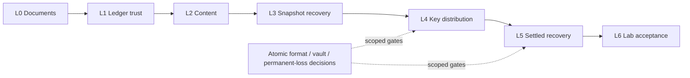

# E2EE core and Lab migration

[中文](e2ee-migration.zh.md)

This migration brings the public library, protocol drafts and runnable local Lab into one implementation. It does not activate product E2EE, migrate production data, publish packages, or establish native key custody or platform acceptance. The [whitepaper](../../specs/e2ee/whitepaper.md) describes proposed architecture; its implementation claims refer to the pinned prototype until the owning public layer is verified.

## Source and ownership

The [per-file manifest](e2ee-migration-manifest.json) records source SHA-256, target owner, disposition and layer. `已迁` means the functionality has an existing public owner, not byte-for-byte copying or whole-module acceptance; `需迁并修复` includes unfinished implementation, `旧方案淘汰` retains the pinned source as history, and `待明确决定` requires a protocol or product decision. Planned target paths are not claims that those files exist.

- Public base: `871179e297a9a9f52f83d51a6038d1958c263139`, including HPKE [#1432](https://github.com/LodyAI/Lody/pull/1432).
- Original core: `f1bc0c52649c21d2e9b620fe3558874c40545e38`.
- Candidate: `bd5a9c1ec71ed7fa8085e51faec4f1e8dbe985b8`; staged patch SHA-256 `4c36a1e507f2e7bcc55e9e88906ffe2b617e9d9c9aed55ab5e76745bd4d7ee71`; unstaged diff empty. Original source and candidate stay read-only.
- Public Effect resolves from `packages/e2ee-core` to **4.0.2**, matching the root lock/catalog. The prototype's separate v4 catalog does not justify upgrading or adding another Effect runtime.
- Actual Lab source is `packages/e2ee-lab`: local HTTP/SQLite Riverrun host, honest Loro/Flock clients, scheduling, attack capability, replay packs, synthetic fixtures and crash subprocesses. Both pinned sources contain this package. The playable tutorial has drafts but no corresponding application source in either pinned tree. The source independent-demo note explicitly records removal of `packages/e2ee-demo` after host/session coverage moved to `packages/e2ee-lab`; its obsolete startup commands are not runnable migration commands.

The design source's public whitepaper and permission text are carried here with internal plan/evidence links removed. Private decision records, implementation plans, production configuration and transcripts remain in their owning repository. Their fingerprints identify the constraints without publishing their contents.

## Stack and shared files

Each layer compares only with its direct parent. Actual branch/head/base and validation are recorded in its Draft PR; the final layer also validates the complete diff and test tree. A layer may split when independent review needs a smaller risk boundary.

| Layer | Responsibility                                                                      | Shared owner and dependency                                                                                                                                     |
| ----- | ----------------------------------------------------------------------------------- | --------------------------------------------------------------------------------------------------------------------------------------------------------------- |
| L0    | Public bilingual architecture, protocol provenance, inventory                       | Specs stay draft; no inferred approval.                                                                                                                         |
| L1    | Authenticated ledger snapshots, comparison and historical author authorization      | Extend `src/ledger` records/policy/replay, opaque verified views and strict signature verifier. No candidate verifier injection or arbitrary-state constructor. |
| L2    | Signing, content and document-key workflows, SDK provider                           | Reuse `src/crypto`, v0 domains and existing public byte wrappers; published SDK only.                                                                           |
| L3    | Host snapshot admission, exact position and client document recovery                | Trusted caller context/AAD; persistence precedes cursor advance; one bad document does not stop unrelated documents.                                            |
| L4    | Epoch envelope/history, rotation, durable mailbox, installation reports and repairs | Fixed HPKE suite; exact pending/outbox bytes; finite explicit rounds; no hidden runtime. D12 format and permanent-loss backup are separate decision gates.      |
| L5    | Settled recovery authorization and cleanup contracts                                | Independent R per workspace; one-file direction. Vault/file encoding, wrapping, concurrency and retention remain undecided.                                     |
| L6    | Lab integration, local host, replay, fixtures, commands and fault acceptance        | Consume the new public core and registry SDK. No copied core, old two-step member-removal story or unpublished vendor tarball.                                  |

`package.json`, the root lock/catalog, entry maps and module README/AGENTS belong to the first layer that consumes each change and are updated incrementally. Node-only storage has an explicit subentry; no native custody or runtime is silently installed through the portable root. Test fixtures belong to their behavioral owner. Lab owns synthetic storage adapters and its process resources; core owns protocol policy.

At the initial remote check, [#1433](https://github.com/LodyAI/Lody/pull/1433) SDK preparation (`08aec8c69f4e0cffbfb8be9e9f67d27b0a30062f`) and [#1434](https://github.com/LodyAI/Lody/pull/1434) submission (`f11f1451c095e47a10226ca1824c1b8b66e7a087`) were open. Their authors retain ownership. Dependent implementation waits for actual main rather than copying unmerged code. Refresh those facts before starting dependent work.

A subsequent refresh before the document Draft found #1433 merged at `37cadfbcb0fa2183a98ccf041ba3820a8945b28e`, main at the base above, and #1434 still open at `54b16340c28a59e29bade3bf4d275d812f549c21`. The document bottom follows actual main; dependent implementation remains gated until submission lands.

Platform custody, private cloud ledger/projection/JWT/mailbox, Web/mobile composition, published upstream changes and production deadline enforcement are linked workstreams in their respective repositories. They cannot be represented by one public Git stack.



## Decisions that remain open

- Strict deadline B: no new claim and no change to ordinary 60-second tolerance.
- Recovery-vault format, wrapping, identity/version binding, concurrent updates and retention. The old shared-R/file prototype is not approved as that format.
- New-key backup and recovery when the publishing device is permanently lost after commit and before delivery. A process restart cannot validate permanent-loss recovery.
- D12's new atomic-removal encoding/version/old-reader rejection. Reject standalone old tag2 removal; do not invent replacement fields until confirmed.
- Self-device-revocation rotation scheduling, exact machine-operation scope and any newly discovered protocol conflicts require their owning decision. These do not block unrelated snapshot/content work.

Settled requirements include per-workspace R, client recovery of bad snapshots, document-local sync failure, native secure key custody preference without changing algorithms, durable offline edits, and disabled production E2EE.

## Reproduced prototype failures

Run these only in an independent frozen copy with synthetic keys and local sockets. The source candidate is not a test worktree.

```sh
pnpm --filter @lody/e2ee-core exec vitest run test/review2-a.test.ts test/review2-c-delivery.test.ts test/review2-c-rotation.test.ts test/review2-e-api-boundary.test.ts
pnpm --filter @lody/e2ee-lab exec vitest run test/review2-b-sync.test.ts
```

The first run independently reproduced **7 failures / 5 passes**; the Lab run reproduced **2 failures / 12 passes**. These are selected review suites, not full-suite totals. Retain old failure evidence and new passing behavioral reproduction in each owning layer.

| Reproduction                                                  | Owner                 | Required disposition                                                                                        |
| ------------------------------------------------------------- | --------------------- | ----------------------------------------------------------------------------------------------------------- |
| Reflective construction of a forged LedgerView                | L1                    | Public closure-backed views already reject constructors; test equivalent attack through real exported APIs. |
| Caller-supplied always-success signature verifier             | L1                    | Public authority creation must perform the pinned real verifier, never accept injected success.             |
| Admin-signed snapshot leaving Owner without personal/R device | L1                    | Structural reachability check at snapshot import.                                                           |
| Substituted journal endorser becomes trusted Owner            | L1 + #1434            | Restore requires independently retained trust; journal contents grant no trust.                             |
| Duplicate envelopes exceed read limit and block delivery      | L4                    | Bounded resumable paging and exact cursor progress.                                                         |
| Sending 4097th envelope fails lifetime outbox limit           | L4                    | Durable bounded pending/result lifecycle, not a permanent lifetime counter.                                 |
| Rotator permanently loses current key before delivery         | L4 + backup decision  | Keep unresolved; no claim that local restart fixes permanent loss.                                          |
| Duplicate committed control record accepted at later offset   | L6 + ledger transport | Reject it with state and cursor unchanged.                                                                  |
| Rollback page rewinds persistent cursor                       | L6 + ledger transport | Reject it with prior durable state/cursor retained.                                                         |

Full frozen-copy confirmation: core **574 passed / 7 failed / 1 skipped**; deterministic Lab **182 passed / 2 failed**, excluding the external-model suite. All nine failures match the table. The public submission target is `src/submission/index.ts` with SQLite in `src/submission/sqlite.ts`; candidate transport framing must adapt to that contract after it lands.

Also reproduce and fix the known snapshot continuation-offset substitution in L3. No test removal, missing export or disabled functionality substitutes for a fix.

## Acceptance and resource ownership

Core workflows remain inert Effect values. Application/Lab composition owns Scope, creation, cancellation, waiting and bounded awaited close. Promise APIs pass cancellation to cancellable work; non-cancellable native work is awaited before temporary secret cleanup. `Result.gen` early failure does not run a generator `finally`: cleanup must use an ordinary outer `try/finally` or a scoped Effect resource.

Lab acceptance uses real HTTP/SQLite persistence, process reopen, two clients, Loro/Flock/Repo SDK paths, durability barriers, retained cursor on decrypt/import/save failure, document isolation and bad-snapshot client recovery. Controlled transport faults and synthetic key protection are stated as test boundaries. External-model exploration is optional, separate from deterministic CI and does not access real keys. SIGKILL recovery is not power-loss or device-loss acceptance.

The complete stack is unfinished. Migrating the manifest is not migrating its remaining implementations; no layer is Ready, merged, deployed or published by this work.
