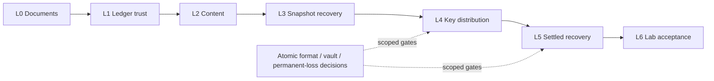

# E2EE 核心与 Lab 迁移

## 当前能力范围（本集中分支基于 2190d418，2026-10-14）

## 仅支持当前格式

用户于 2026-10-14 明确：E2EE 尚未上线，没有线上旧账本需要维护。旧账本/API 门面、JSON 日志解码/导入和旧客户端双格式运行直接淘汰，不再列为待迁任务；manifest 只保留其来源 hash 作历史记录。当前格式的账本回放、签名历史作者、代次历史及崩溃重开仍须保留。参见[范围与核对](../notes/implemented/simplification/2026-10-14-e2ee-current-formats-only.zh.md)。

Lab 已有 Draft [#1526](https://github.com/LodyAI/Lody/pull/1526)。下文的“尚无 Lab PR”、早期测试数量与分阶段待办属于历史进展，不能作为当前总状态。迁移尚未整体完成；逐文件状态不是功能完成率，目标路径存在也不是行为等价证明。

| 能力 | 当前实现 | 剩余边界 |
| --- | --- | --- |
| 权限、历史作者、账本签名与提交 | public ledger / admission / submission 与 SDK CAS | 外部可信 checkpoint 的取得及持久管理不能由 SQL 或 offset 替代 |
| 内容 | content 工作流、header3 update binding、真实 Loro/Flock 消费 | protected snapshot 发布、位置绑定与完整恢复未完成 |
| 密钥 | history、HPKE envelope、outbox、mailbox、receiver、repair、distributor、受限 A | 新 epoch 的耐久发布/备份策略、vault 与生产 protector 未完成；合成 E7 测试不是完整 publisher |
| Lab | 认证、joins、原 genesis 读取、外部pin既有workspace共同生命周期、header3 host写入、有限key round、真实OS actor/动作/硬退出/故障、CLI证据与判定 | genesis/新epoch/snapshot/vault producer及entropy相关原件replay/场景仍有决定或上游门槛；不称原完整Lab完成 |

旧格式或旧类被淘汰，不意味着它承载的能力可以丢弃；epoch/history publisher 等必须分别登记行为替代或明确剩余责任。受限 A 批准不覆盖 vault、备份、D12、严格 B 或历史发送者信封恢复。本说明不改变任何协议或批准状态。


[English](e2ee-migration.md)

这次把公开库、协议草案和可运行的本地 Lab 收敛到一套实现，不开启产品 E2EE，不迁生产数据，不发布包，也不代表原生存钥或全平台验收。[白皮书](../../specs/e2ee/whitepaper.zh.md)描述拟采用的架构；其中独立包实现指固定来源原型，只有对应公共层验证完成后才算本仓实现。

## 来源与归属

[逐文件 manifest](e2ee-migration-manifest.json)记录源 SHA-256、目标、状态和层次。“已迁”表示已有公共功能归属，不是原样复制或整个源模块验收；“需迁并修复”包含尚未实施；“旧方案淘汰”保留固定来源作历史；“待明确决定”需要协议或产品结论。目标路径是计划归属，不假称文件已存在。

- 公共基线：`984c35c5b30600d68abec1ec3e585eca73bcd4f0`，含 HPKE [#1432](https://github.com/LodyAI/Lody/pull/1432)。
- 原 core：`f1bc0c52649c21d2e9b620fe3558874c40545e38`。
- 候选：`bd5a9c1ec71ed7fa8085e51faec4f1e8dbe985b8`；暂存补丁 SHA-256 `4c36a1e507f2e7bcc55e9e88906ffe2b617e9d9c9aed55ab5e76745bd4d7ee71`；未暂存 diff 为空。原仓和候选只读。
- 公共包实际解析的 Effect 是 **4.0.2**，与 root lock/catalog 一致。原型另设 v4 catalog，不是升级或新增另一套 runtime 的理由。
- 实际 Lab 为 `packages/e2ee-lab`：本地 HTTP/SQLite Riverrun 宿主、诚实 Loro/Flock 客户端、调度、攻击能力入口、重放包、合成 fixtures 和崩溃子进程。两份固定来源都有该包。“可玩教程”有草案，但两份固定树都未找到相应应用源码。来源 independent-demo note 明确记录：`packages/e2ee-demo` 在宿主/session 覆盖迁到 Lab 后已删除；旧启动命令不是可运行的迁移命令。

仅迁设计源中明确适合公开的白皮书和权限文本，移除内部计划与证据链接。私有决策记录、实施计划、生产配置和对话不复制；指纹只标识约束版本。

## 栈与共享文件

每层只相对直接父分支。准确 branch/head/base 与验证记录写在该层 Draft PR；末层另验整组 diff 和测试树。层次可按独立审查的风险继续拆分。

| 层  | 职责                                               | 共享归属与依赖                                                                                                     |
| --- | -------------------------------------------------- | ------------------------------------------------------------------------------------------------------------------ |
| L0  | 双语公开架构、协议来源、完整清单                   | Spec 保持 draft，不推断批准。                                                                                      |
| L1  | 认证账本快照、核对、历史作者授权                   | 扩展已有 `src/ledger` records/policy/replay、不透明 verified view 和严格签名验证器；拒绝注入验证器和任意状态构造。 |
| L2  | 签名、内容、文档钥工作流和 SDK provider            | 复用 `src/crypto`、v0 域及公共字节类型，消费已发布 SDK。                                                           |
| L3  | 宿主快照准入、准确位置和客户端文档恢复             | 可信调用方提供上下文/AAD；先持久保存再推进游标；单文档失败不扩大到其它文档。                                       |
| L4  | epoch 信封/历史、换代、持久信箱、安装报告和修复    | 固定 HPKE；原始 pending/outbox 字节；显式有限轮次；D12 格式与永久丢失备份单独等决定。                              |
| L5  | 已定恢复授权和清理契约                             | 每工作区独立 R、一文件方向；库/文件编码、包装、并发和保留未定。                                                    |
| L6  | Lab 集成、本地宿主、重放、fixtures、命令与故障验收 | 消费新公共 core 和 registry SDK；不复制 core，不恢复旧两步移除，不保留未发布 tarball。                             |

`package.json`、root lock/catalog、导出、README/AGENTS 由首次消费的层逐步更新。Node 存储独立子入口，不从 portable root 偷带原生存钥或 runtime。fixtures 属于行为测试的模块；Lab 管合成存储和进程资源，core 管协议。

平台存钥、私有云端账本/投影/JWT/信箱、Web/手机组合、上游发布和生产期限执行分别列关联工作线，不能表示为一个公共 Git 栈。



## 未决项

- SDK 内容快照位置：旧 snapshot header4 把 offset 藏在密文中，服务端无法核对实际提交位置。提案是在新 snapshot header 放 exact-offset SHA-256 摘要，用现有 SDK v2 AAD 认证；另选上游 SDK 契约变更并消费已发布版本。新快照格式与认证接纳尚未批准；不要求旧读者兼容，provider 与 host admission 须一同审查。
- 严格期限 B：不新增 claim，不改普通 60 秒容差。
- 恢复库格式、包装、身份/版本绑定、并发和保留。旧共用 R/文件原型不等于批准的新格式。
- 提交后、发钥前发布设备永久丢失的新钥备份与取回；重启不能验收永久丢失。
- D12 最终原子移除编码与认证快照位置；不要求兼容旧 reader。拒绝旧 tag2 单独移除，未确认前不自创字段。
- 本人撤设备后的换代调度、基本机器操作清单及其它新发现的协议冲突交给其决策归属；不阻塞独立快照/内容工作。

已定：每工作区独立 R、客户端恢复坏快照、单文档停止同步、优先原生安全存钥但不改算法、本地草稿可靠保存、生产 E2EE 关闭。

## 已复现的原型失败

只在冻结的独立副本用合成密钥和本地 socket 运行，源候选不是测试工作树。

```sh
pnpm --filter @lody/e2ee-core exec vitest run test/review2-a.test.ts test/review2-c-delivery.test.ts test/review2-c-rotation.test.ts test/review2-e-api-boundary.test.ts
pnpm --filter @lody/e2ee-lab exec vitest run test/review2-b-sync.test.ts
```

首次独立复现：核心 **7 失败 / 5 通过**；Lab **2 失败 / 12 通过**。这是选定审查套件，不是全仓总数。每层保留原 fail 与等价新行为 pass 证据。

| 复现                                   | 归属                  | 要求                                                   |
| -------------------------------------- | --------------------- | ------------------------------------------------------ |
| 反射构造伪造 LedgerView                | L1                    | 公共闭包 view 已拒绝构造；用真实导出入口验证同类攻击。 |
| 注入总返回成功的签名验证器             | L1                    | 授权创建实际运行固定验证器，不信注入成功。             |
| Admin 签快照却让 Owner 没有个人/R 设备 | L1                    | 导入检查状态可达条件。                                 |
| journal 替换背书者变为 Owner           | L1 + #1434            | 重开必须独立保留信任，不从 journal 授权。              |
| 重复信封撑满读取上限，全部投递停止     | L4                    | 有界可继续分页与准确游标。                             |
| 第 4097 个信封撞永久 outbox 上限       | L4                    | 有界持久 pending/result 生命周期，不能永久累计。       |
| 发布者发钥前永久丢失当前钥             | L4 + 备份决定         | 保持未解决，重启不能替代。                             |
| 后续 offset 重复已提交控制记录被接受   | L6 + ledger transport | 拒绝且状态/游标不推进。                                |
| 回退页让持久游标后退                   | L6 + ledger transport | 拒绝并保留已保存状态/游标。                            |

冻结副本完整复跑：core **574 过 / 7 败 / 1 跳过**；确定性 Lab **182 过 / 2 败**，排除外部模型套件。九项失败均与上表一致。公共 submission 实际归属为 `src/submission/index.ts` 和 `src/submission/sqlite.ts`；候选 transport framing 待该契约落地后适配。

L3 另复现、修复已知快照 continuationOffset 替换。删除测试、缺导出或禁用应迁功能都不能冒充修复。

## 验收与资源归属

core 返回惰性 Effect；应用/Lab 管 Scope、创建、取消、等待和有界且等待完成的关闭。Promise 边界将取消传给可取消操作；原生不可取消工作结束后再清临时秘密。`Result.gen` 提前失败不会执行生成器 `finally`，用外层普通 `try/finally` 或 Effect scoped resource 清理。

Lab 使用真实 HTTP/SQLite 持久化、进程重开、双端 Loro/Flock/Repo SDK、保存屏障、解密/导入/保存失败不推进游标、文档隔离及坏快照客户端恢复。受控传输故障和合成存钥明确为测试边界。外部模型探索是可选项，与确定性 CI 分开，不读取真实密钥。SIGKILL 不等于断电或设备永久丢失。

整栈尚未完成。清单迁入不表示其中实现已迁；本次不自动 Ready、merge、deploy 或 publish。

当前实施基线：三项前置均已落地。submission #1434 合入为 `7c58cabe1d05f132b7133a52b45a16b79274ea6a`；L0 已纳入实际 main `984c35c5b30600d68abec1ec3e585eca73bcd4f0`。L1a 先迁历史作者、已签名 epoch 事实与当前内容权限查询，不改 wire；快照格式仍待定；不要求兼容旧客户端。

## 当前已实施的栈

以下是本层发布前核对的 Draft 栈快照；精确父 head 指本栈选定的直接基准。main 会继续变化，底层固定祖先不等于远端最新 main。每层仍按 PR 当前 head/base 独立复核。

| PR | Branch | Head | Parent head |
| --- | --- | --- | --- |
| [#1438](https://github.com/LodyAI/Lody/pull/1438) | `e2ee-migration-baseline` | `59c3840b0165ce8a6637418c1e2b2095b13f6b88` | `984c35c5b30600d68abec1ec3e585eca73bcd4f0` |
| [#1439](https://github.com/LodyAI/Lody/pull/1439) | `e2ee-ledger-content-facts` | `946965a7fd3ccc10c6a18f41f8f54a38c74232a3` | `59c3840b0165ce8a6637418c1e2b2095b13f6b88` |
| [#1442](https://github.com/LodyAI/Lody/pull/1442) | `e2ee-document-workflows` | `543f82d1c4f4470436d4ad183f0f53259faddf49` | `946965a7fd3ccc10c6a18f41f8f54a38c74232a3` |
| [#1446](https://github.com/LodyAI/Lody/pull/1446) | `e2ee-epoch-history` | `b67e0c062c667046d8c90b7a2512dbbd0834be40` | `543f82d1c4f4470436d4ad183f0f53259faddf49` |
| [#1447](https://github.com/LodyAI/Lody/pull/1447) | `e2ee-ledger-signing` | `d87ee2d444a60079ae1adf84565a7bd53faf905e` | `b67e0c062c667046d8c90b7a2512dbbd0834be40` |
| [#1448](https://github.com/LodyAI/Lody/pull/1448) | `e2ee-epoch-envelopes` | `0a73d464b5c93fab4b4e0f7ce704778ba437ac94` | `d87ee2d444a60079ae1adf84565a7bd53faf905e` |
| [#1450](https://github.com/LodyAI/Lody/pull/1450) | `e2ee-key-delivery` | `34b918367fe23f6bf9c2ff1cea31b154de298cb2` | `0a73d464b5c93fab4b4e0f7ce704778ba437ac94` |
| [#1464](https://github.com/LodyAI/Lody/pull/1464) | `e2ee-ledger-snapshots` | `5d3967ec94e3b10fdec76220937e9fcfe2623590` | `34b918367fe23f6bf9c2ff1cea31b154de298cb2` |
| [#1472](https://github.com/LodyAI/Lody/pull/1472) | `e2ee-key-mailbox` | `58cbd49c6869f28d09efb60d3b9a7ec10243e93a` | `5d3967ec94e3b10fdec76220937e9fcfe2623590` |
| [#1474](https://github.com/LodyAI/Lody/pull/1474) | `e2ee-content-snapshot-auth` | `f6bedf5092b921e8a34f1baacc9a50c6bb9d5a08` | `58cbd49c6869f28d09efb60d3b9a7ec10243e93a` |
| [#1479](https://github.com/LodyAI/Lody/pull/1479) | `e2ee-ledger-admission` | `f7dc8e53b1f5a10f11d3eeebab3a292c3fc3023b` | `f6bedf5092b921e8a34f1baacc9a50c6bb9d5a08` |
| [#1480](https://github.com/LodyAI/Lody/pull/1480) | `e2ee-host-epoch-protection` | `ec6a02f97aea1445a89ee1bc5a4d72e38f1bf9ee` | `f7dc8e53b1f5a10f11d3eeebab3a292c3fc3023b` |
| [#1482](https://github.com/LodyAI/Lody/pull/1482) | `e2ee-epoch-receive-reports` | `4134109a76739d8b36ff5a8a1209e37e16518703` | `ec6a02f97aea1445a89ee1bc5a4d72e38f1bf9ee` |
| [#1484](https://github.com/LodyAI/Lody/pull/1484) | `e2ee-ledger-feed` | `14e7c5a1a7fd5beb273d77c5dd936c2b7155a1b8` | `4134109a76739d8b36ff5a8a1209e37e16518703` |
| [#1485](https://github.com/LodyAI/Lody/pull/1485) | `e2ee-mailbox-repairs` | `680686d1442e7f8b12f6f8b84af3f17f3c514b97` | `14e7c5a1a7fd5beb273d77c5dd936c2b7155a1b8` |
| [#1487](https://github.com/LodyAI/Lody/pull/1487) | `e2ee-recipient-mailbox` | `098e274221aae13305d29ff75629bee168678ded` | `680686d1442e7f8b12f6f8b84af3f17f3c514b97` |
| [#1491](https://github.com/LodyAI/Lody/pull/1491) | `e2ee-ledger-sdk-cas` | `f82f8634743d5bc4dd8858cf6867b91d80c221ba` | `098e274221aae13305d29ff75629bee168678ded` |
| [#1493](https://github.com/LodyAI/Lody/pull/1493) | `e2ee-sender-distribution` | `36ca2685b7eefeb15ebd041e50444796c2686652` | `f82f8634743d5bc4dd8858cf6867b91d80c221ba` |
| [#1496](https://github.com/LodyAI/Lody/pull/1496) | `e2ee-content-sdk-binding` | `0418fd69e22d1eeba47553714473ec54762837ec` | `36ca2685b7eefeb15ebd041e50444796c2686652` |

SDK 准备 #1433 与 submission #1434 已落地，后者 merge 为 `7c58cabe1d05f132b7133a52b45a16b79274ea6a`；本栈未改其实现。A 保护方向已明确：可信组合一次初始化 protect/unprotect，绑定用途／Org／接收者／epoch／commitment，真实保存重载后才报告。synthetic protector 不等于原生平台存钥。

L1d 的[全历史 feed](../../packages/e2ee-core/src/ledger/FEED.md)、L4g [持久 repair](../../packages/e2ee-core/src/keys/REPAIR.md)与 L4h [接收 fetch 组合](../../packages/e2ee-core/src/keys/RECIPIENT-MAILBOX.md)已有公开归属。全历史最后核对使用独立自有字节；repair 终态和 acknowledgement 保持全部原件。有效已登记 R 可接收／repair 代密钥，不因此获得发钥／写入／管理权限。原 Lab2 失败仍待实际迁移消费路径复验；sender 发现／当前 key／outbox rounds、SDK provider／snapshot bootstrap 和 Lab／恢复范围仍未完成。L1e 提供[全审计 SDK／P09 read／CAS 适配](../../packages/e2ee-core/src/submission/STREAMS.md)，其他 transport／lease 消费方另迁。旧整块 JSON journal 淘汰、不隐式导入。原 labeled entropy 重放需明确 Lab 能力决策：公开首次 seal 固定使用安全随机源，不全局替换 crypto，也不私改 primitive。

## 最新main核对与交付上限

实际fetch main `987962e77022df6a800f4e889f124b51f6eb8056`，tree `4601a3f2b65d122c5b314cab79dc275fba9af636`。HPKE #1432、SDK准备 #1433、submission #1434都已是祖先。SDK准备提供测试和接缝，不是生产保护器。相对冻结stack底座984c，公共core/RPC文件没有新增交集。当前main CI38151323459成功；准确原组合CI38109831626仍为取消，后继871179 CI38109983563成功。不会仅因这次核对重跑不变攻击矩阵。

继续已有实施，整轮迁移PR最多24张，包含已有19张。剩余SDK、sender、内容／恢复消费者和Lab集中交付；保留协议决策门，新层都为Draft。当前head的独立审查与作者测试、CI分开报告。

L4i适配[有限发送目标发现与投递](../../packages/e2ee-core/src/keys/DISTRIBUTION.md)：使用已提交、已保护的当前密钥，保留outbox原件和每个revision的task/result，由真实账本决定终态，并重建本机发布者报告。实际Lab消费和候选备份／轮换另有归属，新代码单独绑定当前head审查。

L2 SDK update绑定使用 `./content/streams`、已定header3、真实公开内容工作流和本次操作密钥清理。直接父层为sender #1493 `36ca2685b7eefeb15ebd041e50444796c2686652`。快照 wire 格式仍待人决定；已发布SDK类型检查与实际Lab／transport验收分开，原provider迁移仍未完成。

Lab 集成分支以 #1496 0418 为直接父层，仍未创建 Lab PR。固定6de真实 Lab24/typecheck/focused lint 通过：公共账本 actor/P09 原字节恢复、Loro/Flock 实际 SDK、SQLite 状态/游标对与 Loro 子进程重开、单文档隔离。坏快照仅在历史可读时客户端恢复成功；Riverrun0.3.0非零 snapshot PUT 推进 earliest_offset，历史不可读时只能安全拒绝并保留游标，历史保留/API归属是新增恢复依赖缺口。完整原 host/actors/driver/攻击/replay/CLI 与原 Lab2 仍未闭合。详见同层[Lab README](../../packages/e2ee-lab/README.zh.md)，不继承历史 root/CI 为当前通过。

当前 Lab 增量添加 genuine 账本策略和有界 Scope HTTP 密钥消费者：公开 HPKE 投递/安装/报告、篡改帧拒绝、同进程重开 R 禁止发送。当前完整 root Lab30/core302、format/docs/public boundary 通过，Lab输入指纹不变；凭据认证、完整轮换/host/driver/replay/CLI 仍未完成。固定 6de 的 Lab24 root 证据不继承至本增量。

未批准的具体审阅提案: [D12](../../specs/e2ee/atomic-removal.zh.md), [vault](../../specs/e2ee/recovery-vault.zh.md), [publisher loss](../../specs/e2ee/publisher-key-recoverability.zh.md).
