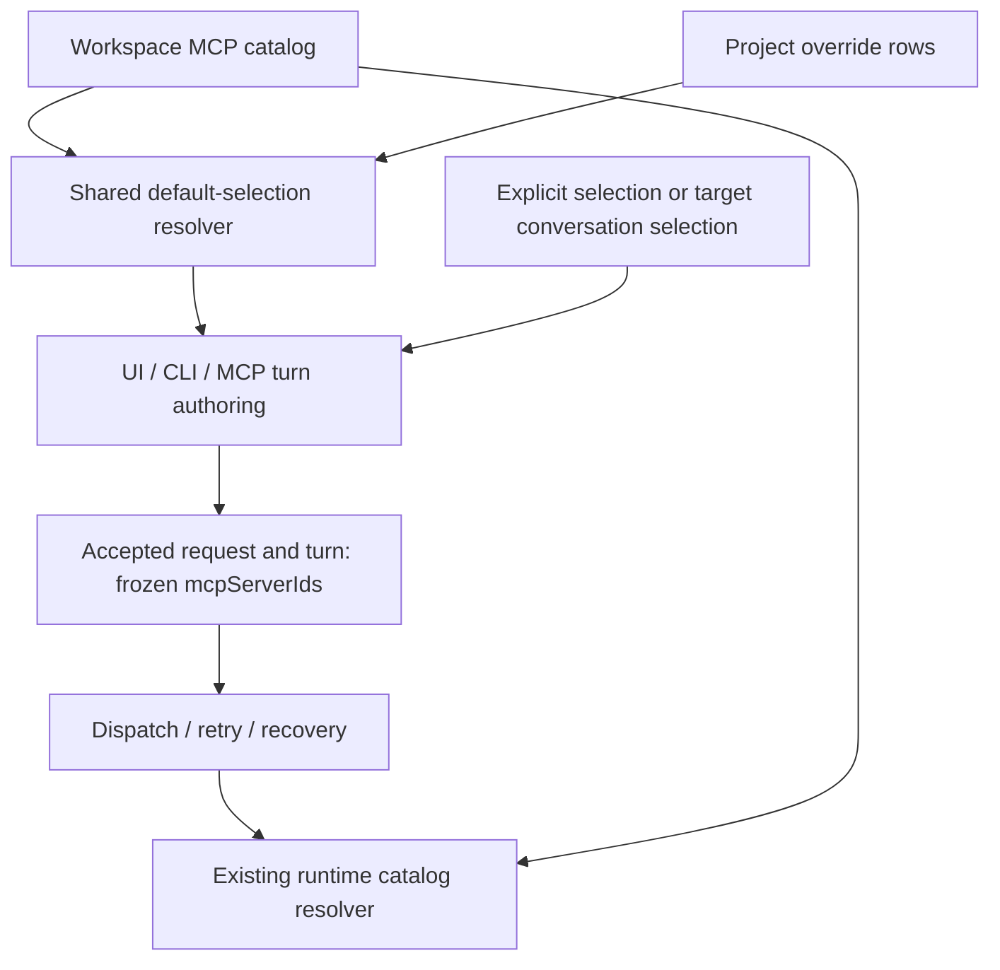

# Project default MCP authoring policy

Status: proposed
Translation: current

[中文](2026-10-09-project-default-mcp.zh.md)

## Abstract

Project conversations currently have no project-specific MCP defaults, so users
must choose servers through the composer or workspace defaults. This proposal
adds per-server project overrides in workspace Flock and resolves them before
accepting the first turn of a new conversation. The resulting ids use the existing
per-turn execution contract, keeping retries independent of later preference
edits. Existing conversations retain their selection; dynamic inheritance is an
alternative requiring additional provenance, not part of this proposed first version.

## Evidence and responsibility boundaries

- `packages/shared/src/workspace-mcp.ts` already owns catalog `enabledByDefault`,
  preserves absent versus empty selection, and resolves runtime connection problems.
- `packages/components/src/hooks/use-session-mcp-selection.ts` currently chooses
  temporary override, persisted ids, then workspace defaults. Its state reset only
  follows persisted ids; adding project context requires a scope-aware reset.
- Landing, draft-session and existing-session composers all use this hook. A Tab-only
  change would miss CLI/MCP authoring and staged sends.
- `packages/shared/src/workspace-flock.ts` currently recognizes `mcpServer` and
  `agentRole` families. New policy rows need parser, scan, writer, subscription and
  forward-compatibility coverage, not merely a new TypeScript type.
- `apps/cli/src/commands/session.ts` builds continuation input config without
  visibly passing MCP ids at the inspected `buildCliHistoryInputConfig` call.
  Creation, continuation, operation acceptance and recovery need an explicit audit;
  UI inheritance alone cannot establish CLI/MCP parity.
- `session-dispatch-watcher.ts` forwards the driving turn's ids; `session-manager.ts`
  passes them to `loadSessionMcpCatalog`. Preserve that boundary. Preparation keys
  already account for MCP selection in `packages/shared/src/session-preparation.ts`.

The [draft Spec](../../../../specs/project-default-mcp.md) owns proposed user semantics.
This extends the [catalog durability explanation](../../../docs/workspace-catalog-durability.md)
and must preserve the [local orchestration boundary](../../implemented/architecture/2026-09-29-local-session-orchestration.md).

## Proposed structure

Use a proposed row key `['projectMcpDefault', projectKey, mcpServerId]` with a
boolean value. The workspace is implicit in the document. Encode `projectKey`
from a versioned structured tuple, avoiding delimiter collisions: local machine
plus project id, or canonical GitHub repository identity; never cwd or branch.
Use the repository's existing canonicalization rules and verify rename/removal
lifecycle during implementation. Removing a project cleans only its preferences;
it never removes catalog entries or historical turn selections.

An absent row inherits workspace default; `false` suppresses a globally enabled
server. Row granularity prevents independent switches from overwriting a whole
array. Same-row conflicts follow Flock ordering. Reset deletes overrides in one
durable transaction; test concurrent reset/edit semantics explicitly. Deleting an
MCP may leave inert orphan references until bounded cleanup; surface them as removed
and do not reuse ids. No destructive sweep during a partially loaded catalog.

`@lody/shared` owns identity, schemas and a pure selection resolver. Components own
presentation, draft scope, loading and durable-write feedback. Authoring services
own ready-snapshot reads, access checks and freezing before acceptance. Runtime
owns connection resolution, capability checks and diagnostics, never default policy.
New typed writer APIs should mutate one row and validate ownership/catalog scope.
Use existing platform ports; do not create a cloud backend requirement.

## Choices and trade-offs

| Choice | Result |
| --- | --- |
| Add project ids to each MCP catalog entry | Couples server editing to project policy and enlarges conflicting catalog writes; reject. |
| Store one selected-id array per project | Simpler, but loses independent concurrent switches and needs a separate inherit/replace mode; not preferred. |
| Apply defaults only in the UI hook | Misses CLI/MCP and accepted-operation freezing; reject. |
| Union defaults at ACP startup | Overrides explicit `[]`, mutates retries and defeats user deselection; reject. |
| Live inherit defaults in all conversations | Useful if requested, but needs persisted inherit/override provenance and migration for older turns; defer. |
| Seed new conversations through shared authoring | Reuses current per-turn runtime contract; preferred first version. |

Important contract change: `packages/shared/AGENTS.md` currently says MCP has
exactly two durable layers. This design deliberately proposes a third *authoring
policy* layer while retaining catalog and per-turn execution ownership. Implementation
must update that rule alongside the draft Spec. This design-only change does not
silently rewrite the active invariant or claim approval.

## Implementation sequence and verification limits

1. Agree on new-conversation semantics; implement shared identity, row contract,
   authorized durable writer and resolver with precedence/concurrency behavior tests.
2. Integrate all authoring entry points, operation freeze, deferred send and warm
   preparation. Test `[]`, retry after policy edits, target-project delegation,
   continued conversation selection, and config-driven runtime recreation.
3. Add the Tab, search/status rows, reset and composer integration. Exercise project
   switching, workspace isolation, loading, failed saves and read-only access.
4. Add protocol capability negotiation and mixed-version tests. Verify local-only
   composition and use synthetic MCP E2E fixtures rather than personal catalog data.

Research inspected source and existing contracts; no application code was changed,
no behavioral tests or packaged UI checks were run, and there is no approval.
Draft PR: [#1708](https://github.com/LodyAI/Lody/pull/1708).
Documentation checks are recorded in the task response. Private catalog data and
retrieved conversation content are intentionally excluded from repository artifacts.
