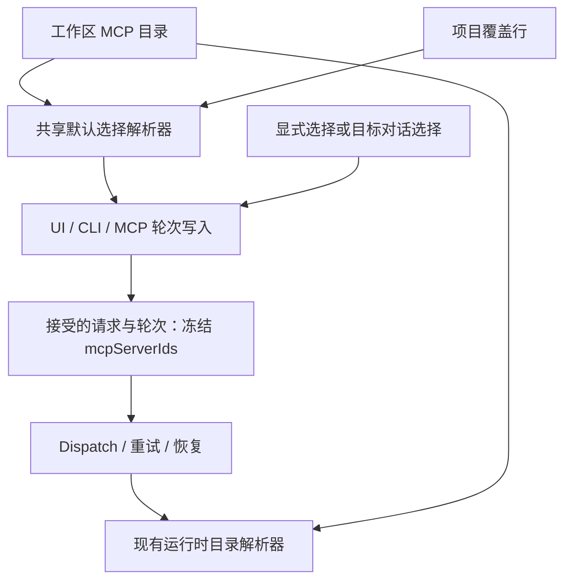

# 项目默认 MCP 的轮次写入策略

Status: proposed
Translation: current

[English](2026-10-09-project-default-mcp.md)

## 摘要

项目对话目前没有项目专属的 MCP 默认项，用户只能通过输入框或工作区默认项选择。
本提案在工作区 Flock 增加逐个 MCP 的项目覆盖，在新对话首轮接受前完成解析。
结果沿用现有每轮选择契约，使重试不受后续偏好修改影响。已有对话保留自己的选择；
动态继承需要额外的来源状态，不属于建议的首版范围。

## 证据与职责边界

- `packages/shared/src/workspace-mcp.ts` 已拥有目录 `enabledByDefault`，区分缺省与
  显式空选择，并处理运行时连接问题。
- `packages/components/src/hooks/use-session-mcp-selection.ts` 当前按临时覆盖、
  已持久化 ids、工作区默认的顺序选择。状态重置仅跟随持久化 ids；新增项目上下文
  需要按身份范围重置。
- Landing、草稿会话及已有会话输入框均使用这个 hook。只改 Tab 会漏掉 CLI/MCP
  写入和延迟发送。
- `packages/shared/src/workspace-flock.ts` 当前识别 `mcpServer`、`agentRole` 两类。
  新策略行需要解析、扫描、写入、订阅及向前兼容覆盖，不能只增加 TypeScript 类型。
- `apps/cli/src/commands/session.ts` 中查看到的续聊 `buildCliHistoryInputConfig`
  调用未显式传 MCP ids。实现需要完整核查创建、续聊、Operation 接受及恢复；
  UI 继承不能证明 CLI/MCP 一致性。
- `session-dispatch-watcher.ts` 传驱动轮次的 ids，`session-manager.ts` 再传给
  `loadSessionMcpCatalog`，应保持这个边界。预热 key 已在
  `packages/shared/src/session-preparation.ts` 包含 MCP 选择。

[Spec 草案](../../../../specs/project-default-mcp.zh.md)负责用户语义。
本提案扩展[目录持久化说明](../../../docs/workspace-catalog-durability.md)，并保留
[本地编排边界](../../implemented/architecture/2026-09-29-local-session-orchestration.zh.md)。

## 建议结构

建议行 key 为 `['projectMcpDefault', projectKey, mcpServerId]`，值为布尔值。
工作区由文档确定。`projectKey` 编码版本化结构元组，避免字符串分隔符碰撞：
本地机器加项目 id，或规范化的 GitHub 仓库身份；不用 cwd 或分支。
沿用仓库现有规范化规则，实现时验证改名/删除生命周期。删除项目只清理其偏好，
不删除目录项或历史轮次选择。

无行表示继承工作区默认；`false` 可关闭全局默认开启的 MCP。逐行写入避免不同
开关互相覆盖整个数组；同一行冲突遵循 Flock 顺序。恢复默认在一次持久化事务中
删除覆盖，需明确测试与并发编辑的关系。MCP 删除后可暂留无效引用，展示已移除，
随后有界清理，不复用 id。目录未加载完整时不得执行破坏性清理。

`@lody/shared` 负责身份、schema 和纯选择解析器；Components 负责展示、草稿隔离、
加载及持久化反馈；轮次写入服务负责就绪快照、授权及接受前冻结；运行时负责连接
解析、能力检查和诊断，不负责默认策略。新的类型化 writer 每次修改一行，验证项目
管理权及目录范围。复用平台端口，不新增云后端依赖。

## 方案取舍

| 方案 | 结果 |
| --- | --- |
| 在每个 MCP 目录条目加项目 ids | 将服务器编辑和项目策略耦合，扩大目录写冲突；不采用。 |
| 每个项目存一个选择数组 | 简单，但不同开关会冲突，还需要继承/替换模式；非首选。 |
| 只在 UI hook 加默认 | 漏掉 CLI/MCP 和接受请求的冻结；不采用。 |
| ACP 启动时合并默认 | 覆盖显式 `[]`，改变重试，用户无法取消；不采用。 |
| 所有对话动态继承 | 如有需求可做，但需要持久化继承/覆盖来源并迁移旧轮次；暂缓。 |
| 统一写入时预选新对话 | 复用每轮运行时契约；建议首版。 |

关键契约变化：`packages/shared/AGENTS.md` 当前规定 MCP 恰好两层持久数据。
本设计明确提议增加第三层「写入默认策略」，同时保留目录与每轮执行的归属。
实现必须随 Spec 更新这条规则。本次仅设计，不偷偷修改仍生效的约束，也不声称已获批准。

## 实施顺序与验证边界

1. 确定新对话语义，实现共享身份、行契约、带授权的持久化 writer 与解析器，测试
   优先级及并发行为。
2. 接入全部轮次写入入口、Operation 冻结、延迟发送和预热，测试 `[]`、策略编辑后
   重试、目标项目委派、续聊选择及配置变化引起的运行时重建。
3. 增加 Tab、搜索/状态行、恢复默认及输入框接入，验证项目切换、工作区隔离、加载、
   保存失败和只读访问。
4. 加协议能力协商及混合版本测试，验证本地边界，使用合成 MCP E2E fixture，
   不把个人目录数据放进仓库。

本次研究检查了源码和现有契约，没有修改应用代码、运行行为测试或打包界面检查，
没有批准。草稿 PR：[#1708](https://github.com/LodyAI/Lody/pull/1708)。
文档检查结果在任务回复中记录。仓库产物不包含私人目录数据或
检索到的对话内容。
