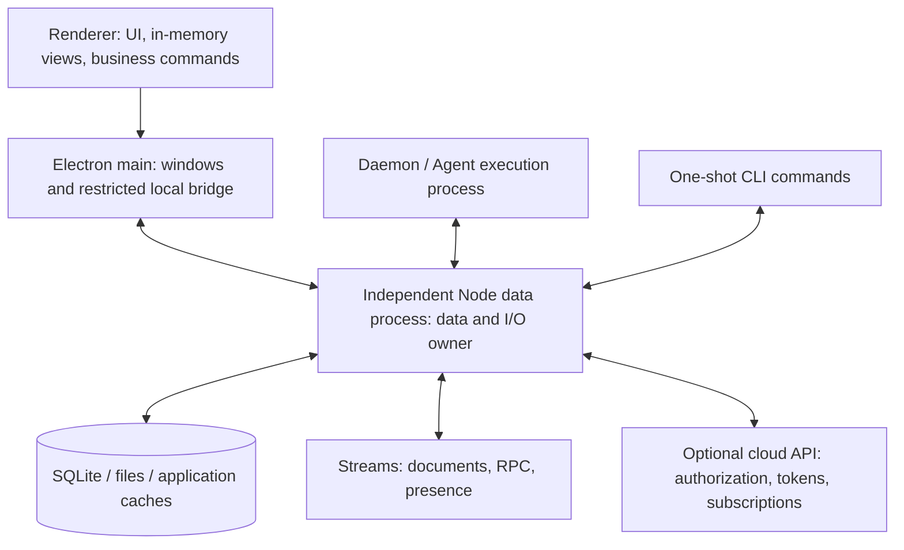
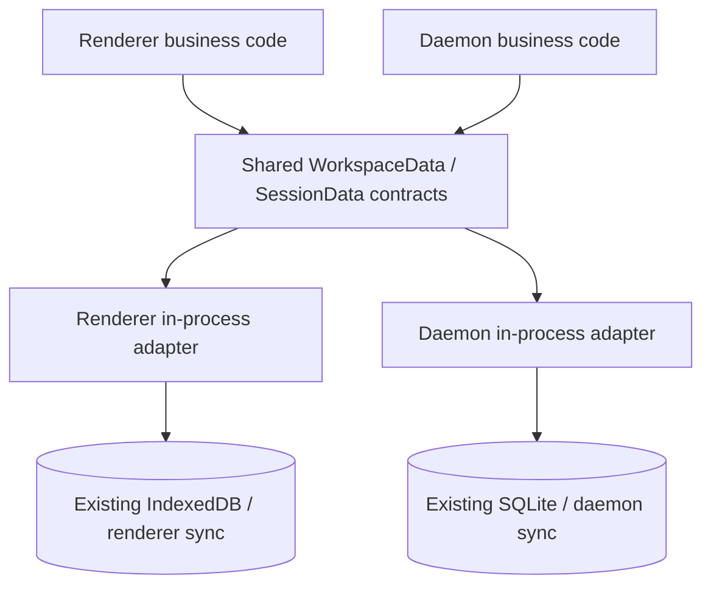

# Desktop unified data process

Status: proposed
Type: architecture
PR: [#1572](https://github.com/LodyAI/Lody/pull/1572)
Translation: current

[中文](2026-10-14-desktop-data-process.zh.md)

## Abstract

The desktop renderer and daemon currently own separate Loro replicas, persistence and optional cloud connections; additional windows add replicas and subscriptions. This change aims to make the application faster, reduce duplicate synchronization and requests for the same backend data, and converge application data, Streams authorization and external I/O on one owner. First migrate both consumers to common queries, operations and subscriptions backed by existing in-process adapters; this refactor can ship independently. Later use an independent Node.js desktop data process while headless daemons may permanently embed the same owner Layer; renderers retain memory views and use owner durable receipts as the local success boundary. Accept the stages separately: this is source research and a proposal, and interface convergence establishes neither connection deduplication, complete I/O centralization nor measured performance benefits.

## Requirement origin and long-term purpose

The requirement comes from multiple desktop consumers needing the same business data while independently owning replicas, storage, authorization and network subscriptions. The long-term goal is for renderer, daemon and Electron main to read/write/observe through an independent Node data source. That process centrally manages Loro/Flock and other data, application disk/network I/O, and Streams authorization, token acquisition/refresh and backend subscriptions. Renderer business IndexedDB persistence retires after reliable migration, while the UI uses memory views. Business operations preserve authorship, permissions and recovery guarantees.

The common business interface is an independently releasable step: both consumers use the same queries/commands/observations for live directory updates, conversation rendering/editing, Message Queue and other data operations, with Repo/Doc inside adapters. Effect Service declares dependencies, composes domain operations and makes resource lifetimes explicit; the later data process implements actual shared storage and connections. Faster session display and fewer duplicate downlink/subscription/authorization requests are long-term benefits to measure, not outcomes established by renaming interfaces or counting logical connections. The [Service guide's background](../../../docs/workspace-data-service.md#background-core-requirements-and-long-term-goals) now leads with requirement mapping, value in both phases and verification metrics so the proposal can be read without the prior discussion.

## Reading the current revision

The [current Service/migration decisions](#current-service-and-migration-decisions-2026-10-14) and Service guide are current; the [consumer ledger](2026-10-14-desktop-data-consumers.md) records file destinations. They retain phase-one scope and placement/body candidates while adding sync/command/RPC/presence/storage ownership. Earlier audits/reviews remain historical, not implementation claims.

## Decision and scope

The decision requiring review is to replace the desktop's two persistent replicas and dual-author sync with one local data owner. User and Agent business identities remain distinct; combining the physical writer must not change authorship. Intent belongs in the existing [communication architecture Spec](../../../../specs/communication-architecture.md), while this note records the implementation path and trade-offs. The current CLI `AGENTS.md` forbids restoring the old write-intent proxy. Implementation must update that constraint explicitly rather than adding the new protocol to v7 or quietly reviving the deleted v4–v6 envelopes.

Data services must serve a headless daemon without Electron and permanently support the same embedded owner Layer. The target covers disk/network I/O for Lody data, files and services. Git, terminals, Agent subprocess access to projects/models and embedded browsers have separate execution-capability boundaries. If they too must perform all actual I/O through one process, execution/network isolation needs further changes; a data-interface migration alone cannot guarantee that.

The public OSS composition remains local-only. Only official cloud composition may inject cloud capabilities. This research enables no product-cloud services, depends on no private backend packages, and proves no server-side permission synchronization or revocation timing.

## Current implementation and key findings

Source baseline: `16bf3fb03dceffc6a7f2a1a37b46b8bf7ab7561f`. The catalog pins Loro `1.16.3`, loro-repo `0.22.0`, Streams CRDT `0.17.0`, Mirror `2.3.2`, Effect `4.0.2`, and Electron `44.7.0`; this worktree has no installed dependencies.

| Current responsibility | Source entry and finding |
| --- | --- |
| Renderer persistence | `packages/components/src/providers/create-workspace-runtime.ts:187,475`: creates an IndexedDBStorageAdaptor and LoroRepo per workspace/window |
| Renderer cloud sync | The same file at `1677,1720,2986`: independent lifecycles for the token provider, Streams, Machine RPC, and presence/monitor |
| Renderer authorship | The same file at `4590` and `workspace-writer-impl.ts`: the direct writer authors on local documents |
| Daemon persistence | `apps/cli/src/lib/loro/sqlite-repo-store.ts:78` and `doc.ts:385`: workspace SQLite, Repo, and data channel |
| Daemon authorization and cloud sync | `doc.ts:650`, `streams-transport.ts:34`, `cloud-cli-port.ts:196`, and `lody-fleet.ts:435` |
| Electron local connection | `apps/electron/src/main/services/loro-data-plane-relay.ts:35,123,363`: main already shares one local socket to the daemon and broadcasts to windows |
| Local updates | `packages/shared/src/local-loro-data-plane-server.ts:674,701`: imports Loro/Flock without a business-level durable receipt |
| Bridge for renderer Session browsing | `apps/cli/src/lib/loro/doc.ts:1190`: releases after one cloud reconciliation; it does not replace the renderer's live cloud loop |

The current local relay may drop frames while disconnected and relies on the renderer's stored replica to catch up through a rejoin. The renderer's cloud path also owns its uploads. Deleting IndexedDB and disabling renderer Streams therefore does not automatically make the daemon a reliable sole data source.

Business write commands should let the owner author/commit on the actual live document, preserving the normal local-event upload path. If renderer authorship followed by CRDT update transfer is retained, the imported operations' persistence and explicit upload path also need proof. Do not assume an ordinary `sync()` after import will upload them. Old-database migration faces the same issue: importing alone does not establish completion.

Related history: the earlier Flock persistence problem is recorded in the [Repo persistence decision](../../implemented/architecture/2026-09-27-loro-repo-flock-persistence-migration.md), local reconnection in the [recovery decision](../../implemented/bug-fix/2026-09-17-local-loro-join-recovery.md), and the current shared writer in the [local writer decision](../../implemented/architecture/2026-10-12-effect-local-presence-writer.md). This proposal replaces desktop data ownership without erasing those recovery and backpressure constraints.

## Target responsibilities

This diagram shows the preferred independent desktop deployment. Headless embedding retains the same responsibilities; the current revision explains placement.



| Part | Responsibilities it owns |
| --- | --- |
| Data process | Repo, Loro/Flock, HistoryWriter, storage, persistent request state, upload recovery, authorization, tokens/refresh, room registry, backend subscriptions, application files/caches |
| Renderer | UI, editing drafts, in-memory caches for current ranges, loading/errors/optimistic display; no durable Repo, Streams token, or product-backend connection |
| Daemon | Owns Agent/ACP/terminal execution and scheduling, using data Services. Embedded mode keeps Repo/SQLite inside its private owner Layer; independent mode places them in host. Business code directly opens neither and creates no duplicate Streams rooms. |
| Main | Windows, menus, protocol callbacks, native OS interaction, local-client authorization and forwarding; no separate business-data or sync state |

“Reuse” means one authoritative persistence/network owner. Ordinary JS/Wasm LoroDoc objects cannot cross IPC; client business code receives values, events and range results. Private renderer adapters may use memory-only readonly Loro increments or DTO projections, compared in the current revision. Docs remain private, and editing is authorized/committed through owner commands.

## Process and connection choices

Use the same DataOwnerLive core: prefer an independent plain Node desktop host, default permanently to embedding in a single headless daemon, and choose other placement by lifetime/sharing needs. Independent deployment uses existing process-owner launch/discovery and Unix sockets/Windows named pipes without Electron. Separate protocol/client transport from core/Node host; @lody/data-protocol, @lody/data-client and @lody/data-node are proposed packages that do not exist. Shared UI depends only on platform data ports without Node/Electron.

Electron `utilityProcess.fork` is another possible launch adapter whose lifetime is limited to Electron. It supports a complete Node environment and MessagePort, but requires app readiness and cannot fulfill the contract of continuing to serve a daemon after application exit. A host surviving application exit must belong to the existing process-owner/supervision role, not the Electron application scope or its kill-all-on-exit set. If later measurements show meaningful main-relay forwarding overhead, evaluate transport-path optimization separately. First unify ownership rather than rewriting every transport at once. The utility launcher must still follow the existing process-owner/release rules, not introduce a separate direct kill/retry mechanism.

The data directory has an exclusive owner and an explicit protocol version. All local clients using that directory, including one-shot CLI commands, must connect to it. Preserve logical isolation for accounts, workspaces, deployment environments, and credential channels; do not combine Stable/Nightly desktop credential directories. When an incompatible old owner is discovered, report upgrade/reconnection rather than opening the same SQLite concurrently or silently falling back to renderer IDB.

## Read/write interfaces and ordering

### Ship the shared data interfaces independently first

This is not a separate extra layer around the renderer's `WorkspaceWriter` and the daemon's `SessionBackend`. Put the common interfaces in a shared data module so both sides use the same query, command, and observation contracts for the same business data. Implementations may reuse the existing HistoryWriter, SessionDocument, and each side's Repo internally. Different identities may still have different capabilities; sharing an interface does not grant additional permissions.

First-stage structure:



Repo, LoroDoc, Flock, Mirror, and room handles stay inside storage/sync adapters. Public business interfaces do not return a Repo; exposing `getRepo` or merely renaming `runtime.repo` to `runtime.data` does not establish the boundary. Suggested data domains:

| Shared data domain | Queries and observation | Operations |
| --- | --- | --- |
| Session directory/metadata | Identity, deleted/live state, paginated lists, initial snapshots and changes | Creation, metadata-field changes, archive, restore, delete |
| Session content/control fields | Reuse SessionData range reads and observation; queue and state DTOs | User input, Agent batches, permission responses, queue and state commands reusing the selected backend's existing writer and shared rules |
| Workspace/machine directories | Family-scoped queries/observation of Providers, Roles, MCP, local projects, and related data | Explicit domain changes under the existing validation rules |
| Schedules/operations/preview | Definitions, directories, range results, and observation | Domain commands preserving existing ordering/validation; operations reuse the existing Service without restoring the removed legacy Task product |
| Persistence/sync state | Observe local readiness, first catch-up, and upload state separately | Explicit local persistence barriers and remote catch-up without arbitrary transport operations |

Authoritative reads and command submission use asynchronous entry points; UI synchronous reads use in-memory views. A subscription callback is a client listener, not an updater sent to execute remotely. Represent query filters, conditional writes, and operation arguments as data. Storage snapshot provenance, conditional checks, and history compensation remain inside the adapter. Do not compress every domain into arbitrary key/value writes that bypass authorship, schedule publication, or history validation.

The shared interfaces can migrate in several PRs: directory metadata first, then machine/workspace catalogs, then session control and other domains. Each PR includes real consumers on both sides and leaves no daemon-specific raw-Repo bypass for the migrated domain. The current renderer inventory, excluding runtime implementation/tests, has 53 lines accessing `runtime.repo`; daemon `src/session`, excluding tests, has 40 `.repo` references. These counts cover only the specified paths/spellings; aliases, MCP/commands, and other modules need separate audits. The first directory PR does not complete the whole shared-interface refactor.

First-stage release boundary: business code on both sides no longer reads/writes Repo/Flock/Doc directly; composition entry points inject adapters. Preserve existing storage formats, Streams identities/connections, sync routes, and write-confirmation semantics. Directory reads must not silently open Session bodies. Bootstrap and live observation stay gap-free, live fields win during overlap, and missing does not mean deleted. Preserve catalog writes returning after their existing flush followed by independent upload, and the schedule definition → flush → registry → flush sequence. Keep the daemon's synchronous startup-configuration validation within the same logical operation without adding an await gap. Static boundary checks prevent new business code from reconnecting directly to Repo; behavioral tests compare actual results rather than import strings or mock call counts.

The first stage adds no process or IPC, deletes no IndexedDB, rewrites no checkpoints, changes no token/permission owner, and does not prematurely replace current local-commit returns with future durable receipts. Its release value is a consistent data boundary on both sides so a later stage can replace the implementation; performance and connection deduplication belong to stage two. The later IPC adapters still need the reliability contracts below. Wrapping an in-process adapter in RPC does not by itself complete that migration.

### An Effect Service as the shared business contract

Use pinned Effect `4.0.2`'s `Context.Service` for workspace-scoped business capabilities: queries/commands return Effects, observations return cold Streams, and long-lived session access acquires scoped business handles. The [complete Service design](../../../docs/workspace-data-service.md) defines directory, session, catalog, schedule, and preview capabilities, results, identity, Scope, and React/IPC boundaries. Repo/Doc/Mirror are not public return values.

Stage one uses in-process Layers on both sides implementing the same contract while preserving their storage, sync, and existing success boundaries. Stage two runs the actual service in the data host and injects client Layers. Business authorship remains separate from authorization identity: Loro retains its existing HistoryWriter, while Roost retains the selected owner's writer and shared rules, without adding a bypass writer. Complete domain operations such as fork/copy and guarded compensation keep real provenance/recovery inside the owner rather than returning another snapshot registry or rollback closure.

Directory contracts separately cover the workspace session list and the turn directory within a session. The former continuously observes the Meta index, handles creation, changes, deletion, sorting/filtering/parent relationships and page invalidation without opening every body, and separates local ready from optional cloud live state. Stage one still has an owner per process; stage two shares one. Current history backends are `loro | roost`; the name raw needs clarification, while legacy plain JSON turns are a compatible representation within the Loro backend. The service binds the backend from hydrated persisted metadata, retains creation opt-in, and does not switch after flag changes or failure. Ordinary readers/HistoryView do not branch on backend; creation policy, finite diagnostic labels and operation capabilities remain separate. Public business interfaces expose neither LoroDoc/FlockDoc nor generic getState/setState; migration must include the old SessionDocStore and view composition.

Observers own independent leases, but their reader and observations share the owning session handle's lifetime; closing the handle ends every related observation. Independent consumers acquire handles in their own Scopes while sharing the internal owner; closing one does not affect another. Workspace/authorization retirement terminates related observations and fences late results. Scoped consumers/renderer bridges rebuild overflowing observations within a budget. An internal View event entrypoint explicitly handles fresh initial, reset/terminal and source epochs. Canceling a command waiter does not prove no write occurred. Data-owner, authorization and observation generations remain distinct; subscription sequence numbers are neither durability evidence nor generic CAS. Management editors are separate from list summaries; credential retain/replace/clear preserves the owner's current secrets during a rename.

Current Loro readers and the generic Roost compatibility adapter build full directories during initial observation; slicing outside does not remove that cost. Production Roost renderer bridges and Node owners already provide paged initial observations, which must be retained. Truly bounded atomic initial pages require owner support or an existing bounded paging observation. Roost history observations must also hold the Loro control-cursor notification source. The daemon's prepared launch guard retains a synchronous, restricted current-data view; cross-process claim decisions form a separate stage-two gate. Pure computation remains ordinary functions, and temporary Promise/SDK Layers do not establish a completed native migration.

### Supplemental audit of rendering, editing, and queue consumers

The Service names and representative signatures above do not establish consumer coverage. Actual rendering needs the complete SessionHistoryReader, not just readTurn/readRange. The renderer bridge retains the existing synchronous ConversationView and cached `peek`, with additional readonly in-memory stores for control, queue, submissions, and status. React does not wait for Effect during render, and control state is not throttled with history frames. Old Doc/Mirror/updater access, Stop's multi-step writes, and schedule proposals' whole-turn replacement must actually migrate into the corresponding domain capabilities. The [Service consumer contract](../../../docs/workspace-data-service.md#4-complete-call-boundaries-for-rendering-editing-and-message-queue) records the mapping and completion gates; this audit implements none of those interfaces.

Edit/resend reuses the existing SessionEditAndResendSpec/Response and complete execution service. A factual correction: the product returns success/error, while accepted/rejected/indeterminate belongs to internal replaceEditableTail/import results; product failure does not universally prove that no write occurred. Fork/edit/steer depend on both data and execution. Phase two needs explicit handoff for rewrite/queue/activation and prepared ACP, rather than moving storage while leaving fragmented workflows in the UI.

Queues need begin/save/cancel edit, move, remove, steer/head fallback, and daemon promotion/recovery rather than generic CRUD alone. Existing edit markers are expiring scheduling pauses, not exclusive locks. Phase one retains the queue-head edit synchronization barrier and client edit-operation identity. The promotion ledger remains prepared → history_accepted → activation_published → queue_consumed, and unknown steer outcomes are never replayed automatically. An opaque row ID maps the existing `$cid` without reallocating storage identity or exposing a container object.

The real UI already has a separate source pending-input projection. Unprepared attachment inputs are held only in memory; ready Roost inputs have a durable source owner. They reuse ordinary bubbles without modifying authoritative history, and the same turnId is not displayed twice after entering history. Submission admission/read/observe/retry/cancel must migrate together, preserving the distinction among source save, owner acceptance, delivery, and execution, plus predecessor barriers. Migrating directory/Repo IndexedDB does not automatically migrate this unique-user-input database. This is a static source/consumer audit; the existing finite model does not validate these rendering and business workflows. Actual compilation, behavioral tests, and desktop acceptance remain implementation gates.

### Writes

Existing `WorkspaceWriter` and `SessionData.commands` interfaces can have Desktop client implementations. Illustrative sequence:

```text
client command(id, clientEpoch, workspace, expectedRevision?, args)
  -> host validates bound identity, permissions, arguments, and conditions
  -> modify actual owner data through the selected backend's existing writer / domain update
  -> complete the local storage barrier and recoverable request-result record
  -> durable receipt(id, hostGeneration, revision)
  -> upload remotely independently; retain recovery ownership on failure
```

Network disconnection must not block authorized local writes. When the data process is unavailable, unconfirmed input remains in the original draft/pending display and must not be marked saved. Persisted locally, caught up with the cloud for the first time, converged remotely, and executed by an Agent are separate facts.

Bind stable IDs to request content; the same ID cannot carry different arguments. After a lost ACK, query the same request's status. No result record does not prove no write occurred. Only commands proven idempotent/recoverable may be retried; others return indeterminate. Do not claim `repo.flush()` automatically makes cross-document business updates, the request log, and the receipt one atomic SQLite transaction. Implementation must prove an atomic commit or use staged records and verifiable idempotent recovery for every crash point.

After a successful submission, restart must recover and continue upload even if the UI exits or the cloud disconnects. The journal should not add an fsync for every streaming token. A single Agent batch may be coalesced with an explicit unconfirmed window, while gates such as external-execution activation and catalog publication retain their durability ordering. Schedule definitions currently follow definition → flush → registry → flush (`packages/shared/src/schedule-repository.ts:111`); do not generalize that into an arbitrary single set.

These interfaces need adaptation rather than direct serialization: replace the JS callback in `flockRowUpdate` with a domain command or owner-checked conditional update; replace a `rollback()` function with a complete owner-side domain operation. HistoryWriter stored-copy WeakMap provenance remains with owner-side capture/copy. Do not accept arbitrary JSON as trusted history or create another authoritative snapshot registry. Preserve the existing distinctions among user identity, author labels, and execution targets.

### Reads and subscriptions

Prefer the asynchronous range reader and gap-free `observe()` in `packages/shared/src/session-data/types.ts`, and the SessionData injection entry in `createConversationSession`. Control fields and directories also need data ports. Replacing only the history backend does not remove direct access through `SessionDocStore.doc/setState` and `WorkspaceRuntime.repo`.

The host establishes the subscription and initial snapshot at one observation boundary, returning `subscriptionId + hostGeneration + revision`. Later events carry consecutive sequence numbers. Renderers discard old generations/revisions and reread the affected range after detecting a gap. Lists receive only identities/scalars; conversations fetch content by visible turn/range; streamed output transfers changed turns/text deltas. Do not broadcast complete documents/history for every token.

Each client has a bounded send queue. A slow window receives coalesced rebuildable updates or a reread request rather than blocking other windows or daemon writes. An in-memory projection is not proof of durable success. A read-only in-memory Loro/Mirror adapter may temporarily support existing read paths, but must not masquerade as a synchronous proxy LoroDoc. Remove raw Repo exposure gradually.

## Authorization, tokens, and shared subscriptions

The data process centralizes workspace-access/permission subscriptions, authorization requests, Streams token acquisition/refresh, 401 recovery, durable rooms, presence, Machine RPC, and prefetch. The server remains the final permission authority. Centralizing the client owner neither reduces server checks nor proves immediate revocation guarantees.

Shared resources must at least distinguish backend/deployment, account or machine principal, workspace, credential generation, room kind/ID, and content-protection mode/namespace. Multiple windows for the same account can share. A machine token and a user token cannot be combined merely because their stream names match, and the daemon's broader permissions cannot authorize the renderer. One logical stream has one producer under equivalent identity and permission semantics. Different logical streams may still have different live requests; a unified process does not mean one TCP/WebSocket connection for the entire application.

The renderer currently uses user credentials, while the daemon uses machine/CLI credentials. One physical host does not itself guarantee that subscriptions under these two identities can be combined. Before implementation, official cloud composition must explicitly define a unified sync identity for each workspace and the legitimate source of its credentials, and prove that each client's read/write permission mapping is equivalent to existing server-side authorization. Execution-machine authentication may remain independent; it need not become the data-sync identity. If existing authorization cannot be mapped equivalently, keep those transports separate and explicitly report that renderer+daemon connection deduplication for that identity combination is incomplete. Host process counts are not evidence of backend connection deduplication.

Each subscriber receives read/write capabilities and a lease. Main binds a window to a trusted account/workspace rather than trusting client-declared userId/peerId. Socket path permissions, endpoint discovery, and the connection handshake jointly authenticate clients. Renderers call narrow APIs, without arbitrary URL fetch, file-path read/write, token export, or raw SQL. Events go only to authorized subscribers; do not keep broadcasting sensitive business values to every window and relying on peerId filtering.

Permission revocation, logout, and account switching synchronously fence requests/publication/retries from the old generation, canceling and awaiting actual completion of old token/subscription work. Token updates and room rebuilding have their own owners. Canceling a waiter does not prove the underlying request stopped. Offline-cache access and disk retention/deletion after logout follow separate account-isolation policy; network failure must not automatically clear caches or elevate permissions. Reuse the existing [token owner](../../../../packages/shared/src/loro-streams-token/README.md) and [content boundary](../../../../specs/workspace-streams-content.md), without another hidden token cache.

The room registry combines interests from renderers, Agents, and background tasks. While the UI observes a Session, the host keeps its shared live room; do not copy the current one-reconciliation-then-unsubscribe behavior. Scanning a history directory alone does not open bodies. A one-shot snapshot view may catch up within bounds and release, without creating an Agent SessionDocument. If unuploaded writes remain after the last lease ends, the upload-recovery owner stays. Otherwise unload under a bounded cache policy so historical rooms cannot grow indefinitely.

## Migration inventory for all application I/O

Unifying Loro is only the first part. The following must also move into the data service to meet the goal of centralized application data and backend I/O.

| Category | Current entry/problem | Target |
| --- | --- | --- |
| Workspace Loro/Flock | Renderer IDB and daemon SQLite | One persistent Repo, cursor, and network owner |
| Shortcuts / prefetch / Roost | `prompt-shortcut-provider.tsx`, `eager-sync-worker-task.ts`, `roost-history-cache.ts`, `eager-sync-high-water-cache.ts` | Owner centralizes background work; renderer uses only in-memory results; Roost storage belongs to the owner, which manages any necessary native threads |
| Backend queries/subscriptions | `convex-provider.tsx` creates a client in the renderer; the cloud API seam is React hooks | Descriptor-based host query/subscription port, with renderer stores adapting React hooks |
| Attachments and downloads | Renderer XHR multipart and fetch/Blob downloads; CLI blob store | Host owns transfers, validation, files/caches; bounded binary IPC/local protocol for display |
| Other data | Workspace catalog JSON, operations/Inbox SQLite, user input IndexedDB, preferences and drafts in localStorage | Include in the owner; input may be the only copy of user data and cannot be cleared as rebuildable cache |
| Other service I/O | GitHub API/tokens, usage/notifications, runtime artifacts, logs | Dedicated ports move into the host, preserving their own permissions and completion semantics |
| Native UI and credentials | Electron auth, OS keychain, protocol callbacks, startup theme | Host owns business state/authorization; narrow native adapters provide platform capabilities; actual storage/network placement requires separate acceptance |

A strict requirement that every actual network request execute in the independent Node process also requires moving the login transport. The current [browser login Spec](../../../../specs/desktop-browser-login.md) requires main to own PKCE and uses Chromium networking for system proxy/PAC, certificates, and cookies. Node fetch does not automatically preserve those behaviors. Electron utilities can use `net.fetch`, but `net.WebSocket` is main-only and utilities do not include `safeStorage`. Moving Streams tokens must not incidentally change login or secure-storage guarantees. Full I/O migration needs a separate Spec change and validation of an equivalent Node transport/host adapter. If an adapter actually performs network/storage I/O in main, the claim is centralized business ownership, not all physical I/O centralized in Node.

Images/media/iframes also make their own network requests. Strictly zero external renderer requests require host-local resource endpoints, streaming/caching, and CSP/request restrictions rather than only proxying business `fetch`. Do not copy every attachment into large IPC JSON/base64 payloads. Define streamed-byte budgets, cancellation, and release first.

## Lifecycle and Effect boundaries

Keep pinned Effect `4.0.2` rather than expanding this task into a repository-wide migration. The new data host's top-level lifecycle can be composed natively while Repo/SDK integration temporarily uses registered third-party adapters. Moving code into a new process does not complete the existing Loro migration. See [charter L2](2026-09-27-effect-lifecycle-migration-roadmap.md#l2-and-the-loro-sync-stack); update its ledger when unit dependencies/ownership actually change.

| Lifecycle concern | Proposed contract |
| --- | --- |
| Trigger | The first Desktop/CLI access ensures one compatible host; opening a document acquires a lease without activating an execution Session |
| Owner | The supervisor owns the process; the host owns the database, tokens, subscriptions, and request recovery; each client owns only its leases |
| Cancellation | Closing UI releases read leases; in-flight commands follow explicit admission/result handling rather than assuming a canceled wait means no execution |
| Handoff | Confirm actual exit and resource/database-lock release of the old host before allowing a new owner; a PID alone does not prove ownership |
| Failure recovery | Retain owner/Cause when raw I/O has not been cleaned up or release fails; do not start another database writer over uncertain state |

“Run local agent” controls only the execution worker and must not also stop the data service. The current coupling in `application.ts/cli-ipc.ts` needs separation. Closing a window releases that window's subscriptions. If daemon leases remain when the application exits, the host owned by the independent supervisor stays running. Complete host shutdown follows: stop new requests and execution-write producers → wait for/record admitted commands and output → stop and await sync, tokens, and background writers → finally flush local data, request results, and upload-recovery checkpoints → close storage → relinquish ownership. A flush before sync stops still needs a final durability barrier after every producer ends, or the last remote import/background write can arrive after that earlier flush. It need not wait for successful network upload; retain recovery records for unuploaded data.

After a host crash, restore local data under a new generation and let clients reacquire leases/observations. Changes with a durable ACK must exist. Old events cannot enter a new account or generation. Daemons on remote machines still have their own data owners/replicas; this proposal combines only duplicate resources on the same local machine.

## Phased implementation and completion gates

1. **Ship the shared interfaces independently first.** Inventory and migrate real renderer/daemon read, write, and observation consumers across the data domains above, allowing only storage/sync adapters to access Repo. Accept with behavioral tests for both sides under the same contracts and static boundary checks. Preserve existing storage, sync connections, and confirmation semantics; capture performance/subscription baselines without deleting old databases. Until all domains are migrated, report only completed domains rather than describing a directory slice as the entire refactor.
2. **Build a reliable data host.** First define the unified sync identity and client authorization mapping. Extract the CLI Repo/SQLite, token, and Streams owners; implement a singleton/ready handshake, request-result recovery, permission generations, and a shared live-room registry. One-shot CLI commands also use the client. Reuse local-transport backpressure/framing with a separately versioned command protocol, preserving v7.
3. **Switch Desktop clients.** Move renderer and daemon access to SessionData/WorkspaceWriter/directory ports; fully migrate direct doc/setState, ScheduleRepository, input receipts, preview, and related paths. Once old-data import has proof of recovery and upload, disable workspace renderer IDB, Streams, RPC, presence, and the eager worker. Phase three completes only the Loro scope; report other I/O separately.
4. **Complete application I/O centralization.** Move Shortcuts/Roost, API subscriptions, attachments, user input, operations, preferences, logs/runtime, and resource acquisition into the owner; validate login/proxy/certificates and native adapters. Add static rules preventing Desktop creation of persistent Repos, token providers, and direct service-network access; Web/mobile retain browser implementations.
5. **Accept the result and remove transitional layers.** Retain old DB backups until the explicit rollback window ends; clean up only after confirming no old writer remains. Do not run old and new cloud writers together as a trial and call the result a “sole owner.”

Old IDB contains unuploaded Loro operations, Flock/tombstones, Shortcuts outboxes, and sole copies of user input. Migration must enumerate every account/workspace/window namespace, stop old writers, export fully, merge idempotently in the host, read back durable data, and record a migration receipt. Preserve original CRDT identities/operations rather than rebuilding from JSON state. Old cursors cannot directly serve as evidence that the new replica persisted their covered data; use replica-bound checkpoints or catch up again. Old unuploaded operations need an explicit upload-recovery path; the current SDK's ability to provide it requires real proof. Interrupted migration is reentrant, failures retain the original databases, and no automatic empty-database creation may overwrite them.

## Acceptance and performance assessment

Validate with real Loro/Flock/SQLite, actual IPC, and controlled failure points:

- Two windows plus the local daemon observing the same room under the same identity have one cloud live producer/token-refresh producer; principals remain separate.
- Offline submissions survive window closure and restart. Crash the owner during application, flush, result recording, and ACK; losing an ACK must not duplicate sends/execution.
- Initial snapshots competing with live output, slow windows, event gaps, renderer crashes, account changes, and revocation produce no lost events, unauthorized access, or stale-generation contamination.
- Concurrent user changes and Agent batches preserve HistoryWriter rules for fields, unknown data, and conditional rollback.
- Last-lease release correctly overlaps room upload/catch-up; history directories do not join thousands of document bodies; stopping the Agent leaves the data service available.
- Old IDB unuploaded data and outboxes are fully migrated, uploaded, and read back; checkpoints retain data-before-cursor ordering.
- Headless daemons, one-shot CLI commands, multiple desktop installations, Windows pipes, packaged Node/SQLite ABI, proxy/PAC/certificates, and OSS zero-cloud behavior pass.

Predicted benefits are fewer duplicate subscriptions, initial catch-ups, token requests, CRDT decodes, persistence operations, and window-to-window transfers on one machine, not measured performance results. If `w` windows and one daemon all observe the same room live under an equivalent, legitimate unified sync identity, the original `w+1` application consumers can become one. That benefit cannot be claimed as established for different identities before the prerequisite gate above passes. Actual physical connections depend on HTTP pooling and the backend protocol; that cannot support a promise of one connection for the whole application or a specific cost-reduction percentage.

Central ownership also adds IPC, serialization, and queues, creating a shared bottleneck and failure point. Range-read caches, batched Agent writes, bounded room concurrency, separate control/large-byte lanes, shared backpressure, and fair scheduling are necessary. Compare cold startup and local-cache open times, input-persistence p95, streamed UI latency, total renderer/main/host/daemon RSS, IPC bytes, DB write amplification, backend subscriptions, and reconnection/token requests. Renderer RSS or connection counts alone are insufficient.

## Deep review (2026-10-14)

This and the next section preserve the draft and conclusions at the two review points. Later authorized changes are recorded under “Contract revision after review” below. “Unresolved” here describes the reviewed draft, not the latest guide's contracts.

The review covers this proposal, the communication architecture draft and the Service guide. The source baseline remains `16bf3fb03dceffc6a7f2a1a37b46b8bf7ab7561f`; the Chinese guide SHA-256 is `bafa845a5284027388df28e8d44b060963aab7337282a8b628b35b3750fccda5`. This section records unresolved findings without rewriting the guide during review or changing production code. Domain-by-domain phase-one delivery is viable, but three P1 contract issues block complete consumer replacement. Phase two still depends on the already-declared identity, execution-handoff and durable-migration gates.

1. **P1-R1: catalog summaries cannot replace management editor projections.** The guide's domain table restricts public queries to summaries rather than configurations containing env/credentials, but defines neither a Provider/MCP management-edit exception nor credential-preserving update semantics. The MCP form initializes from connection.env/headers/bearerToken (`mcp-connection-form.tsx:71-96`) and reconstructs the entire connection on save (`107-146`); settings upserts a complete row (`mcp-setting.tsx:140-155`, `workspace-catalog-write.ts:70-73`). Provider editing similarly initializes from config.env and validates an existing API key (`agent-config-dialog.tsx:1554-1568,2447-2448`). Feeding credential-stripped summaries into these consumers can drop existing connection credentials during a rename or prevent saving. An isolated synthetic experiment copied the current pure MCP factories unchanged: a name-only edit retains credentials with the full entry, while a credential-stripped projection produces submission values without them for both transports. This validates the helper/migration conflict, not an implemented Service UI/storage path. Separate list summaries from authorized editor DTOs, and define credential retain/set/clear plus owner-side conditional updates without broadcasting secrets to ordinary directories/subscribers.

2. **P1-R2: an independent observer loses its reader when the old handle closes.** The guide requires every method execution to check handle closure while allowing an observer in another Scope to survive that closure. History changed frames contain only invalidation IDs/ranges, so bodies still require rereads. A permitted sequence is open H → start O in another Scope → close H → O receives a change → H.history.readTurn fails with DataScopeClosed, preventing refresh. An abstract witness under these assumptions leaves the observer live, display v1 and source v2, with rereads rejected. This is not an Effect/Repo/IPC reproduction. An observation should carry a reader usable under its own lease, or reads and observation should share one scoped acquisition; otherwise handle closure must explicitly end both. Retaining an internal document reference does not restore public reader availability.

3. **P1-R3: Stream terminal/reset has no defined mapping into the existing ConversationView.** The guide terminates overflowing observations and requires re-observation, but its reuse of the current reader/display cache lacks a terminal-channel/reinitialization contract. SessionObservation only has initial/initialPage/unsubscribe (`session-data/types.ts:139-145`); the View calls observe once and applies initial once during construction (`create-conversation-view-from-reader.ts:1038-1078`). After initialization, a failed Stream cannot notify the View through an already-settled initial Promise. Merely closing the subscription leaves old hydrated content visible. Define the bridge's recovery owner, typed error/status, new initial-data acquisition, source/membership/content generation fencing, and rules for retaining/replacing the View and range leases. ObservationResetRequired, permission denial and workspace retirement must not all become the same infinite retry.

Fit with real usage: the existing ConversationView DTO reader/window cache, directory Meta watch/index, persisted Loro/Roost selection/shared planners and queue domain operations are reusable without exposing Docs to business code. Edit/fork/steer and prepared launches cross data/execution boundaries. Their existing rewrite barriers and synchronous claims (`session-edit-and-resend-service.ts:152`, `session-manager.ts:777-809`) do not automatically survive a Layer replacement; phase-two handoff still needs a protocol. Validate connection sharing under equivalent authorized identities, rather than treating a shared process as a passed gate.

Complete interface migration has explicit remaining scope: Code Collab's file tree watches/reads a separate file-index Flock (`code-collab-file-index-cache.ts:159-171`), while content/save/diff/LSP use machine ports. Goal pause/clear versus set/resume already have distinct request/prompt contracts (`use-session-actions.ts:546-570`, `packages/shared/AGENTS.md`). The guide's concrete domains have not assigned these two scenarios; previewComments or generic control fields cannot replace them, and their old Flock/RPC paths cannot be disabled before migration. These are full-stage scope/handoff gates, not blockers to publishing already-complete domains.

Performance assessment remains structural: reducing duplicate live producers under the same legitimate identity has potential, but precise turn invalidations currently reread the complete hydrated-turn DTO (`create-conversation-view-from-reader.ts:588-607`), adding serialization/copy costs after an IPC move. Wire batching/coalescing/deltas remain unvalidated. The existing finite model was rerun and strict-checked during this review, but it contains no handle-close reader, terminal View recovery, configuration editor or execution-saga states and does not cover the three findings. No complete dependencies, desktop/backend/migration or performance experiments were run.

## Second deep review (2026-10-14)

The second review uses the unchanged baseline: HEAD `16bf3fb03dceffc6a7f2a1a37b46b8bf7ab7561f`, Chinese guide SHA-256 `bafa845a5284027388df28e8d44b060963aab7337282a8b628b35b3750fccda5`, and Chinese communication architecture SHA-256 `f7c74fed780d9447a64a5251a16ef8641f093e2c0b0dfef9de7447f439657f10`. P1-R1/R2/R3 remain unrevised. This pass found no fourth confirmed P0/P1, and complete consumer replacement remains unready. Neither the proposal body nor production implementation changed.

Additional inspection covers cold document opening/metadata hydration, read failures and old-page cursor rebasing, durable input source/owner/delivery state, cancellation with a delayed snapshot, queue promotion ledgers, the RPC fast-path causal barrier, and workspace/account/execution-invocation identity boundaries. Already-declared phase-two gates are not counted again as new defects, and unverified implementation choices are not reported as vulnerabilities.

The existing coordinator from `session-accepted-inputs.ts` was extracted unchanged and exercised with synthetic in-memory storage/owner/resources/lock ports in three deterministic experiments. Assertions examine resulting state rather than mock call counts, with no network, real sleeps or wall-clock conditions:

| Scenario | Observable result |
| --- | --- |
| Restore unknown input; lookup returns unobserved; the old guide deliveryStarted fence was saved | The source retains the same inputId and frozen content, records confirmed after acceptance, and does not offer the old guide again |
| Owner receipt is accepted but active is false | The source removes its pending record and the synthetic authority still lacks the input; retry does not resurrect removed history |
| UI snapshot is empty but storage contains durable input for that session | cancelSessions discovers and cancels/removes the record without writing it into the synthetic authority |

These experiments cover only the stated source-coordinator branches. They do not execute the real Effect owner, IndexedDB transactions, cross-window Web Locks, Roost atomic receipts, IPC or desktop, and do not test RPC-error classification. Extraction leaves the function body unchanged and supplies dependencies through injection; fixtures contain no real conversation content. Existing recovery rules are in `session-accepted-inputs.ts:90-141,198-225,294-324`; frozen-target validation and predecessor barriers are in `workspace-pending-sends.ts:27-69,101-109,137-154`. Public DTOs and the future Node owner must preserve these rules rather than equate confirmed with executed or handle unknown through a new append.

Other inspected boundaries:

- Metadata that has not loaded differs from an absent legacy discriminator. The guide already requires binding after hydration, so this is not a new finding. The renderer reads metadata and selects the backend after bootstrap (`create-workspace-runtime.ts:4170-4239`); that order does not prove the new adapter's cold-open/error recovery is complete. Unknown or unavailable must not become None/empty history.
- Old history cursors are not uniformly unrecoverable. The View retains the loaded-prefix cursor and rebases only the loaded window after an old-cursor failure (`create-conversation-view-from-reader.ts:805-845,1090-1117`); the Roost bridge validates cache/owner revisions (`roost-session-bridge.ts:499-563`). This recovery is distinct from P1-R3's whole-observation terminal/reset, which still lacks an adaptation contract.
- One local owner does not eliminate the cross-machine TurnHistoryGate. When remote RPC input arrives before its user entry, assistant LIST writes still wait for that entry (`turn-history-gate.ts:19-33`). Queue promotion still recovers through prepared/history_accepted/activation_published/queue_consumed. The guide correctly requires preserving the existing order; no new protocol has been implemented.
- A directory inputConfig lazy getter cannot cross JSON/structuredClone unchanged. The Loro reader projects on first access (`session-data/loro.ts:147-169`), so wire materialization pays that computation cost. This remains an unmeasured performance/adaptation condition, not a P1 inferred without data. Correct framework types and passing small-capacity models do not prove the new serialization path is faster.
- Invocation requester/config remain frozen. Socket/client binding, sync identity, prepared claims and data/execution handoff still require the declared phase-two acceptance gates. No real backend or cross-principal experiment establishes authorization mapping or connection sharing.

The next effective review should examine revised contracts for the three findings and concrete consumer bridges. Additional source inspection of the same draft does not resolve confirmed issues. Publishing complete phase-one domains remains viable; removing renderer persistence/old RPC and migrating unified data ownership still require their respective evidence.

## Contract revision after review (2026-10-14)

Following the user's request to adjust the plan, the bilingual [Service guide](../../../docs/workspace-data-service.md) changed while the production-source baseline stayed unchanged. P1-R1/R2/R3 are **revised in the design; consumer implementation and product acceptance remain pending**. The proposal stays proposed and the Spec draft; authorization to revise establishes neither implementation nor human approval.

| Original issue | Selected revision | Phase-one completion condition |
| --- | --- | --- |
| P1-R1: summaries omit management fields/credentials | Separate list summaries from authorized `readEditor/applyEditorPatch`; sensitive values are write-only, omission/keep preserves current owner values and replace/clear is explicit per field/key; the owner rereads, checks edit conditions and retains unknown/unrelated fields | Migrate both MCP transports' form initialization/save and Provider existing-key validation; verify rename retention, explicit clearing, concurrent conditions and revocation on the real write path |
| P1-R2: observation remains live after its reader closes | Use one handle lifetime rather than add a separate observation reader; observers cannot outlive the handle that created them, closure ends all of them and fences late reads; independent consumers acquire scoped handles sharing the internal owner | Cross-Scope observations end with the handle; canceling one observer retains the reader; another handle is unaffected; validate actual cleanup and independent command ownership |
| P1-R3: terminal/reset cannot notify/rebuild the current View | Add internal reader-to-View initial/changed/interrupted/terminal events; a scoped bridge recovers within a budget, fences stale results with sourceEpoch, and uses a fresh initial to rebuild directory/coverage/cursors and clear body/fact caches while retaining View/UI intent | Change `createConversationViewFromReader` ingestion; test post-load failure, a second initial, stale callbacks, deep anchors, range/pin leases, retries/release and authorization termination against both backends; wrapping the current initial Promise is insufficient |

The management design chooses write-only credential patches instead of broadcasting secrets or returning entire launch configuration, so existing forms must change. Edit conditions concern fields already observed by the owner and relevant to the edit, not a cross-device lock or elimination of concurrent CRDT merges. Short-lived editor context is not authorization; retirement/expiry rejects old tokens. Trusted daemon launch DTOs retain the original synchronous guard and cannot be replaced with a renderer editor projection.

The lifecycle contract's five questions: triggers are observation overflow/gaps, owner unavailability and handle/authorization retirement; ownership is the source coordinator/history bridge under the scoped View acquisition, or the daemon's consuming flow; cancellation ends only this consumer's observation/retry and retires publication identity while admitted commands retain their owner; handoff requires actual old-resource cleanup and a still-valid authorization binding; recovery distinguishes reset/unavailability, individual range-read errors, permanent errors/exhausted budgets and denied/closed termination. Cleanup failure retains the original owner rather than creating a second producer after a timeout.

A local history reset retains the session handle. If host restart requires a new handle, the View acquisition retires and rebinds history/control/queue/submission together so no store retains the old reader. View identity and UI draft/viewport/pin intent survive, but source generations, bodies, facts and cursors rebuild. Deep anchors may require bounded paged scanning and loading status; constant-time relocation and restoration of the entire old prefix are not promised. Authorization retirement revokes old View read/publication capability without switching identities or claiming recall of already-delivered data.

Added models validate finite contracts rather than implementation: 600 editor cases; two handles with two observers each add 1,345 states and 4,511 transitions at depth six; 165 View recovery cases cover termination/release, stale initial/body/page/fact/change replies, failure budgets and binding checks for explicit retry. Node 24 execution and strict type checking pass. Real forms, Effect Scope, every-store rebinding, actual View range/pin/anchor behavior, SQLite/IPC, I/O cleanup and performance were not executed and remain their respective phase-one/two acceptance gates.

Temporary ablations removed four rules independently: omitted-credential retention, cascading handle closure, the old-initial epoch check and the consecutive-failure budget. Each model failed its corresponding behavioral assertion. This establishes only detection of those faulty rules within the finite checks, not real consumer or Effect implementation acceptance; no ablated production source was written.

Code Collab, goal request/prompt routing, prepared claims, unified sync principals and durable storage migration retain their earlier full-stage gates. Revising these three contracts permits neither deletion of old Flock/RPC/IndexedDB paths nor immediate switch to the unified data host. Implement complete domains of the common business interface first, ship after real consumers pass, then proceed to process migration.

## Current Service and migration decisions (2026-10-14)

Promote I/O responsibilities into the Service guide with SyncAuthority, MachineCommands/trusted consumer, MachineRpc, Presence/trusted publisher and separate PromptShortcuts/FileCollaboration. Catalog families, sole-copy input, opening/cold and ledger acceptance are explicit contracts. This replaces earlier completeness statements lacking these interfaces while retaining placement/body candidates. No production Services, lint, host or migration are implemented.

### Evidence and corrections to the review sketch

The complete consumer scan pins df5b5a068e2f6a44118a30d0cc8fa34c2e4fcc49. This revision refreshes GitHub main and fetches 7541fbf76d154e3a98987e646c6aa932baebacd5, four commits later. CLI/shared/RPC and audited sync/presence files are unchanged; components differs in about/memory settings, a story and styles. Caller lines remain accurate for df5b5a0; the ledger does not claim a full scan of the newer SHA and each implementation slice refreshes it. Working tree stays at 16bf3fb without checkout/overwrite. Retain command-specific managers and shared-presence registry identity without colliding producer keys.

Accept the added boundaries, correcting four sketch assumptions:
- Renderer atoms/runtime immediate-unready-return comments differ from create-workspace-runtime:4394-4426, which awaits transportReady/acquisition/join and releases the wait lease on Abort. Preview comments :4518 also await transport/first sync. Preserve implementation and record stale comments rather than infer if-connected.
- CLI SessionDocument:2505-2542 is bounded boolean confirmation rather than classic require-route/throw. Callers ignore false or choose notification/recovery separately. Register four phase-one policies with real callers and actual primary destination/evidence.
- Historical authority differs from current gates: GC/empty catalogs use completed initial projections; schedules clear readiness every generation. Provider commands rescan after authoritative joins and recheck cancellation before publication/after merges. One historical epoch cannot authorize later execution.
- Resync is not the sole wake source: keep startup/manual/dirty/cheap-online triggers and one scan/event entry. Consumer handlers/storage/cleanup fail; Effect<never, never> hides that. Request-row disappearance is not universal execution success.

### SyncAuthority caller register

These are compatibility mappings, not changed results. Every grouped call becomes its own migration regression for local-only/no route/unready/false/error/cancel/later writes/reconnect. Private firstSynced/state declarations are not new business waits. Exact host upload fences need SDK/write evidence; legacy barriers retain original strength.

| Caller (main lines) | Target/policy | Retained outcome/gate |
| --- | --- | --- |
| create-workspace-runtime:974,4394-4426 | Session-control/preview primary, wait-for-route then per-route wait | Store transport/join/Abort/lease/selected plane; Loro covers same-Doc control/history, preview is separate, not universally cloud ACK |
| create-workspace-runtime:4518-4524; use-preview-visual-comment-doc:235 | Preview comments, wait-for-route | Preserve first-sync/missing-room handling, independent local comment outcome |
| schedule-write-sync:24,60-65; create-workspace-runtime:4572-4585 | Definition, retain-until-ack | Durability returns first, background uploader survives idle/reconnect with existing owner-dispose/Abort |
| session-chat-interface:2951,5967,5996,6031; use-session-doc:456 | Session-control, wait-for-route | Head wait then applied/no-op relies on Loro same-Doc control/history coverage; retain errors/stale ACK/edit identity |
| session-send-delivery:179; message-send-status-context | Session-control, background wait-for-route | Local accept first; Loro send confirmation relies on same-Doc history coverage. Retain primary/waiter scope, no execution inference or input rollback |
| CLI doc:2536; session-backend:503 | Session-control, bounded-confirmation, original default 4s | Missing/unhealthy/deadline false, original success true, caller boolean policy |
| roost-session-backend:400-401; roost-node-session:2009 | Roost local history flush plus session-control | Node history wait proves local SQLite-owner flush only; combine with bounded control boolean, never remote Roost synchronization |
| CLI commands/session:2580 | Dispatch pointer, bounded best effort | Never throw after acceptance/rollback dispatch; wait before teardown |
| message-handler:5595,8721 | Finalize/permission notification, bounded | False does not undo finalization; permission false retains notification fallback |
| dispatch-watcher:2836; execution-service:3615,3868; worktree-script-history:105 | Turn/replay/script, bounded | Original recovery deadline/serialized recheck/meta refresh and false/error handling |
| local-project-history-sync-service:800,1018,1091,1117 | Imported history/control, bounded | Four frozen import/cursor/saved-content/sync-pending paths remain distinct |
| schedule-command-service:124,288 | Proposal history/control, bounded | Local-only bypass; cloud false reports saved-local/sync-pending and same-ID recovery |
| schedule-sync-gate:17-18 | Registry, current authority plus binding wait | New generation clears ready; first-sync/wait/status gate, no stale first Promise |
| streams-room-binding:63-65; connection-recovery:401,409,1000-1001 | Private binding primitives/refresh | Detached differs from classic disconnected/NoRoute; retain Results/stages/deadlines |
| command-watcher:156; message-handler:2995-3010,3772 | Machine-data authoritative join/rescan | Cloud provider authority versus local immediate; per-family delete/archive/project conditions |
| machine-flock-sync-coordinator:264; lody:164 | Machine-data/workspace-meta | Dirty upload versus reader interest, cheap online versus expensive Meta scan |
| message-handler:3006; doc hasCompletedInitialMetaSync | Meta baseline/local index | Complete index distinguishes deleted from unseen; retain physical cleanup runtime/dirty/path guards |
| catalog-room:110; machine-flock-rows:418,445,490,974 | Workspace/machine authoritative acquisition | Authoritative empty/freshCatchup/selected binding/live-wins/deletion scan; local snapshots are not cloud authority |
| schedules:62,131; share-publisher:47; diff-summary:491 | Definition/load/share/evidence initial sync | Individual deadline/hydration/paging/cancel, not upload receipts |
| file-index-cache:200; eager task:84 | File owner/prefetch | Separate grants/scopes/LRU/cancel; no file indexes in default lody sync |
| room-sync/registry/tracker; session getSyncState; presence/monitor | Private status to domain DTOs | First frames/readiness/unknown/selected plane, no raw business transport |
| commands/sync/export; command-runtime sync* | Metadata/catalog/control refresh plus backend history refresh | Explicit online failure/offline mode and per-target Results, not waiting on old baseline |

Remove if-ready from phase-one public policies. create-workspace-runtime:969-975's detached no-op is internal behavior after wait-for-route transport/join, not a new immediate-return policy. Awaited authority is a snapshot; domain owners recheck target/grant/conditions. Private AuthorityView.current retains synchronous callbacks. Host/auth/placement generations invalidate earlier authority; remote baseline remains missing until rebuilt, while local storage/index hydration suffices in local-only.

Each phase-one policy requires the following real evidence before entering a slice. Reusing a name cannot change existing outcomes:

| Phase-one policy | Existing evidence | Compatibility boundary |
| --- | --- | --- |
| wait-for-route | create-workspace-runtime:4394-4426,4518-4524; business caller use-session-doc:456 | Await transportReady/join, then selected binding; retain detached/missing-room/Abort branches |
| bounded-confirmation | CLI doc:2505-2542 and session-backend:503 | Unavailable/deadline returns false, default 4s; register outer ignore/error/notification-fallback behavior |
| require-route | streams-room-binding:63-65; primitive calls in connection-recovery:409,1000-1001 | Missing-route failure retains existing refresh/deadline wrappers, not a blanket CLI-store default |
| retain-until-ack | schedule-write-sync:24,60-65; create-workspace-runtime:4572-4585 | Local success precedes a private ref held until same-generation joined barrier; dispose/Abort also ends waiting, never remote ACK |

UploadReceipt retains barrier-completed (local-primary/remote), not-attempted, not-confirmed and not-required-local. Legacy completion proves only its original barrier; reason/destination fields use known evidence only. Throws remain errors and false never becomes success; Effect interruption ends waiting without fabricating receipts. Schedule refs are existing phase-one behavior; persistent upload custody after phase-two client exit has a separate gate.

SyncTarget session-control excludes Roost history. roost-node-session:2009-2013 only flushes history writes; roost-session-backend:400-404 combines it with SessionDocument. Retain that private phase-one aggregate. Submissions/write-command owner receipts express history acceptance rather than control ACK. Loro session-control barriers cover same-Doc control/history; send-confirmation/head-edit dependencies are marked above, preserving selected binding, unready/cancel behavior and original evidence strength. DirectoryStatus.cloud projects workspace-meta AuthorityState: authority/directory observations share one internal source/revision and include readiness loss; UI labels do not maintain another authority cache.

### Family methods, secrets and consumers

Workspace has two families and machine-flock:577-609 fifteen. Management/trusted launch DTOs differ from summaries; readable does not mean manageable. Preserve actual shared/platform/CLI/MCP actor/grant/validation with owner rechecks.

| Family/representation | Owner/proposed methods | Authorization/secrets/consumers |
| --- | --- | --- |
| Workspace mcpServer | Catalog.listMcp; Management.changeMcp | Summary allowlist/management grant, header/env secrets; settings/CLI/configure |
| Workspace agentRole | Accessible Roles/changeRole | Existing read/availability/owner/editor/frozen revision; prompts/config not ordinary summary; editor/create/discovery |
| Machine dotlodyPath/localProject | Machine/project views, authorized add/update/removeProject | Host paths/shared-project rules and full deletion command; landing/import/admin/CLI/GC |
| memory | Associations/link-if-absent/editName/unlink | No Provider-content deletion; machine/provider/memory identity; memory helpers |
| agentConfig/agentConfigIndex | Summary/management/change/index | Secret env/auth/overrides, MCP references/limited output, separate launch; atoms/CLI/setup |
| acpCapability/acpModelCapability | Capability view/trusted update/refresh | Per-config freshness/bounded schema/protocol rather than CLI semver; quota/models/Roles/discovery |
| rateLimit legacy/provider forms | Limits/trusted patch/refresh | Preserve provider identity/source, no secret-derived keys; quota/MachineDocument |
| builtinAgentOptOut | Preference/authorized opt-in-out | Machine actor/managed-runtime rules; builtin registration/settings |
| Legacy sessionLaunchConfig | MachineLaunchData readonly baseline | No new persistent write, possible launch secrets; preparation/dispatch/fork/resume |
| archive/deleteSessionCommand | MachineCommands/consumer | Target lifecycle/grants, keyed-command/result forms; UI/MessageHandler |
| deleteLocalProjectCommand | deleteProject/observe/consumer | Archive-first/dirty refusal/original-root protection/cleanupResult; remove UI/handler |
| providerSetup/cancellation | setup/cancel/observe/consumer | Target CLI publication, cancellation beats stale/concurrent publish, no auth URLs/codes/tokens/raw output; setup/Magpie |
| Derived Magpie, not new family | importMagpie composes setup/config | Local confirmation/fixed loopback/public token/capability; UI pending retained |
| Meta/e/ existence, separate | Directory indexes/resolveOwner/updatePr | Authority-qualified absence; poller/dispatch/GC/export |
| Schedule definition/registry, separate | Schedules/trusted scheduler/authority | Fingerprint/cursor/run intent/local SQL/current gate; UI/CLI/engine |
| File-index/signal, separate | FileCollaboration index/publish/read/save | Owner/path/origin/readonly external/local seed, no content/evidence in Meta |

Guide §8.5 decides host ownership for PromptShortcuts grants, Code Collab LRU, eager caches and Roost RPC. Legal user/machine-principal sharing remains a gate; two principals in one process are not deduplication. Code Collab v2 has no revived synced text CRDT: content/LSP/save retain restricted Machine RPC with host-owned client/index/cache.

### Remote RPC ingress and execution availability

Choose host ownership of Streams RPC client/server network ingress; daemon retains handlers, execution control and raw ACP/terminal owners. This accepts another failure point and the cloud→host→daemon hop. Independent host keeps data available through daemon stop/update and for multiple windows; it does not make remote execution independent of data service.

In main message-handler:3090-3140 and machine-rpc-server, daemon currently acquires tokens, reads requests and writes replyTo. Keeping the complete server in daemon removes a hop and isolates ingress, but requires a Streams connection/credential/refresh exception to centralized I/O. Host-issued tokens alone still couple expiry/reconnection to host recovery. Unified Streams authorization/I/O is a core requirement, so this proposal accepts the coupling. If prototypes miss control availability/latency budgets, review that exception before changing ownership.

| Phase-two failure window | Observation and responsibility |
| --- | --- |
| Host knows daemon lease is invalid before handoff | execution-unavailable; retire that source's online/active publication, never report acceptance |
| Host fails and client cannot receive a reply | Existing per-method deadline; clients cannot infer handoff from timeout, so mutations are unknown |
| Daemon has request, host/reply is lost | Daemon retains execution/cancellation/release ownership; query supported results by existing request/operation id, never auto-replay unknown writes |
| Host recovers/restarts | Rebuild grant/read and daemon leases; retire old IPC/progress generation. Preserve existing method idempotency/refusal records. Unqueryable results remain unknown; absence does not prove nonexecution |

Server cutover gates cover failures before/after handoff/reply, duplicates/stale generations, auth failure, existing stop/steer/prepare deadlines, added IPC latency, control lanes independent of body/low-priority backpressure, ACK/handoff and raw release. Host retains a separate control lane/concurrency budget. Local main→daemon ingress stays present, but data-dependent prepare/steer may return owner-unavailable. Validate actual stop release/errors rather than only live ingress. Business requester is not authenticated identity; retain source-side/target authorization.

### Execution presence leases

Daemon's machine lease supports machine online; each execution/turn lease underneath supports active-turn publication. Host's network sink only accepts trusted SessionExecutionPresence publication. Host survival, cached entries or renderer viewing refs cannot renew execution. Viewing/execution origins and references remain isolated.

Explicit daemon IPC disconnect immediately retires its lease generation, stops heartbeats, clears local availability and queues remote clear. An injected-Clock local lease deadline detects silent loss. Protocol declares detection/local-cleanup bounds calibrated during phase-two prototypes; neither may be infinite or depend on cloud presence TTL, and failed remote clear cannot delay local invalidation. Network/host failures still rely on existing TTL/freshness for remote convergence, without an instantaneous global-clear promise.

Retiring publication means unreachable source, not ACP release/completion. Normal completion joins actual raw release before clear; disconnected daemon retains real owners, unfinished writes/stop recovery and close obligations. Reconnection redeclares live execution state, fencing late heartbeat/clear by host generation, daemon instance and lease id/revision. Stale leases cannot revive entries or erase successors. Fake-Clock gates cover link close, silent deadline, surviving/restarting host, failed clear, multiple viewers, old/new daemons and pending raw release. Phase one does not add these IPC faults.

### Consumer ledger and static boundaries

The [consumer appendix](2026-10-14-desktop-data-consumers.md) registers 141 files/847 AST candidates plus nineteen thin/storage/injected dependencies: 160 rows, 94 proposed consumers, 60 proposed adapters/entries and six verified DTO collisions. Destinations are proposed, not existing Services. Syntactic AST without a complete type checker cannot prove alias/injection completeness or that these are the only dependencies.

Public WorkspaceRuntime.repo/SessionDocStore.doc, generic writers and raw sync fields remain in retiring Legacy, absent from new Services. Closing a domain removes related public return types/imports; unmigrated files register bounded baselines/removal gates rather than whole-directory exemptions. The first real slice adds AST lint to pnpm check through Oxlint/a dedicated script, covering aliases/reexports/type members. Move packages/components/tests/no-materialized-history-in-components.test.ts source constraints into lint with its slice, retaining behavioral coverage. Tours use synthetic InMemoryDataLive fixtures. This revision defines acceptance without implementing lint.

### Phase-two placement, coverage and credential impact

Persistent bootstrap records format, embedded/independent placement, binding/channel, generation and migration journal. Startup reads it rather than racing to choose placement; independent daemons always connect/launch host. Incompatible owners/failed cleanup refuse rather than falling back to embedding. Explicit user placement changes stop all Agents, retire admission, join ACP/writer/I/O, flush/release exclusivity and publish new mode before rebinding. Journal recovery prevents handoff with uncertain raw release.

Freeze/export persisted OpLog VV/bytes per renderer/account/workspace/window/document. MigrationData.importReplica verifies identity, merges updates without pending imports, persists and reads back storage, then returns a receipt only if hostVV dominates sourceVV. In-memory version()/JSON equality is insufficient; compare retained OpLog vectors and fail closed on shallow/checkout/unresolved dependencies. Keep old IDB readonly/undeleted until every source is covered and separately verify outbox/key/attachments. VVs cover corresponding Loro docs only; use Flock versions/tombstones/export receipts and per-input IDs/order/content/receipts/attachment manifests. Imports do not upload through local-only events; explicit upload-custody adoption is a separate gate.

Add a desktop Agent batch-write baseline: enqueue → host admission → writer apply → local durable → UI visibility distributions, throughput/queue/IPC bytes/CPU/backpressure. Compare embedded/independent with identical data/batches/authors/background interests. Count host+daemon+all renderer RSS/heap/Wasm, including every memory-replica Doc/OpLog. No baseline values exist; prototypes calibrate budgets.

Credential retirement plans list credential/device/session/channel, shared local/remote deployments, scopes, replacements and expiry/revocation/subscription proof/prompt. Local-only scoped credentials can target obsolete local entries; shared user/workspace/CLI credentials may invalidate old remote daemons, requiring a machine list/upgrade/reauthentication path. Legitimate independent remotes retain grants/RPC compatibility and do not acquire new local wire merely because desktop storage migrated. Block cloud cutover until obsolete-local issuance can be isolated through official credential/version design rather than revoking whole accounts/workspaces. Managed old entries require upgrade; remote capability errors guide upgrade/reauth, while unknown old UI cannot change from a marker.

### Validation scope

PR preparation checks: Node execution, individual strict TypeScript 5.8.2 checks and Oxfmt 0.65.0 checks pass for all three finite models. This worktree has no installed dependencies: full pnpm check stops at missing tsgo and pnpm format at missing oxfmt, so application type/tests and workspace formatting did not complete. docs check matches the pre-work 82 errors/68 warnings item by item without new findings. Finite models do not establish runtime implementation or product acceptance.

The [finite authority/placement model](../../../../specs/models/workspace-data-sync-authority.model.ts) executes/strict-checks: four independent explorations total 272 states/2,160 transitions, depth five/two generations, covering baseline/current, setup cancellation, no active-Agent takeover, persisted restart mode and stale-ready fences. A temporary epoch-guard ablation fails the stale-ready witness. It excludes SDK/raw release/persistence/IPC/grants/clocks. Same-version Loro 1.16.3 references test two offline windows' vectors, encoded snapshot readback and equal-JSON/missing-OpLog, not fsync/IDB/SQLite/upload migration. Effect 4.0.2/TS5.8.2 expected compile failures show renderer runtime lacks MachineCommandConsumer/SessionExecutionPresence, not acceptance of real exports/composition.

This revision updates design/ledger/finite models only. Production Services/lint/main/renderer/daemon are unchanged. Effect types use another checkout's same-version 4.0.2 reference, not this application graph; source scan uses pinned main. Authority/migration models and Loro reference experiments validate synthetic boundaries only. Real consumers, policy/current-authority gates, pending-input storage, command/RPC/presence and IDB migration acceptance ship with implementation.

The new independent execution-publication model explores 141 states/1,116 transitions at depth five, two lease generations/two local logical ticks/two viewing refs. It covers active link-close cleanup, bounded silent expiry, no extension by host survival, stale heartbeat/clear fencing and publication retirement distinct from raw release. Node execution/strict TypeScript pass; removing the heartbeat-generation guard in a temporary ablation fails the stale-heartbeat witness. This does not test real IPC/Effect Clock, remote clear/TTL, RPC server or ACP release.

A same-version Effect 4.0.2/TypeScript 5.8.2 reference contract rejects session-history, legacy session and if-ready while accepting session-control/authority Streams. This is a type witness, not actual app exports/client Layer acceptance. Documentation checks compare with the pre-work baseline without added issues. Architecture remains proposed and the Spec draft.


## Phase-two owner placement and read transport revision (2026-10-14)

Accept the second colleague review: desktop independence has a concrete lifetime reason, embedding is permanently valid for headless daemons, synchronous dependencies move according to their actual call paths, and body transport compares a narrow projection with memory-only Loro replication. This section supersedes the previous embedded-only-during-rollout and general-projection decisions; earlier records remain historical. Phase one remains an independently releasable behavior-equivalent refactor, with main performance benefits in phase two. This revision changes design only.

### Why desktop prefers an independent host

Daemon is already Node and owns SQLite. Running DataOwnerLive there can share both data and connections. The additional process addresses desktop data lifetime; connection deduplication itself does not require a third process.

There is a concrete source requirement: cli-service.ts:713-725 disables local Agent execution while keeping the desktop useful for remote Agents; :744-771 separately restarts/stops CLI, and :945-977 currently terminates CLI during exit cleanup. Binding data to those switches would stop/rebuild directory reads, session viewing and tokens/subscriptions. An independent desktop host preserves them across execution stops/restarts and separates execution CPU/GC from sync recovery. The latter is an isolation benefit to measure, not a reproduced claim that Agent subprocesses crash daemon: those children already have isolation.

| Choice | Benefits and costs | Decision |
| --- | --- | --- |
| Same owner Layer embedded in daemon | No Agent hot-write IPC, one fewer process; daemon stop/restart also affects data | Permanent default for single headless daemon |
| Daemon as desktop owner with data-only mode | Also shares connections with fewer processes; execution switches must leave data Scopes intact, process restart still reconnects data | Valid alternative to compare with baseline/prototype |
| Independent desktop Node host | Data lifetime survives Agent switches/restarts; windows/main/daemon share an owner; adds process memory, startup and write IPC | Preferred per the original desktop requirement, pending performance measurements |
| Independent headless host | Useful for multiple local consumers or a separate data lifetime; single daemon gains hot-write IPC cost | Optional according to actual sharing/lifetime needs |

DataOwnerLive is the same core Services/Layers for backends, rules, storage, authorization, sync and recovery. Embedded deployment supplies it directly to DaemonDataLive; independent deployment adds server/client transport. Direct calls preserve the synchronous facade and existing Agent batch timing. Remote machines select their own deployment and serve applications through existing remote capabilities rather than routing through desktop host. Embedded daemon serves one-shot CLI through its owner endpoint; CLI does not open the same primary again.

Supervisor means existing process-owner/CLI-supervisor launch, discovery and release, not a fourth permanent process. Host and execution daemon have separate Scopes; disabling Agents retains UI data references. Any daemon lease keeps host running; Electron exit releases only desktop client refs and never includes host in the CLI kill-all set. Unexpected host exit is recovered by the daemon-side supervisor in persisted independent mode; exclusive ownership/new generation must complete before leaving owner-unavailable, without switching to embedding. Final close requires all client refs, admitted commands and actual I/O holders to finish before drain/flush. Cross-application ownership must use the existing process layer and be tested, not inferred from utilityProcess. Directory exclusivity uses a lock and owner generation. Placement changes stop admission, drain/flush, release the old owner, then acquire the new one; failures retain recovery responsibility rather than opening two owners. Placement is permanent configuration separate from format-migration state.

### Daemon synchronous dependency inventory and phase-two treatment

Source is fixed at 16bf3fb03dceffc6a7f2a1a37b46b8bf7ab7561f. This inventory covers the SessionAccess/SessionAgentWriter/MachineLaunchData, catalog and schedule data boundaries being migrated, following SessionDocument, SessionBackend, ACP helpers, injected callbacks, prepared resources and Flock-helper consumers. Existing Promise entries are distinguished from internal synchronous read/check/write. Function names, pure computations or grep counts do not establish completeness. Runtime resources, ACP memory, UI drafts and Git/process state remain execution-owned.

Every operation moved to owner still executes in-process when embedded. Independent deployment invokes a complete host command, retaining condition reads and their mutations within existing domain coordination/real writers. Atomic here preserves the original no-new-await read/check/write or existing transaction/conditional write; it is not a global Doc/cloud/ACP transaction.

| Dependency and current source | Independent-host treatment |
| --- | --- |
| Auto-seen: history-auto-read.ts:17-35 directory scan → markTurnSeen; session-agent-writes.ts:68 commit-time state guard | Explicit execution interest arms policy at host; readonly viewing does not. Keep shallow reads, final stored-copy checks and writes there rather than remote read-await-mark. |
| Model summary: session-model-summary.ts:40-94 synchronous count/readModelSummaryAt; doc.ts:2098-2130 subscription/serialized meta publication | Derive/publish narrow summaries at host with latest visible assistant, dirty/retry and hidden/deleted guards, without sending transcript to daemon. |
| Bound backend/initial observation: doc.ts:2086 getSessionBackend, :2159-2189 subscribeAll/control; session-data/loro.ts:394 watch + initial | Bind hydrated backend once per acquisition; host establishes gap-free initial/listener. Daemon gets DTOs/events. Existing async permission waiters retain single-flight/dirty/stale-reply fences. |
| Permission location/terminal guards: history-writer.ts:712-754/shared applyRespondPermission; acp/history.ts:1418-1453; message-handler.ts:8895-8975 async outcome waiter | Match request/turn, refuse finished/already-answered entries and persist the winning outcome inside owner commands; waiters observe outcomes. ACP mode calculation stays daemon-owned; automatic/timeout decisions use conditional commands, not stale reads overriding user answers. |
| Agent hot writes: session-agent-writes.ts:68-150 and acp/history-apply.ts; writer synchronously locates/reads/mutates/commits | openAssistantTurn/applyBatch/setTurnField enter once with enqueue-time assistant/user/epoch identity. Embedded adds no IPC; independent deployment preserves batches/order and measures throughput/flush latency without per-token multiple queries. |
| User status/duplicate copies: HistoryWriter updateCopies and session-data/AGENTS.md last-copy guard | Complete commands check relevant stored copies at owner, refusing status regressions/started requeue. Daemon caches are display data, not commit guards. |
| Import, tail/goal and capture/copy: session-data/loro.ts:457-565; doc.ts:2044-2052 cursor callbacks; Edit & Resend RewriteBarrier | Owner rechecks/writes baseline/cursor synchronously, applies tail/goal conditions, stored copies and conditional rollback. Complete commands cross IPC, not WeakMap handles/closures. Cursor failure after data mutation remains indeterminate. |
| Fork reservation/recovery: doc.ts:2618-2643 get/setForkOperation; session-fork-service.ts:329,505 and withForkOperationLock | Owner conditionally reads/reserves/queries target operations and retains receipts/markers. Daemon retains ACP/worktree saga; compensation/confirmation rechecks operation identity at owner instead of deleting from an earlier IPC snapshot. Locks constrain participants only. |
| Assistant persistent ordering/evidence: doc.ts:3152-3186 shallow container reads; session-backend.ts:260-269 already Promise-based | Keep awaited DTO queries bound to turn/invocation/read version; late replies cannot target a new turn. Ordering is an evidence snapshot, not write permission; evidence commands still recheck identity/state. |
| Plan/ACP runtime config: doc.ts:3190-3200 shallowLatestTurnId and :2646-2725 directory/latest-user/control guard | Host locates/rechecks in setPlan/applyAcpRuntimeConfigPatch, using explicit target/input identity rather than remote-latest then bare write. Retain serialization and sensitive-option filtering. |
| Prepared current config: session-manager.ts:655-805,962-992; session-launch-config-resolver.ts:77-116 synchronous Flock callback | Host owns data validate/authorize; daemon retains physical prepared ACP claim. Linearization/reuse ticket/cancellation are specified below; converting the synchronous callback to Promise is insufficient. |
| Queue/control: doc.ts:2491 receipt condition/:3203-3301 queue shallow reads; session-backend.ts:328-437 already Promise-based promotion/queue methods | Queue snapshots may await; owner rechecks head/editing lease/identity/promotion conditions. Retain prepared → history_accepted → activation_published → queue_consumed; RPC/ACP delivery is another boundary and unknown steer never replays. |
| Catalog/launch/access cache: agent-config-machine-flock.ts:36-85, resource-discovery-runtime.ts:56-90 and message-handler.ts:3779 synchronous Flock projections sit inside async lookups; session-access-policy.ts:106 uses Effect catalog.read | Read queries retain Effect/await with finite DTOs from one owner-authorized snapshot. Mutating config/projects or publishing launch inputs rechecks in owner commands. Keep owner-cached/remote_missing/indeterminate; display caches grant no new rights. |
| Schedule/provider read-modify: schedule-workspace.ts:233 runtime prior→set; provider-setup-manager.ts:429 onward cancellation/config recheck | Move complete publish/conditional setup commands and flush/registry ordering to owner; preserve schedule cursor/run-intent IMMEDIATE transaction. Daemon coordinates execution resources/slots. Earlier reads/network validation cannot overwrite cancellation rows. |

Cross-process preparation is more than moving claim to host. Host atomically rechecks binding/current config/prepared fingerprint and commits data-side launch authorization, provisionally a short-lived reuse ticket bound to request/preparation/owner generation. Daemon synchronously claims its own runtime after receipt. Claim miss, cancellation and disconnect release or query that authorization; another ticket cannot reuse a possibly transferred resource. Config changes before authorization refuse; changes after authorization follow existing frozen-launch policy. Deterministic config-change ↔ authorization ↔ claim ↔ spawn tests must establish whether this linearization preserves prior user behavior. Otherwise independent mode explicitly does not advertise prepared reuse and uses revalidated cold launch rather than stale-snapshot fallback. Embedded retains the current synchronous claim. This handoff still needs its implementation design and is not closed.

Existing async display/export/evidence entries can wait across processes while preserving binding, cancellation, revisions and stale-reply checks. Reads deciding launch/write/delete/queue/access move as conditional or complete owner operations. MessageHandler permission waiters already await backend reads; the no-await guarantee belongs to writer internals, not that daemon API.

Operation store.get/snapshot (lody-mcp-server.ts:2373), schedule SQLite and other stores remain in the long-term I/O inventory: reuse existing Effect Services and move complete SQL operations/transactions, without daemon SQLite escape hatches. File/Code Collab, credential broker and ACP evidence files keep their earlier owning gates; this table does not count unmigrated modules as complete I/O centralization. Each phase-two slice updates the inventory for its final call graph and tests real consumers rather than deleting Repo on the strength of this design.

### Two read-increment candidates

No public Doc constrains business APIs, not a private renderer adapter using memory-only Loro. Host remains authoritative for data, writes, persistence and networking; renderer has no binary author/upload route and editing still uses commands. A private Doc's mutable SDK API grants no host write capability; Node verifies real identity.

| Dimension | Narrow business projection | Memory-only Loro replica |
| --- | --- | --- |
| Increment/recovery implementation | Ordered readonly cache with no client-write merge, but still revision/gap/reset, target identities and atomic publication | Reuses Loro encoding/causality/idempotent import; still needs bootstrap/catch-up, lease/auth/source fences and backpressure |
| Loro/Roost | Common DTO with backend adapters generating changes | Direct import for Loro; Roost needs its native projection or another CRDT conversion, which is outside this candidate |
| Initial data/memory | Business values for visible pages/turns; whole items can retain unknown content | Original SessionDoc snapshots/updates carry document data and required history; measure decode, Wasm/OpLog, long sessions and multi-window total memory |
| Minimum readable scope | Owner selects allowed/loaded fields | Entire forwarded SessionDoc must be authorized; never forward credential-bearing catalog Flock or assume selected CRDT ops provide safe field redaction |
| Local writes/imports | Consume actual local changes; full-turn materialization for every diff retains host cost | Forward committed updates from local and imported sources, including external authors; renderer reader still needs precise invalidation |
| Maintenance | Small protocol can unify backends; general splice/tree bindings/unknown fields/index conversion create complexity | Reuses SDK, while retaining more Loro state and private adapters/version/recovery management in renderer |

[Official encoding documentation](https://loro.dev/docs/tutorial/encoding) supports incremental export by version. Full snapshots contain state/history; shallow snapshots are not arbitrary field/turn redaction. Causal gaps can leave pending imports: SDK does not fetch missing dependencies for the application. Adapters must inspect status and catch up from host or rebuild, as described by [official import guidance](https://loro.dev/docs/concepts/import_status). Pinned Loro 1.16.3 types also include ImportStatus.pending. Current local-loro server reassembles doc-update chunks before one import (:119-120,674,984), useful encoding/assembly experience rather than a reusable dual-author authorization model.

Prefer the **narrow projection prototype** for now and retain memory-only Loro as a formal comparison. The final wire is unselected. Prototype tail append and affected-item replacement first; domain events/checkpoints retain structure/scalars/deletion. Use existing turn/item identities and known text/thought fields rather than a general UTF-16 splice, arbitrary field/list identity tree or recursive bindings. Non-append editing may replace an item and retain unknown JSON; consistent owner checkpoints establish new/reordered identities.

Subagent streaming already exists (session-data/AGENTS.md streaming schema), so it cannot be deferred as hypothetical. An initial prototype may replace tool/child items, but frequent growing-item replacement can become O(N²). Measure it; add a narrow append for existing child items or choose Loro replication if budgets fail, rather than advertise linear transfer for all cases. Completion does not resend a whole turn, and the append path sends inserted bodies; recovery/structural checkpoint cost is separate. Source/owner/auth fencing, gap-free initial, atomic batches, gap recovery and bounded backpressure remain requirements despite the narrower codec.

Selection compares synthetic long text, thought, sparse tool patches, nested subagents, legacy JSON, external Loro imports and local/remote Roost over identical visible ranges, measuring bootstrap/delta/checkpoint bytes, total RSS/heap/Wasm, decode/projection CPU, allocations, first frame and latency. If Loro replica fits authorized scope/budgets and substantially reduces maintenance/CPU, its private backend Layer may use it while Roost retains projections and public Services stay common. If raw-document memory/read scope fails, choose the narrow projection. Earlier 50 ms/64 KiB/512 KiB values below remain uncalibrated prototype starting points, not product limits. Remote Roost must deliver end-to-end increments; host-local deltas after full RPC reads do not solve backend pressure.

### Prerequisites for catalog cutover

Separate credential product unit → tested write-only forms/owner contract → catalog host IPC Layer, in that order. Phase-one management DTO stays with authorized in-process editors, outside the new wire. IPC read schemas admit non-secret settings, credential existence/verification and edit conditions only. Classify env/header secrets explicitly; treat unknown fields as secret instead of guessing from names and forwarding entire records.

keep/replace/clear and per-field changes retain validation, unedited secrets and conditions. Renderer may submit newly entered secrets through authorized setting commands but does not read stored secrets back. Existing-key validation/connection tests use stored values at owner and return safe status. Trusted daemon launch credential leases are separately granted and frozen for target/requester, outside ordinary renderer/catalog access. Streams tokens remain solely in owner sync/auth. This dependency blocks catalog host cutover, not phase one or independently complete phase-two directory slices.

### New storage layout and legacy binaries

Propose `getLodyDataDir()/data-owner/v1/<binding-storage-key>/` derived by a common path helper. Storage keys bind account/local identity, workspace, environment and credential channel without tokens/secrets. Embedded/independent deployment shares this layout. Old SQLite uses sqlite-repo-store.ts getLoroRepoSqliteDbPath; renderer names `lody-loro-repo-db-<workspace:window>` plus a separate cursor DB. Host reuses none of those names, files or aliases.

1. First publish migration/owner-bootstrap-aware compatibility entries. Inventory old daemon, one-shot CLI, every window IDB, Roost, outboxes/attachments and credential channels. Freeze new legacy admission, await real writers/started I/O and flush; closing windows or copying an active SQLite primary while omitting WAL is insufficient.
2. One migration owner exports/reconciles all legacy sources, including offline/unuploaded writes, into a staging path. Preserve Loro authors/unknown history and Roost owner export/import/branch rules. Verify cursors together with their exact persisted replicas; never copy another replica's cursor alone. Old IDB/SQLite is not yet safe to delete.
3. Verify identity/content, outbox/upload custody and crash recovery, publish the new-format cutover record, then admit one DataOwnerLive. Interrupted migration resumes from journal/staging. After new writes, never automatically roll back, merge old directories again or dual-write. Pre-admission rollback requires exclusive reacquisition by the old owner.
4. Freeze legacy directories as checksummed recovery archives, with no editable historical version. Supported old-format entries/launchers require upgrade; limited recovery/export may read archives without starting old writers. Stop Chromium before handling IDB physical files. Migration design must specify per-DB export/archive, permissions, WAL and attachments; SQLite permissions do not freeze browser IDB.
5. New paths physically isolate the primary from old default-path operations. Compatibility entries reject old-format writes. OS/old-version tests must cover read-only/archive handling and managed-launch restrictions. Truly unaware programs gain no new upgrade UI and may recreate an empty legacy store; same-UID permissions are not a boundary against malicious/manual bypass. Prove primary isolation separately from preventing uploads to the same cloud streams.
6. Optional cloud composition must also stop legacy producers, transfer pending uploads, revoke/expire their managed token/subscription and renewal capability, targeting only the original local binding/channel without canceling legitimate remote devices. If existing credential/backend contracts cannot distinguish the obsolete local client, that cutover gate stays unpassed pending an official cloud-port design. New paths do not isolate legacy cloud authors. Public local-only omits cloud handling but still validates legacy local writers and recovery.

This is a proposed one-way migration, not a tested new layout or a promise about unknown old UI. Besides baseline/prototypes, cutover needs separate multi-window offline-write, unaware-old-version, pending-upload, crash/WAL, account/channel and embedded↔independent placement validation.

### Validation scope of this revision

This round adds source call-chain audits and alternative analysis without application performance measurements or production changes. A synthetic fixture runs against another checkout's same-version Loro 1.16.3 Node package: two missing-dependency increments stay pending, baseline delivery restores ABC, replay is idempotent, snapshot includes a synthetic private field, and local replica edits leave source unchanged. This validates SDK causal behavior and whole-Doc field visibility, not a readonly adapter, Lody/IPC authorization or performance. The earlier body model is a finite general-splice candidate, not validation of narrow append/item codecs, Loro replication or protocol selection. Effect 4.0.2 fixtures retain only their earlier type/synchronous-example scope. Real consumers, both owner compositions, prepared handoff, secret DTOs and legacy binary/cloud-credential isolation must ship with each implementation.

## Phase and protocol revision after colleague feedback (2026-10-14)

The following records the previous revision; placement/body candidates are superseded above, and budgets/frames remain historical prototype sketches.

Accept feedback on oversized phase one, the missing body protocol, synchronous fast paths and Service granularity. The guide shrinks from 486 to approximately 233 lines with matching languages. Background/public API lead; model/validation detail lives here. The design stays proposed and production code is unchanged.

### Phase-one scope and reassignment of findings

Phase one delivers real consumer behavior equivalence and domain business boundaries, shipping by slice. It does not preimplement an unintroduced host restart, IPC transport generation, bounded observer overflow, cross-process View rebinding or new Clock backoff. Types reserve the error/event positions; the phase-two client Layer introduces these behaviors together with real recovery/tests. A phase-one slice introducing its own queue/terminal failure must still deliver recovery; naming the phase does not exempt a new fault.

The claim that in-process code has no owner-unavailable needs qualification to the new data host. Current Roost renderer reads through a remote owner and retains cache/retry/revision recovery in refresh (roost-session-bridge.ts:605-676,730-750). Those existing behaviors remain phase one. Cold Stream alone does not imply no queue. Phase-one renderer keeps direct listeners/readers; native adapters coalescing invalidations must preserve precise membership/turn semantics.

| Original finding | Revised phase allocation |
| --- | --- |
| P1-R1: summary-to-editor migration loses credentials | Phase one separates summary/authorized management DTO and preserves current credentials on name-only/field edits, form values and existing-key validation. Write-only/editToken/conflict UX is a separate product unit. |
| P1-R2: live observer loses its public reader | Phase one still delivers handle cascade, observer-release isolation and stale-read fencing, because its new public handle/Scope creates this boundary without IPC. |
| P1-R3: new terminal/reset cannot reach the View | Phase one does not feed these new errors to the old View. Phase two introduces them with initial/interrupted/terminal ingestion, fencing, cache rebuilding, rebinding and bounded retries; existing Roost/View read recovery remains. |

Management DTOs may include finite env/header/API-key values already authorized for editing/display. They are neither ordinary summaries nor complete launch state and expose no Repo/Flock. Phase-one renderer retains full Flock replicas, giving no process-level secret isolation; rename retention for both MCP transports, field removal and Provider existing-key checks remain regressions to verify. Centralized Streams tokens/no ordinary SDK-token delivery belongs to phase two and is distinct from configuration-management UX.

### Domain Services and synchronous reading

Use SessionDirectory, SessionAccess, WorkspaceCatalog/CatalogManagement, SessionSubmissions, WorkspaceSchedules and PreviewComments as separate dependencies/Layers; reuse the existing operation Service. WorkspaceData may remain the entry facade name. SessionHandle loses agent; trusted execution depends on SessionAgentWriter/MachineLaunchData supplied only by the appropriate daemon composition, with no trusted tags in the public renderer entry. Runtime submission requires a satisfied Effect environment. Declaring an Effect with outstanding dependencies is valid; types do not replace node identity/authorization checks.

SessionHistoryReader T | Promise<T> and synchronous CLI behavior are required by session-data/AGENTS.md (types.ts:163-197). Phase-one facades share actual reader/owner and retain synchronous Loro, asynchronous Roost, cached peek and synchronous guards rather than wrapping every query in runPromise. ConversationView itself awaits hydration/replacement (create-conversation-view-from-reader.ts:458-475). Test return timing/first frames/original scheduling rather than claim the entire View is synchronous.

### Topology and protocols

Headless daemons need no Electron launcher. On migrated machines CLI or desktop supervisor starts the same plain Node host and daemon uses a local client. Every remote machine retains its own host. Old machines use embedded ownership during rolling migration with the same core domain implementation, creating embedded/shared-host migration modes rather than permanent duplicate business implementations. Explicit directory migration state prevents incompatible handshakes from spawning another SQLite owner.

Local handshakes validate wire version, DTO/projection features, host epoch and account/workspace binding; rejection reports upgrade/reconnect. Remote calls use packages/shared/AGENTS.md MachineMeta.protocolCapabilities key/version rules, missing means unsupported and CLI semver is diagnostic only. sessionHistoryProjection v1 is proposed and cannot be advertised before implementation. It differs from existing sessionHistory v2 and local-loro v7; phase two does not reuse the old write-intent envelope.

### Phase-two body direction and budgets

Use readonly business-projection deltas. Initial snapshots bind turn/item/list/text-field opaque identities; generation plus baseRevision/revision orders UTF-16 splices and affected item/list/scalar changes. Cover text/thought/tools/nested transcripts. New/replaced subtrees supply bindings; mapping rebases create a generation checkpoint. Preflight whole batches, then publish. Gaps/unknown targets change sourceEpoch/rebuild; old/replayed frames cannot replace current data. Writer/copy provenance remains owned by backend adapters.

Fast adapters consume local text/item changes or append segments rather than serialize/read complete turns per token. Measure legacy JSON/Roost diff CPU/allocations: linear body transfer does not establish linear CPU. Remote Roost full-read RPC followed by host-local delta leaves network amplification intact, so new capability is end to end. Old remotes use explicitly delayed low-frequency checkpoints/rate limits and separate compatibility measurements, without passing incremental acceptance.

Prototype starting budgets: 50 ms coalescing, 64 KiB encoded frame, 512 KiB queued per observer and one checkpoint in flight. Control/auth lanes are independent; overflow terminates only that observer. Snapshot chunking/atomic assembly, assembly budgets and explicit resource failure/range reads for large turns require implementation acceptance. Append-only sends inserted bytes, doubling-size checkpoints, and a final version marker without full-turn retransmission. Body payload is O(N) absent reset/unrepresentable structures; metadata/rebuild counts/serialization/CPU/latency are measured separately.

#### Earlier frame candidate moved out of the guide

Retain the earlier general splice/item/list frame as a historical candidate without real codec/IPC acceptance. The current narrow prototype does not require these bindings. The sketch proposed batchId/index/total/checksum chunking for logical snapshot/delta batches, assembling/preflighting before one revision publication. The selected protocol must define assembly budgets/gap handling. readRange addresses turns, not bytes; segmented field reads need a separately designed capability.

```ts
type TurnProjectionFrame =
  | { kind: "snapshot"; turnId: string; generation: number;
      revision: number; turn: SessionTurn; bindings: ProjectionBindings }
  | { kind: "delta"; turnId: string; generation: number;
      baseRevision: number; revision: number; edits: readonly ProjectionEdit[] };

type ProjectionEdit =
  | { kind: "spliceText"; fieldId: string; offsetUtf16: number;
      deleteUtf16: number; insert: string }
  | { kind: "replaceItem"; itemId: string; value: SessionItem; bindings: ProjectionBindings }
  | { kind: "insertItem"; listId: string; beforeItemId: string | null; itemId: string; value: SessionItem; bindings: ProjectionBindings }
  | { kind: "removeItem"; itemId: string }
  | { kind: "setTurnFields"; fields: TurnScalarPatch };
```

### Baseline first, then select slices

There is no runtime baseline for this refactor yet. Code inventories, models and reference fixtures are not measurements. The following plan precedes the first domain implementation; it provides no invented readings and this documentation task starts no production subscriptions.

| Scenario | Baseline/after measurements |
| --- | --- |
| One window + daemon versus two windows + daemon, same workspace | Live producers/subscriptions grouped by stream/trusted principal, bootstrap count/downlink bytes; logical rooms separate from physical connections |
| Cold/cached open and directory-only browsing | First-frame/readiness/body opens; each process RSS/heap/Wasm, DB/IPC bytes on the same synthetic dataset |
| One long streaming turn and nested tool/subagent | Updates/reads/full DTO bytes/delta/checkpoints, cross-process copies, CPU/allocations and UI latency distribution |
| Shared viewing, window exit, sleep/reconnect | Token/refresh/re-subscription/duplicate bootstrap, actual release and unuploaded recovery |
| Headless start, old/mixed-version daemon and restart | Launcher cost, negotiated mode, compatible-path bytes/latency, rejection/recovery |

Directory is a minimal-boundary candidate, not a measured best ROI. If active bodies/subscriptions dominate, select session-viewing/body-projection as the performance slice. Covered consumers/business capabilities define each independent release; full coverage is a final ledger state rather than a first-PR gate. Preserve authorship, permission, saving and cancellation guarantees, reporting both benefits and IPC/host costs. Use synthetic or authorized data and safe metrics/anonymous correlation; commit no transcripts/secrets.

### Validation this round

The new [body projection model](../../../../specs/models/workspace-data-projection.model.ts) executes and strict-checks: 295 finite splice/coalesced-revision/replay/gap/source-generation/atomic-refusal cases and 21 append-only byte scenarios, with two fields, at most two ordinary edits, two source/shape generations and at most 4,096 appends. It counts UTF-8 text payload, excluding frame/binding metadata, real item/list codecs, chunk assembly, Loro/Roost, IPC, scheduling and View performance. Existing lifecycle models apply to phase one, IPC recovery to phase two, and write-only editor to the separate product unit.

An Effect 4.0.2 reference fixture using TypeScript 5.8.2 strict/skipLibCheck validates compile-failure contracts for renderer runtime missing AgentWriter and public handles missing agent, and executes a shared synchronous-reader/Effect.sync fixture. The same-version package is from another checkout, not this consuming graph. It proves no public exports, actual Lody sync facade, complete domain Layers or application build. Real baseline, SDK/IPC/desktop and complete consumer validation remain pending implementation.

Clarification of raw was requested and no corresponding path has been supplied this round. The guide uses verified loro/roost enums, treats legacy JSON as representation compatibility and guesses neither another backend nor a persisted-choice change.

## Research validation and limits

Completed static source/current-document inspection and checks against official Electron/Node IPC/process documentation. The Effect reference came from another checkout's same-version `4.0.2/AGENTS.md`, not validation of installed dependencies in this consuming worktree. No new data process, product network, migration, or performance experiment was run; no runtime code changed, dependencies installed, PR created, or human approval claimed.

The [finite model](../../../../specs/models/workspace-data-service.model.ts) retains 775 states and 1,271 transitions across the original observation/generation/command explorations. The added handle model has 1,345 states and 4,511 transitions: independent models total 2,120 states and 5,782 transitions, each at depth at most six. Separate finite matrices cover 1,872 directory query/event cases, six bootstrap cases, 32 backend cases, 600 editor cases and 165 View recovery cases, totaling 2,675 cases. Matrices are excluded from state/transition counts, and the combined system has not been exhaustively explored. Bounds include observer capacities 1/2, at most four updates, two account/owner generations, one command and two handles with two observers each; three initial directory rows, at most four rows, one event and page limits 1/2; two editor transports, five secret actions and five concurrent changes; two recovery Views, at most four sourceEpochs, four stale-reply kinds and failure budget two. Model budgets are not product defaults. Node 24 execution and TypeScript strict checks pass for the stated abstract decisions; durable receipts describe phase two. Real Effect/Repo/SQLite/IPC, form/View integration, range/pin/anchor rebinding, pagination/index costs, byte limits, Clock scheduling, raw I/O cleanup and performance are not validated.

The initial `pnpm run docs status` completed. The final `pnpm run docs check` still reports the baseline 82 errors and 68 warnings; item-by-item comparison finds no additions or removals, and no errors are reported for documents affected by this work. Unrelated SHA-protected scopes are neither confirmed nor rewritten. Old links `context/loro-ecosystem.md`, `context/local-agent-ownership.md`, and `specs/local-first-two-plane.md` currently do not exist. Conclusions rely on current code/AGENTS/readable docs rather than treating old comments as valid new architecture.

Official references: [Electron 44.7.0 utilityProcess](https://github.com/electron/electron/blob/v44.7.0/docs/api/utility-process.md), [MessagePort](https://www.electronjs.org/docs/latest/tutorial/message-ports), [44.7.0 net](https://github.com/electron/electron/blob/v44.7.0/docs/api/net.md), [utility modules](https://github.com/electron/electron/blob/v44.7.0/lib/utility/api/module-list.ts), and [Node detached lifecycle](https://nodejs.org/api/child_process.html#optionsdetached).
