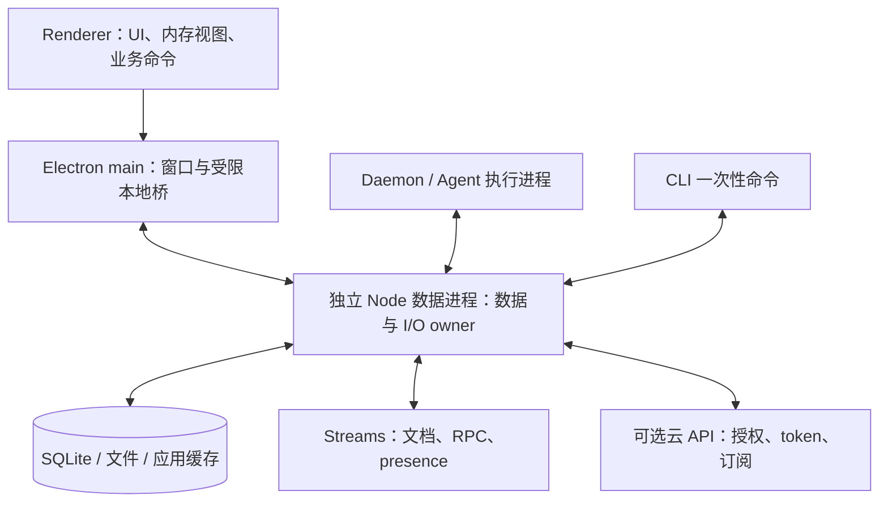
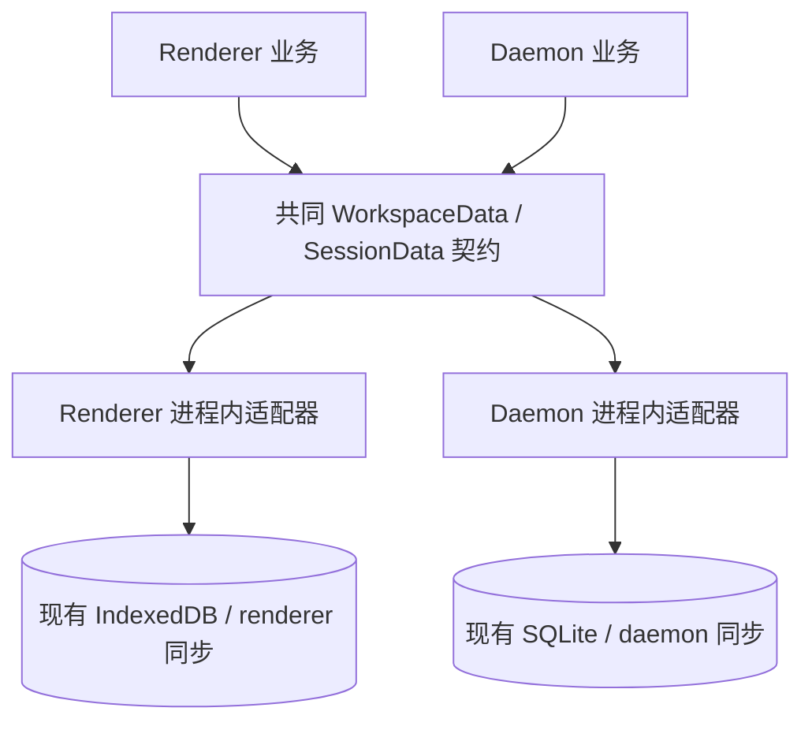

# 桌面统一数据进程

Status: proposed
Type: architecture
Translation: current

[English](2026-10-14-desktop-data-process.md)

## 摘要

桌面 renderer 与 daemon 当前各自持有 Loro 副本、持久化和可选云连接；多窗口又增加了副本和订阅。本次改造旨在提高应用速度、减少相同后端数据的重复同步与请求，并将应用数据、Streams 授权和外部 I/O 收拢到统一 owner。先将两端业务代码迁入同一套查询、操作与订阅接口，分别接入现有进程内适配器，这一重构可以独立发布。之后桌面使用独立 Node.js 数据进程，无头 daemon 可长期内嵌同一 owner Layer；renderer 保留内存视图，以 owner 落盘回执作为本地成功边界。两阶段分别验收；本文是源码研究与提案，接口收拢不证明连接去重、完整 I/O 集中或性能收益已经实现。

## 需求起点与长期目的

需求来自桌面端多个消费者需要使用同一份业务数据，同时各自承担副本、存储、授权和网络订阅的重复工作。长期目标是 renderer、daemon 和 Electron main 都通过一个独立 Node 数据来源读写、订阅；该进程统一管理 Loro/Flock 等数据、应用磁盘与网络 I/O，以及 Streams 授权、取 token、refresh 和后端订阅。renderer 的业务 IndexedDB 持久化在可靠迁移后退出，UI 使用内存视图；业务操作保留作者身份、权限和原有恢复保证。

共同业务接口是可先发布的步骤：两端通过相同查询/命令/观察完成目录实时更新、对话渲染与编辑、Message Queue 和其他数据操作，底层 Repo/Doc 留给适配器。选择 Effect Service 是为了声明依赖、组合领域操作并明确资源生命周期；真正的共享存储与连接由之后的数据进程实现。更快的会话显示、更少重复下行/订阅/授权请求是待测量的长期收益，不能以接口改名或逻辑连接数代替结果。需求映射、两期交付价值与验证指标已前置到 [Service guide 的背景说明](../../../docs/workspace-data-service.zh.md#背景核心需求与长期目标)，让方案可以脱离讨论上下文阅读。

## 当前修订的阅读顺序

当前设计以 [当前服务与迁移决策](#当前服务与迁移决策2026-10-14)及对应 Service guide 为准；[消费者 ledger](2026-10-14-desktop-data-consumers.zh.md)记录逐文件迁移。它保留前轮一期范围与二期拓扑/正文候选，补同步、命令、RPC、presence 和存储责任。以下源码审计与评审记录保留为历史，未声明方案已经实施。

## 决策与范围

需要 review 的决策是：把桌面的双持久副本、双作者同步，改为一个本机数据 owner；业务身份仍分别是用户和 Agent，不能因物理写者合并而改变作者归属。意图放在已有的[通讯架构 Spec](../../../../specs/communication-architecture.zh.md)，实现路径与取舍放在本文。现有 CLI `AGENTS.md` 禁止重新引入旧 write-intent proxy；正式实现需要同步修改这一约束，不能把新协议混进 v7 或偷偷复活已删除的 v4–v6 envelope。

数据服务须能在没有 Electron 窗口时为 headless daemon 工作，永久支持同一 owner Layer 内嵌；目标覆盖 Lody 自身数据、文件与服务的磁盘/网络 I/O。Git、终端、Agent 子进程自身访问项目/模型，以及嵌入浏览器访问网页，另有执行能力边界。若连这些 I/O 也必须只由一个进程实际执行，需要进一步改变执行环境与网络隔离，数据接口改造本身无法保证。

公共 OSS 组合仍是 local-only；云端能力只能由官方 cloud composition 注入。此研究不启用产品云服务，不依赖私有后端包，不证明服务器的权限同步或撤销时序。

## 当前实现与关键发现

源码基准：`16bf3fb03dceffc6a7f2a1a37b46b8bf7ab7561f`。目录锁定 Loro `1.16.3`、loro-repo `0.22.0`、Streams CRDT `0.17.0`、Mirror `2.3.2`、Effect `4.0.2`、Electron `44.7.0`；当前 worktree 无已安装依赖。

| 当前责任 | 源码入口与结果 |
| --- | --- |
| renderer 持久化 | `packages/components/src/providers/create-workspace-runtime.ts:187,475`：按 workspace/window 建 IndexedDBStorageAdaptor 和 LoroRepo |
| renderer 云同步 | 同文件 `1677,1720,2986`：token provider、Streams、Machine RPC、presence/monitor 的独立生命周期 |
| renderer 作者 | 同文件 `4590` 与 `workspace-writer-impl.ts`：direct writer 在本地文档上 author |
| daemon 持久化 | `apps/cli/src/lib/loro/sqlite-repo-store.ts:78` 与 `doc.ts:385`：workspace SQLite、Repo、数据通道 |
| daemon 授权与云同步 | `doc.ts:650`、`streams-transport.ts:34`、`cloud-cli-port.ts:196`、`lody-fleet.ts:435` |
| Electron 本地连接 | `apps/electron/src/main/services/loro-data-plane-relay.ts:35,123,363`：main 已共享一个到 daemon 的本地 socket，向窗口广播 |
| 本地更新 | `packages/shared/src/local-loro-data-plane-server.ts:674,701`：import Loro/Flock，没有业务落盘回执 |
| renderer 浏览 Session 的桥 | `apps/cli/src/lib/loro/doc.ts:1190`：一次 cloud reconcile 后释放，不是 renderer 云 live loop 的替代品 |

当前本地 relay 允许断连时丢帧，靠 renderer 保存的副本在重连 join 时补回。renderer cloud 路径还负责自己的上传。因此，删除 IndexedDB、关闭 renderer Streams，不能自动让 daemon 成为可靠的唯一数据源。

推荐业务写命令由 owner 在真实 live doc 上 author/commit，继续走正常 local-event 上传路径。若保留 renderer author 后发送 CRDT update，则还必须证明 imported ops 的落盘和显式上传路径；不能假定 import 后普通 `sync()` 会上传。旧数据库迁移也面对这个问题，不能只 import 并宣布迁移完成。

相关历史：早先 Flock 持久化问题记录在[Repo 持久化决策](../../implemented/architecture/2026-09-27-loro-repo-flock-persistence-migration.md)，本地重连在[恢复决策](../../implemented/bug-fix/2026-09-17-local-loro-join-recovery.md)，当前共享 writer 在[本地 writer 决策](../../implemented/architecture/2026-10-12-effect-local-presence-writer.md)。新提案替换桌面数据所有权，不抹掉这些恢复和背压约束。

## 目标职责

下图是桌面首选的独立 host 部署；无头内嵌共用相同责任，位置取舍见当前修订。



| 部分 | 持有的责任 |
| --- | --- |
| 数据进程 | Repo、Loro/Flock、HistoryWriter、存储、持久请求状态、上传恢复、授权、token/refresh、room registry、后端订阅、应用文件/缓存 |
| renderer | UI、编辑草稿、当前范围的内存缓存、加载/错误/乐观显示；不持有 durable Repo、Streams token、产品后端连接 |
| daemon | 持有 Agent/ACP/终端执行与调度；通过数据 Services 读写。内嵌时 Repo/SQLite 在同一进程的私有 owner Layer，独立部署时在 host，业务均不直接操作它们或另建相同 Streams room。 |
| main | 窗口、菜单、协议回调、OS 原生交互、本地 client 授权和转发；不再拥有另一套业务数据与同步状态 |

“复用”指一个权威存储与网络 owner。普通 JS/Wasm LoroDoc 对象不能跨 IPC 传递；客户端业务获得值、事件和范围读取。私有 renderer adapter 可采用纯内存只读 Loro replica 接收增量，或保留普通 DTO 投影，两者按当前修订比较；Doc 不公开，业务编辑仍由 owner 命令授权/提交。

## 进程与连接选择

核心是同一 DataOwnerLive；桌面首选独立普通 Node host，无头单 daemon 默认长期内嵌，其他场景按生命周期/共享需求选择。独立部署通过现有 process owner 启动/发现，以 Unix socket / Windows named pipe 提供本地服务，不依赖 Electron。协议、client transport 与核心/Node 宿主分开，名称可为 @lody/data-protocol、@lody/data-client、@lody/data-node，属于提议包，尚不存在。shared UI 只依赖平台数据 port，不引入 Node/Electron。

Electron `utilityProcess.fork` 可作为仅随 Electron 存活的另一启动适配器，支持完整 Node 环境与 MessagePort，但要求 app ready，不能承担应用退出后继续服务 daemon 的契约。跨应用退出的 host 必须由已有的进程 owner/监督角色持有，而非 Electron application scope 或退出时的 kill-all 集合。若以后实测 main relay 的转发开销明显，可以再评估通路优化；先统一 owner，不同时重写所有传输。utility launcher 仍要接入现有进程 owner/释放规则，不能创建另一套直接 kill/retry。

数据目录有独占 owner 与明确协议版本；所有同目录本机客户端（含 one-shot CLI）必须连接它。账号、workspace、部署环境、凭据 channel 的逻辑隔离必须保留，不把 Stable/Nightly 的 desktop 凭据目录混为一个。发现不兼容旧 owner 时报告升级/重连，不并行打开同一 SQLite，也不静默降级到旧 renderer IDB。

## 读写接口与顺序

### 先独立发布共同数据接口

这不是 renderer 专用 `WorkspaceWriter` 与 daemon 专用 `SessionBackend` 各自加一层。共同接口放在共享的数据模块，双方围绕同样的业务数据使用同样的查询、命令和观察契约；实现内部可以复用现有 HistoryWriter、SessionDocument 和各自 Repo。不同身份拥有的能力仍可不同，不因接口相同而获得额外权限。

第一阶段结构：



Repo、LoroDoc、Flock、Mirror 和 room handles 留在存储/同步适配器内部。公共业务接口不返回 Repo，也不以 `getRepo` 或把 `runtime.repo` 改名为 `runtime.data` 代替收拢。数据域建议是：

| 共同数据域 | 查询与观察 | 操作 |
| --- | --- | --- |
| session 目录/metadata | 身份、删除/存活状态、分页列表、初始快照与变化 | 创建、元数据字段修改、归档、恢复、删除 |
| session 内容/控制字段 | 复用 SessionData 范围读取、观察；队列与状态 DTO | 用户输入、Agent batch、权限回复、队列与状态命令，复用选定 backend 的既有写者与共享规则 |
| workspace/machine 目录 | Provider、Role、MCP、本地项目等按 family 查询/观察 | 已有验证规则下的明确领域修改 |
| schedules/operations/preview | 定义、目录、范围结果与观察 | 保留已有顺序/验证的领域命令；operations 复用已有 Service，不恢复已删除的旧 Task 产品 |
| 持久化/同步状态 | 本地就绪、首次追赶、上传状态分别观察 | 明确的本地持久化屏障与远端追赶，不暴露任意 transport 操作 |

读取权威数据和提交命令采用异步入口，UI 同步读内存视图。订阅 callback 是客户端监听器，不是发送到远端执行的 updater；查询过滤、条件写入和操作参数用数据表达。存储 snapshot provenance、条件检查、历史补偿必须留在适配器中完成。不要把所有领域压成任意 key/value 写入，以免绕开作者、调度发布和历史校验规则。

可以分几份 PR 迁移共同接口：先目录 metadata，再 machine/workspace catalog，再 session 控制与其他领域；每份都包含两端真实消费者，不留下 daemon 专用的 raw Repo 旁路。当前 renderer 排除 runtime 实现/测试的 inventory 有 53 行 `runtime.repo` 访问，daemon `src/session` 排除测试有 40 个 `.repo` 引用；这只是指定路径/写法的统计，别名、MCP/命令及其他模块另需审计。第一份目录 PR 不代表整个共同接口重构完成。

第一阶段发布边界：两端业务不直接读取/写入 Repo/Flock/Doc，只在组合入口注入适配器；已有存储格式、Streams 身份/连接、同步路由和写入确认语义保留。目录读取不能偷偷打开 Session 正文；bootstrap 与 live 观察继续无缺口、按字段 live 胜出，缺失不等于删除。原有 catalog flush 后返回、再独立上传，以及调度 definition → flush → registry → flush 顺序不变。daemon 的同步启动配置校验保留在同一逻辑操作内，不新增 await 空隙。静态边界检查防止新业务代码重新直连 Repo，行为测试比较实际结果，而非 import 字符串或 mock 调用次数。

第一阶段不新增进程或 IPC，不删除 IndexedDB，不重写 checkpoint，不改变 token/权限 owner，不提前把当前 local commit 返回改成未来 durable receipt。它的上线价值是建立两端一致的数据边界，后续只替换数据实现；性能与连接去重属于第二阶段。后续 IPC 适配仍要完成下面的可靠性契约，不能将进程内适配器通过 RPC 包装后直接声称迁移完毕。

### Effect Service 作为共同业务契约

采用锁定 Effect `4.0.2` 的 `Context.Service` 定义 workspace 范围的业务能力，查询/命令返回 Effect，观察返回冷 Stream，长期会话访问取得 scoped 业务句柄。[完整 Service 设计](../../../docs/workspace-data-service.zh.md)明确目录、会话、catalog、schedule、preview 的能力、结果、身份、Scope 与 React/IPC 边界；Repo/Doc/Mirror 不成为公共返回值。

第一期由两端进程内 Layers 实现同一契约，保留各自存储、同步和原有成功边界；第二期由数据 host 运行实际服务并注入 client Layer。业务作者与授权身份分离；Loro 使用既有 HistoryWriter，Roost 使用选定 owner 的写者与共享规则，不增加旁路写者。fork/copy、条件回滚等完整领域操作保留真实 provenance/补偿在 owner 内，不返回另一个 snapshot registry 或 rollback closure。

目录契约分别覆盖工作区会话列表和会话内 turn 目录。前者持续观察 Meta 索引，处理创建、修改、删除、排序/筛选/父子关系变化与分页失效，不打开每个正文；本地 ready 与可选云 live 状态分开。第一期仍各进程有自己的 owner，第二期才共享一个。当前历史后端是 `loro | roost`，raw 名称待确认；旧普通 JSON turn 是 Loro 后端内的兼容表示。服务按加载后的持久化 metadata 绑定后端，保留创建 opt-in，不因开关或失败切换后端。普通 reader/HistoryView 不判断 backend；创建策略、有限诊断标签和操作 capabilities 单独保留。公共业务接口不暴露 LoroDoc/FlockDoc 或 generic getState/setState；迁移必须连旧 SessionDocStore 与 view composition 一起改。

每个观察者各自拥有 lease，但与读取共同受所属 session handle 的生命周期约束；句柄关闭结束它的全部观察。独立消费者在自己的 Scope 中获取句柄，内部 owner 仍共享，关闭其中一个不影响另一个。workspace/授权退役终止相关观察并封锁晚结果。超额缓冲由 scoped consumer/renderer bridge 有界重建；View 的内部事件入口显式处理新 initial、reset/terminal 与来源 epoch。取消命令等待不证明未写入；数据进程、授权与观察的 generation 分开，不把订阅序号当持久化或通用 CAS。管理 editor 与列表 summary 分开，凭据通过保留/替换/清除更新，普通改名保留 owner 当前秘密。

当前 Loro reader 和通用 Roost 兼容 adapter 的初始观察会建立全目录；外层截页不消除这个成本。但生产 Roost renderer bridge 和 Node owner 已有分页初始观察，需保留这些路径。真正有界的原子初始页须由 owner 或既有有界 paging observation 提供。Roost history 观察还要持有 Loro 控制 cursor 通知来源。daemon prepared launch guard 保留同步、受限的当前数据视图；跨进程 claim 决策是二期单独 gate。纯计算保持普通函数，当前 Promise/SDK 临时 Layer 不宣称原生迁移完成。

### 渲染、编辑与队列消费者的补充审计

前述 Service 名称/代表签名不等于消费者已经覆盖。实际渲染需要完整 SessionHistoryReader，而不是仅 readTurn/readRange；renderer bridge 保留现有同步 ConversationView 与缓存 `peek`，另提供 control、queue、submission、status 的只读内存 stores。React 不在 render 等待 Effect，控制状态不随 history 帧节流。旧 Doc/Mirror/updater、Stop 的多步写入、schedule proposal 的 whole-turn replacement 都要真正迁成对应领域能力。[Service 的消费者契约](../../../docs/workspace-data-service.zh.md#4-渲染编辑与-message-queue-的完整调用边界)记录映射与完成门槛；本轮没有实施这些接口。

编辑重发复用既有 SessionEditAndResendSpec/Response 和完整执行 service；事实纠正：产品返回 success/error，内部 replaceEditableTail/import 才有 accepted/rejected/indeterminate，不能据产品 failure 一概推断未写入。fork/编辑/steer 同时依赖数据与执行；第二期需要 rewrite/queue/activation 与 prepared ACP 的明确跨边界交接，不能只搬存储后留碎片 workflow 给 UI。

队列需 begin/save/cancel edit、move、remove、steer/head fallback、daemon promotion/recovery，不能仅通用 CRUD。现编辑标记是可过期调度暂停，不是独占锁；第一期保留队头编辑的同步屏障和客户端 edit operation identity。promotion ledger 保留 prepared → history_accepted → activation_published → queue_consumed；未知 steer 不自动重发。opaque row ID 映射既有 `$cid`，无需重分配存储身份，也不公开容器对象。

实际 UI 已有独立 source pending-input projection：未准备附件的 held input 仅内存，Roost ready input 有持久 source owner。它复用普通气泡，但不改权威 history；同 turnId 在历史出现后不重复显示。submissions admission/read/observe/retry/cancel 必须一起收拢，保留 source 保存、owner acceptance、delivery 与执行的区别及 predecessor barrier。目录/Repo IDB 迁移不自动包含这个唯一用户输入数据库。这是 source/消费者静态审计，已有有限模型未验证这些渲染与业务 workflow；实际编译、行为测试和桌面验收仍待实现。

### 写入

已有 `WorkspaceWriter` 和 `SessionData.commands` 可提供 Desktop client 实现。示意顺序：

```text
client command(id, clientEpoch, workspace, expectedRevision?, args)
  -> host 校验绑定身份、权限、参数和条件
  -> 通过选定 backend 的既有 writer / 领域更新修改真实 owner 数据
  -> 完成本地存储屏障和可恢复的请求结果记录
  -> durable receipt(id, hostGeneration, revision)
  -> 独立进行远端上传；失败保留恢复责任
```

网络断开不能阻止有权限的本地写入。数据进程不可用时，未确认输入留在原草稿/待确认显示中，不能标为已保存。落盘成功、首次云追赶、远端已收敛、Agent 已执行分别表达。

稳定 ID 与请求内容绑定；相同 ID 不允许不同参数。ACK 丢失后查询同一个请求状态。没有结果记录不等于没有写入；只有可证明幂等/可恢复的命令才能重试，其他命令返回 indeterminate。不能宣称 `repo.flush()` 自动使跨文档业务更新、请求日志和 receipt 成为 SQLite 原子事务；实现需证明原子提交，或用逐阶段记录与可验证的幂等恢复处理每个崩溃点。

提交成功后即使 UI 退出、云断线，也必须能重启恢复并继续上传。Journal 不应为每个 streaming token 增加 fsync；同一 Agent batch 可合并，明确未确认窗口，并对外部执行激活、发布目录等 gate 保留原有耐久顺序。调度定义当前是 definition → flush → registry → flush（`packages/shared/src/schedule-repository.ts:111`），不能被泛化成一次任意 set。

以下接口需要改造而非原样序列化：`flockRowUpdate` 的 JS callback 变为领域命令或 owner 内检查的条件更新；`rollback()` 函数变为 owner 内完整领域操作；HistoryWriter stored-copy 的 WeakMap provenance 留在 owner 内 capture/copy，不传任意 JSON 当可信历史，也不额外建立第二套 snapshot 权威注册表。用户身份、作者标签、执行目标保持现有区分。

### 读取与订阅

优先复用 `packages/shared/src/session-data/types.ts` 的异步范围 reader 和 gap-free `observe()`，以及 `createConversationSession` 注入 SessionData 的入口。控制字段和目录也需要数据 port；仅替换 history backend 不会消除 `SessionDocStore.doc/setState` 与 `WorkspaceRuntime.repo` 的直接访问。

host 在同一观察边界建立订阅与初始快照，返回 `subscriptionId + hostGeneration + revision`。后续事件带连续序号；renderer 丢弃旧 generation/revision，检测缺口后重读对应范围。列表只拿身份/标量；对话按可见 turn/range 获取内容，流式输出只传变化 turn/文本增量，不能每 token 广播完整 doc/history。

每 client 有有界发送队列；慢窗口合并可重建的更新或收到重读要求，不能堵住其他窗口或 daemon 写入。内存投影不是耐久成功证据。必要时保留只读内存 Loro/Mirror 适配旧读路径，但不伪装成同步代理 LoroDoc，逐步删除 raw Repo 暴露。

## 授权、token 与共享订阅

数据进程集中 workspace access/权限订阅、授权请求、Streams token 获取/刷新、401 恢复、durable room、presence、Machine RPC 与预取。服务端仍是最终权限校验者；集中客户端 owner 不减少服务端检查，也不证明即时撤权保证。

共享资源至少按 backend/部署、账号或 machine principal、workspace、credential generation、room kind/id、内容保护模式/namespace 区分。同账号多个窗口可以共享；machine token 和 user token 不能因 stream 名相同而合并，更不能用 daemon 较宽权限替 renderer 授权。相同权限语义和身份下，每个逻辑 stream 一个 producer。不同逻辑 stream 仍可能有不同 live request；统一进程不等于全应用一个 TCP/WebSocket。

renderer 当前使用 user 凭据，daemon 使用 machine/CLI 凭据；一个物理 host 本身不保证这两种身份的订阅可合并。正式实现的前置 gate 是：由官方 cloud composition 明确每 workspace 的统一同步身份及其合法凭据来源，并证明每 client 的读写权限映射与原有服务端授权等价。执行机器的认证仍可独立，不要求它成为数据同步身份。若现有授权无法等价映射，就先隔离对应 transport，并明确该身份组合的 renderer+daemon 连接去重尚未完成；不能把 host 进程数当后端连接去重证据。

每订阅者取得 read/write 能力和 lease，主进程将窗口与可信账号/workspace 绑定；不信任客户端自己声明的 userId/peerId。socket 路径权限、端点发现与连接握手共同认证客户端，renderer 只能调用窄 API，不提供任意 URL fetch、文件路径读写、token 导出或原始 SQL。事件定向发送给已授权订阅者，不能继续向所有窗口广播敏感业务值再只靠 peerId 丢弃。

权限撤销、退出、账号切换同步封锁旧 generation 的请求/发布/重试，取消并等待原始 token/订阅工作实际结束。更新 token 和重建 room 有各自 owner，不能靠取消一个 waiter 证明底层请求已经停止。离线缓存访问、登出后磁盘保留/删除需遵循独立账号隔离政策，不以网络失败自动清缓存或提升权限。复用已有[token owner](../../../../packages/shared/src/loro-streams-token/README.md)和[内容边界](../../../../specs/workspace-streams-content.md)，不另建隐藏 token cache。

room registry 合并 renderer、Agent、后台任务的兴趣。在 UI 正在观察某 Session 时，host 要保持共享 live room；不能照搬当前一次 reconcile 后 unsubscribe。仅扫描历史目录不打开正文；一次 snapshot 浏览可以有界追赶后释放，不创建 Agent 的 SessionDocument。最后 lease 结束后仍有未上传写入时，上传恢复 owner 保留；否则按有限缓存策略 unload，避免历史房间无限增长。

## 所有应用 I/O 的迁移清单

统一 Loro 只是第一块，以下也要进入数据服务，才满足应用数据与后端 I/O 集中的目标。

| 类别 | 当前入口/问题 | 目标 |
| --- | --- | --- |
| workspace Loro/Flock | renderer IDB 与 daemon SQLite | 一个持久 Repo、cursor 和网络 owner |
| shortcuts / 预取 / Roost | `prompt-shortcut-provider.tsx`、`eager-sync-worker-task.ts`、`roost-history-cache.ts`、`eager-sync-high-water-cache.ts` | owner 统一后台工作，renderer 只用内存结果；Roost 存储放进 owner，必要原生线程由它管理 |
| 后端 query/subscription | `convex-provider.tsx` 在 renderer 建 Client，cloud API seam 是 React hooks | descriptor-based host query/subscription port，renderer store 适配 React hooks |
| 附件与下载 | renderer XHR multipart、fetch/Blob 下载；CLI blob store | host 接管传输、校验、文件/cache；有界二进制 IPC/本地协议展示 |
| 其他数据 | workspace catalog JSON、operations/Inbox SQLite、用户输入 IndexedDB、偏好与草稿 localStorage | 纳入 owner；输入是唯一用户数据，不能当可重建缓存清掉 |
| 其他服务 I/O | GitHub API/token、usage/notification、runtime artifacts、日志 | 专门 ports 迁入 host，保留各自权限与完成语义 |
| 原生 UI 与凭据 | Electron auth、OS keychain、协议回调、启动主题 | host 负责业务状态/授权，窄原生 adapter 提供平台能力；实际存储/网络位置需单独验收 |

严格的“所有网络请求实际在独立 Node 里执行”还需迁移登录 transport。当前[浏览器登录 Spec](../../../../specs/desktop-browser-login.md)要求 main 持有 PKCE，使用 Chromium 网络支持系统 proxy/PAC、证书与 cookie；Node fetch 不自动保留这些行为。Electron utility 的 `net.fetch` 可用，但 `net.WebSocket` 是 main-only，utility 不含 `safeStorage`。不能以迁移 Streams token 为由顺带改变登录与安全存储保证；完整 I/O 迁移要另行修改该 Spec 并验证等价 Node transport/宿主 adapter。若使用 main 实际执行网络/存储的适配器，只能称业务 owner 集中，不能称所有物理 I/O 已集中到 Node。

渲染图片/媒体/iframe 也会自行联网；严格零 renderer 外部请求需要 host 本地资源端点、streaming/caching 与 CSP/请求限制，不能只代理业务 `fetch`。不要把所有附件复制成大 IPC JSON/base64；先定义流式字节预算、取消与释放。

## 生命周期与 Effect 边界

沿用锁定 Effect `4.0.2`，不把本任务扩大为全仓迁移。数据 host 的新顶层 lifecycle 可原生组织，而 Repo/SDK 暂时通过登记的第三方适配器接入；不能把搬进新进程等同于完成原有 Loro migration。参考[charter L2](2026-09-27-effect-lifecycle-migration-roadmap.md#l2-and-the-loro-sync-stack)，真正改变单元依赖/owner 时再更新 ledger。

| 生命周期问题 | 提议契约 |
| --- | --- |
| 触发 | Desktop/CLI 首次访问确保兼容单一 host；开文档获取 lease，不激活执行 Session |
| owner | supervisor 管进程，host 管数据库、token、订阅、请求恢复，各 client 只管自己的 lease |
| 取消 | UI 关闭释放读 lease；提交中的命令按明确 admission/结果处理，不能取消 wait 后假定命令未执行 |
| 交接 | 旧 host 的实际退出、资源释放/数据库锁释放得到确认后才允许新 owner；进程 PID 不单独证明所有权 |
| 失败恢复 | 原始 I/O 未清理或释放失败保留 owner/Cause；不启动另一个数据库写者覆盖不确定状态 |

“Run local agent”只控制执行 worker，不能顺带关闭 data service；现有 `application.ts/cli-ipc.ts` 的耦合需要拆开。关窗口释放该窗口订阅；应用退出若还有 daemon lease，独立 supervisor 持有的 host 保持运行。完全停止 host：停止新请求和执行写入生产者 → 等待/记录已 admission 的命令与输出 → 停止并等待同步、token 与后台写者 → 最终 flush 本地数据、请求结果和上传恢复 checkpoint → 关存储 → 放弃 owner。若同步停止前有预先 flush，所有 producer 结束后仍要有最终耐久屏障，否则最后的 remote import 或后台写入会落在该次 flush 之后。无需等网络上传成功；未上传数据保留恢复记录。

host 崩溃后以新 generation 恢复本地数据，客户端重新建 lease/观察；已 durable ACK 的修改必须存在。旧事件不能进入新账号或新 generation。远端机器上的 daemon 仍有自己的数据 owner/副本，这个方案只合并同一本机的重复资源。

## 分阶段实施与完成门槛

1. **共同接口先独立上线。** 按上面的各数据域清点并迁移 renderer 与 daemon 真实读写/观察消费者，只让存储/同步适配器访问 Repo；用相同契约的两端行为测试和静态边界检查验收。保持现有存储、同步连接和确认语义，采集性能/订阅基线，不删除旧数据库。全部领域迁移前只报告已完成域，不把目录 slice 宣称为整个重构。
2. **可靠数据 host。** 先确定统一同步身份与客户端授权映射；抽取 CLI Repo/SQLite、token 和 Streams owner，实现 singleton/ready handshake、命令结果恢复、权限 generation、共享 live-room registry。one-shot CLI 也走 client。复用本地 transport 背压/framing，另立版本化命令协议，不破坏 v7。
3. **切 Desktop 客户端。** renderer 与 daemon 改用 SessionData/WorkspaceWriter/目录 ports；直接 doc/setState、ScheduleRepository、输入 receipt、preview 等完整迁移。导入旧数据得到可恢复且可上传的证明后，停用 workspace renderer IDB、Streams、RPC、presence 和 eager worker。阶段三只完成 Loro 范围，其他 I/O 仍要逐项报告。
4. **完成应用 I/O 集中。** shortcuts/Roost、API subscriptions、附件、用户输入、operations、preferences、日志/runtime、资源获取迁入 owner；验证登录/代理/证书和原生 adapters。用静态规则禁止 Desktop 新建持久 Repo、token provider 和直接服务网络；Web/mobile 保留浏览器实现。
5. **验收与撤掉过渡层。** 保留旧 DB 备份到明确回退窗口结束；确认无旧 writer 后再清理。不得开启新旧两个 cloud writer 做试运行后称“唯一 owner”。

旧 IDB 含未上传 Loro ops、Flock/tombstones、shortcuts outbox 和唯一用户输入。迁移需枚举所有账号/workspace/window namespace、停止旧 writer、完整导出、host 幂等合并、落盘 readback、记录迁移 receipt。保留原 CRDT identity/操作，不通过 JSON state 重建。旧 cursor 不能直接沿用为新副本已落盘证据；使用 replica-bound checkpoint 或重新追赶。旧未上传 ops 要有显式上传恢复路径；当前 SDK 能否完成需真实证明。中断迁移可重入，失败保留原库，不能自动创建空库覆盖。

## 验收与性能判断

需用真实 Loro/Flock/SQLite、实际 IPC、可控故障点验证：

- 两窗口 + 本机 daemon 观察同身份同房间，只一个云 live producer/token refresh producer；跨 principal 不混用。
- 离线提交后关窗口，重启恢复；owner 在应用、flush、结果记录、ACK 各阶段崩溃，丢 ACK 不重复发送/执行。
- 初始 snapshot 与实时输出竞争、慢窗口、事件缺口、renderer crash、账号切换、撤权，无丢事件/越权/旧 generation 污染。
- 用户修改与 Agent batch 并发遵守 HistoryWriter 的字段/未知数据/条件回滚规则。
- 最后 lease 释放与 room upload/catchup 交叠正确；历史目录不 join 成千上万正文；关闭 agent 后数据服务仍可用。
- 旧 IDB 未上传数据与 outbox 完整迁移、上传及读回；checkpoint 保持数据先于 cursor。
- headless daemon、one-shot CLI、多桌面安装、Windows pipe、打包 Node/SQLite ABI、代理/PAC/证书与 OSS 零云通过。

收益预测是减少同机重复订阅、首次追赶、token 请求、CRDT decode、持久化和窗口间回传，不是已测量的性能结果。若 `w` 个窗口加一个 daemon 都以等价合法的统一同步身份 live 观察同一房间，原来的 `w+1` 个应用 consumer 可以降到一个；不同身份的上述前置 gate 未通过时不能宣称这个收益已经成立。实际物理连接取决于 HTTP 连接池与后端协议，不能据此承诺全应用只一条连接或具体成本下降比例。

集中 owner 也会增加 IPC、序列化与排队，成为共享瓶颈和故障点。读范围缓存、批量 Agent 写入、有界 room 并发、分离控制/大字节 lanes、共享背压、公平调度是必要措施。比较冷启动与本地缓存打开耗时、输入落盘 p95、流式 UI 延迟、renderer/main/host/daemon 总 RSS、IPC 字节、DB 写放大、后端订阅与重连/令牌请求数；不能只看 renderer RSS 或连接数。

## 深度评审（2026-10-14）

本节与下一节保留两次评审当时的稿件和结论；后续授权修订见下方“评审后的契约修订”。这里的“未解决”描述原评审稿，不代表最新 guide 仍保留同样的契约。

评审对象是本提案、通讯架构草稿与 Service guide；代码基准仍为 `16bf3fb03dceffc6a7f2a1a37b46b8bf7ab7561f`，guide 中文版 SHA-256 为 `bafa845a5284027388df28e8d44b060963aab7337282a8b628b35b3750fccda5`。本节记录未解决的评审结论，不在评审过程中改写 guide 消除问题，也不修改生产代码。结论是按领域推进一期成立，但完整消费者切换前有三个 P1 契约问题；二期仍受身份、执行交接、耐久迁移等已声明 gate 约束。

1. **P1-R1：catalog summary 不能替代管理编辑投影。** guide 数据域表限制公开查询只返回 summary，不提供含 env/凭据的配置，却没有定义 Provider/MCP 管理编辑例外或保留凭据的更新契约。现 MCP 表单从 connection.env/headers/bearerToken 初始化（`mcp-connection-form.tsx:71-96`），保存重建整个 connection（`107-146`）；设置页以完整 row upsert（`mcp-setting.tsx:140-155`、`workspace-catalog-write.ts:70-73`）。Provider 编辑也从 config.env 初始化并校验已有 API key（`agent-config-dialog.tsx:1554-1568,2447-2448`）。直接用删去凭据的 summary 接这些消费者，会使普通改名丢掉 connection 中原凭据或阻止保存。对两种 MCP transport，将当前纯工厂代码原样提取到临时脚本，用合成配置做 name-only 编辑：完整 entry 保留凭据，去凭据投影产生的提交值不再包含凭据。这个实验验证的是现有 helper 与该迁移选择的冲突，不是已实施 Service 的 UI/存储测试。修订需分开列表 summary 与授权管理 editor DTO，明确凭据 retain/set/clear 与 owner 端条件更新，不向普通目录/订阅广播秘密。

2. **P1-R2：独立 observer 的读取权随旧 handle 关闭失效。** guide 同时要求每次方法执行检查 handle closed，又允许另一个 Scope 的 observer 在 handle 关闭后继续；history changed 帧只有失效 ID/range，正文仍须重读。合法序列是 open H → 在另一 Scope 启动 O → 关闭 H → O 收到变化 → H.history.readTurn 返回 DataScopeClosed，显示无法刷新。按这些前提执行的抽象反例保留 live observer、旧显示 v1 与新 source v2，重读被 closed 拒绝。它不是 Effect/Repo/IPC 复现。修订应让观察附带同一 lease 下可用的 reader，或把读与订阅放进共同 scoped acquisition；若不支持观察跨 handle 生命周期，关闭时应明确一起结束。只增加内部文档 refcount 不修复公共 reader 可用性。

3. **P1-R3：Stream terminal/reset 尚不能直接映射到现有 ConversationView。** guide 超额时结束观察并要求重新观察，但声称复用当前 reader/display cache 的桥接没有明确 terminal channel/reinitialization 契约。现 SessionObservation 只有 initial/initialPage/unsubscribe（`session-data/types.ts:139-145`），View 在构造时只调用一次 observe、应用一次 initial（`create-conversation-view-from-reader.ts:1038-1078`）。初始完成后 Stream 失败，不能再通过已 settled 的 initial Promise 告知 View；只关闭订阅会留下已 hydrate 的旧画面。需明确 bridge 的恢复 owner、typed error/status、重新建立初始数据、source/membership/content generation fencing，以及保留/替换 View 和范围 lease 的规则。不能把 ObservationResetRequired、权限拒绝或工作区退役都当成同一种无限重试。

与真实场景的适配判断：ConversationView 的 DTO reader + window cache、目录的 Meta watch/index、既有 Loro/Roost 后端绑定与共享 planners、Queue 的领域操作均可复用，无需给业务重新公开 Doc。edit/fork/steer 和 prepared launch 跨数据/执行边界，其现有 rewrite barrier 与同步 claim（`session-edit-and-resend-service.ts:152`、`session-manager.ts:777-809`）不是换 Layer 后自动保留的保证，二期交接协议仍须设计。连接共享按等价授权身份验收；进程合并本身没有通过这个 gate。

完整接口阶段的范围还有明确未闭合部分：当前 Code Collab 文件树依赖独立 file-index Flock 的 watch/read（`code-collab-file-index-cache.ts:159-171`），内容/save/diff/LSP 用机器 port；goal pause/clear 与 set/resume 的 request/prompt 分流已有 shared 契约（`use-session-actions.ts:546-570`、`packages/shared/AGENTS.md`）。guide 的具体服务域尚未给这两个场景归属，不能用 previewComments 或通用 control 字段替代，也不能在它们迁完前关闭对应旧 Flock/RPC。它们是完整阶段的范围/交接 gate，不阻止先发布已闭合的数据域。

性能判断仅有结构依据：相同合法身份下减少重复 live producer 有潜力；当前精确 turn invalidation 会令 hydrated turn 重读整个 DTO（`create-conversation-view-from-reader.ts:588-607`），换成 IPC 后仍有 serialization/copy 成本。wire 层是否批量、合并或发送增量还未验证。现有限模型在本轮重新执行/strict 检查通过，但没有 handle-close reader、terminal View 恢复、配置 editor 或执行 saga 状态，不能证明三个问题已经被覆盖。未安装完整依赖、运行桌面/后端/迁移或性能实验。

## 第二轮深度评审（2026-10-14）

二审基准未变：HEAD 仍为 `16bf3fb03dceffc6a7f2a1a37b46b8bf7ab7561f`，guide 中文版仍为 `bafa845a5284027388df28e8d44b060963aab7337282a8b628b35b3750fccda5`，通讯架构中文版为 `f7c74fed780d9447a64a5251a16ef8641f093e2c0b0dfef9de7447f439657f10`。P1-R1/R2/R3 都尚未修订，本轮没有发现第四个可确认的 P0/P1；这不改变完整消费者切换尚未就绪的结论。没有改方案正文或生产实现。

新增核对覆盖：冷文档打开/metadata hydration、读取失败与旧分页 cursor 重基、持久输入的 source/owner/delivery 状态、取消与 snapshot 延迟、queue promotion ledger、RPC 快速路径的因果屏障，以及 workspace/账号和执行 invocation 的身份边界。没有将方案已经声明的二期 gate 重新算作新缺陷，也没有把未验证的实现选择报告成漏洞。

对 `session-accepted-inputs.ts` 的现有 coordinator 代码原样提取，使用合成 in-memory storage/owner/resources/lock ports 做了三个确定性实验；验证结果状态而非 mock 调用次数，没有网络、真实 sleep 或 wall-clock 条件：

| 场景 | 可观察结果 |
| --- | --- |
| 恢复 unknown 输入，lookup 返回 unobserved，旧 guide 的 deliveryStarted 已保存 | source 继续使用同 inputId 和冻结内容；取得 accepted 后记录 confirmed；旧 guide 不再次交接 |
| owner receipt 为 accepted，但 active 为 false | source 清理待发记录，合成 authority 中该输入仍不存在；不以重试复活已移除历史 |
| UI snapshot 为空，但 storage 中已有该 session 的持久输入 | cancelSessions 发现并取消/清理持久记录，未把它写入合成 authority |

这三个实验只验证 source coordinator 的上述分支；未执行真正的 Effect owner、IndexedDB 事务、跨窗口 Web Locks、Roost 原子 receipt、IPC 或桌面，也未验证 RPC-error 分类。匿名 helper 的提取不改变函数体，依赖通过注入实现；合成 fixture 不含真实会话内容。现有 source 恢复约束见 `session-accepted-inputs.ts:90-141,198-225,294-324`，workspace 的 frozen target 校验与 predecessor barrier 见 `workspace-pending-sends.ts:27-69,101-109,137-154`。公共 DTO 和未来 Node owner 必须保留这些语义，不能把 confirmed 等同已执行，或用新的 append 处理 unknown。

其他核对结论：

- 冷 metadata 尚未加载与 legacy discriminator 缺失需要分别处理；guide 已要求 hydration 后绑定，不作为新 finding。现 renderer 在 bootstrap 后才读取 metadata 并选择后端（`create-workspace-runtime.ts:4170-4239`）；这个顺序本身不证明新 adapter 已完成冷打开/错误恢复，不能把未知或 unavailable 映射成 None/空历史。
- 旧 history cursor 并非一概不可恢复：View 保留 loaded prefix 的 cursor，旧 cursor 读取失败时只重基已加载窗口（`create-conversation-view-from-reader.ts:805-845,1090-1117`）；Roost bridge 校验 cache/owner revision（`roost-session-bridge.ts:499-563`）。该恢复应与 P1-R3 的整个观察 terminal/reset 分开，后者仍没有兼容映射。
- 单机统一 owner 不移除跨机器的 TurnHistoryGate：远端 RPC 输入早于用户 entry 到达时，assistant LIST 写入仍须等 entry（`turn-history-gate.ts:19-33`）。queue promotion 仍依据 prepared/history_accepted/activation_published/queue_consumed 恢复。guide 的保留原顺序要求成立，实际协议未实施。
- directory inputConfig 的惰性 getter 无法原样跨 JSON/structuredClone：当前 Loro reader 只在首次读取时投影（`session-data/loro.ts:147-169`），wire 物化会付出计算成本。这个是未测量的性能/适配条件，没有将其提升为无数据支持的 P1。框架类型正确和已有小容量模型通过，均不能证明新的序列化路径更快。
- 当前 invocation 冻结 requester/config，socket/client binding、同步身份、prepared claim 与数据/执行交接仍按已声明的二期 gate 验收。无真实后端或跨 principal 实验，未声称权限映射或连接共享通过。

下一轮有效评审应针对修订后的三个契约及具体消费者桥接；同一稿的额外源码核对不会自动消除已确认问题。按已闭合业务域推进一期仍可行，删除 renderer 持久化/旧 RPC 与迁移统一数据 owner 仍需各自证据。

## 评审后的契约修订（2026-10-14）

用户要求调整方案后，更新了双语 [Service guide](../../../docs/workspace-data-service.zh.md)，生产源码基准不变。P1-R1/R2/R3 的状态为**设计已修订，消费者实现与产品验收仍待完成**；本提案仍为 proposed，Spec 仍为 draft，不以授权修订推定实现完成或人审通过。

| 原问题 | 选定的修订 | 一期完成条件 |
| --- | --- | --- |
| P1-R1：summary 丢失管理编辑所需字段/凭据 | 分开列表 summary 与授权 `readEditor/applyEditorPatch`；敏感值 write-only，省略/keep 保留 owner 当前值，replace/clear 按字段/键明确表达；owner 重读、检查编辑条件并保留未知/无关字段 | 同时迁移 MCP 两种 transport 的表单初始化/保存和 Provider 已有 key 校验；改名保留凭据，显式清除、并发条件和撤权在真实写入路径验收 |
| P1-R2：观察活着但 reader 已关闭 | 采用共同句柄生命周期，而非再新增一套独立 observation reader；observer 不得比创建它的 handle 活得更久，关闭 handle 结束其所有观察并封锁晚读；独立消费者另取 scoped handle，内部 owner 共享 | 跨 Scope 订阅随 handle 结束；取消单个 observer 不关闭 reader；另一 handle 不受影响；真实资源释放与命令独立 owner 验收 |
| P1-R3：terminal/reset 无法通知/重建现有 View | 增加 reader→View 的 initial/changed/interrupted/terminal 事件入口；scoped bridge 有界恢复，sourceEpoch 隔离旧结果；新 initial 重建目录/coverage/cursor、清正文与 fact 缓存，保留 View 和 UI 意图 | 改 `createConversationViewFromReader` ingestion，验两种 backend 的加载后失败、再次 initial、旧回调、深历史 anchor、range/pin、重试/释放与权限终止；不能只用现有 initial Promise 包装 |

管理方案选择 write-only 凭据 patch，而非向普通观察或整份 launch config 回传秘密，因此现表单必须调整，不能宣称无消费者改动。编辑条件只针对 owner 已接收且此次修改依赖的字段；不宣称跨设备锁或消除 CRDT 的并发合并。短期 editor context 不承担授权，退役/过期必须拒绝旧 token。daemon 的可信启动 DTO 保留原同步 guard，不能拿 renderer editor 取代它。

生命周期契约的五个问题：触发为观察 overflow/事件缺口、owner 不可用、句柄/授权退役；owner 为 scoped View acquisition 下的 source coordinator/history bridge，daemon 则为其调用流程；取消终止本消费者的观察/重试并废止发布身份，已经 admission 的命令保留原 owner；交接只在旧资源实际清理完成且同授权 binding 有效时进行；失败分成可恢复的 reset/unavailable、范围读取失败、永久错误/预算耗尽，以及不可自动恢复的 denied/closed。清理失败保留原 owner，不能趁超时创建第二个 producer。

局部 history reset 保留 session handle；host 重启若要换 handle，则由 View acquisition 一次退役并重绑 history/control/queue/submission，避免其他 store 滞留旧 reader。View 对象和 UI 草稿/viewport/pin 意图保留，但 source generation、正文、fact 和 cursor 重建；深 anchor 可能需要有界分页扫描与加载状态，不保证常数时间定位或恢复全部旧 prefix。授权退役撤销旧 View 的可读/发布能力，不用另一身份重试，不承诺撤回已交付数据。

新增模型验证的是有限契约而非实现：编辑矩阵 600 个场景；两个 handle、每个两个 observer 的深度 6 探索新增 1,345 个状态、4,511 次转换；View 恢复矩阵 165 个场景，包括终止/释放、晚初始/正文/页/fact/change、连续失败预算与显式重试的 binding 检查。Node 24 执行与 strict 类型检查通过。实际表单、Effect Scope、所有 store 的重绑、真实 View 的 range/pin/anchor、SQLite/IPC、I/O 清理和性能仍未执行；这些保留为一期/二期各自的完成门槛。

临时副本分别删除四条规则：省略凭据保留、句柄关闭级联、旧 initial 的 epoch 检查、连续失败预算；模型均因对应行为断言失败。这只说明这些有限检查能识别所列错误规则，不升级为真实消费者或 Effect 实现验收；副本未写入生产源码。

Code Collab、goal request/prompt 分流、prepared claim、统一同步 principal 与耐久存储迁移仍按前文完整阶段 gate 处理；三个设计契约的修订不表示可以删除旧 Flock/RPC/IndexedDB 或接入统一数据 host。优先实现已闭合领域的共同业务接口，真实消费者通过后单独发布，再进入进程迁移。

## 当前服务与迁移决策（2026-10-14）

本轮把原 Note 的 I/O 责任提升进 Service guide，补 SyncAuthority、MachineCommands/可信 consumer、MachineRpc、Presence/可信 execution publisher，以及独立 PromptShortcuts/FileCollaboration。catalog family、唯一副本输入、local opening/cold 与清单验收成为明确契约。这里替代此前没有这些接口的完整性表述，保留上一轮 owner 拓扑与正文候选；尚未实现新 Service、lint、host 或迁移。

### 证据与评审建议的修正

消费者全量扫描固定 df5b5a068e2f6a44118a30d0cc8fa34c2e4fcc49；本次刷新 GitHub main 并 fetch 到 7541fbf76d154e3a98987e646c6aa932baebacd5。两者相差 4 commits，CLI、shared、RPC 及本文核对的 sync/presence 文件未变；components 差异为 about/memory settings、story 与样式。下表保留 df5b5a0 的准确行号，ledger 不冒充新 SHA 的全量扫描，实施切片先刷新。当前工作树仍为 16bf3fb，不 checkout/覆盖。workspace-command-manager 的 command-specific manager 与 shared presence registry 身份仍保留，迁移不能复用冲突的 producer key。

采用评审补齐方向，但修正四处不能直接照抄的语义：
- renderer atoms/runtime 的“未 ready 立即返回”注释与 create-workspace-runtime:4394-4426 实现不同：实现 await transportReady/acquire/join，Abort 释放本 wait lease。preview 评论 :4518 也先等 transport/firstSynced。一期依代码保留，另记注释不一致，不据此推导 if-connected。
- CLI SessionDocument:2505-2542 是 bounded boolean 确认，不是经典 room 的 require-route/throw；调用方可能忽略 false，或者改走通知/恢复。两个模式不足，按真实调用点登记四种一期策略，上传结果保留 primary 目标与证据强度。
- first-ever 权威与 current gate 分开。GC/空 catalog 用已完成初始投影；schedule 每连接换代清 ready。provider command watcher 在 authoritative join 后重扫，取消还在发布前/merge 后复查。不能靠一个历史 epoch 给后续执行许可。
- resync 不是唯一总唤醒，startup/manual/dirty/廉价在线唤醒仍存在；scan 与实时事件必须共用入口。consumer handler/storage/cleanup 会失败，不能用 Effect<never, never> 声称永不失败。请求行消失也不等同所有 family 执行成功。

### 同步/权威调用点登记

表中策略是同名 Service 的兼容映射，不是改变旧调用结果。每个聚合行内的调用须在迁移 PR 拆成独立的行为回归：local-only、无 route、未 ready、false/异常、取消、后续独立写与 reconnect。firstSynced/state 类型声明归私有 adapter，不算新的业务等待。host 的精确 upload fence 需真实 SDK/写入证据；legacy barrier 只报告既有屏障，不能升级为更强 receipt。

| 当前调用（main 行号） | 目标与策略 | 保留结果/权限门槛 |
| --- | --- | --- |
| create-workspace-runtime:974,4394-4426 | session-control/preview primary；wait-for-route＋内部 per-route wait | first store 的 transport/join、Abort、lease 和 selected plane；Loro 会话覆盖同 Doc 控制/历史，preview 单独目标，不一律解释为云 ACK |
| create-workspace-runtime:4518-4524；use-preview-visual-comment-doc:235 | preview-comments；wait-for-route | 首 sync 错误/room 缺失保持原处理，本地评论结果独立 |
| schedule-write-sync:24,60-65；create-workspace-runtime:4572-4585 | schedule-definition；retain-until-ack | durable mutation 先返回；后台 uploader 借用穿过 idle/reconnect，原 owner dispose/abort 语义 |
| session-chat-interface:2951,5967,5996,6031；use-session-doc:456 | session-control；wait-for-route | 队头修改仍 wait 再 applied/no-op；Loro 同 Doc 控制/历史覆盖是该等待的依赖，保留错误/旧 ACK 与编辑 identity |
| session-send-delivery:179；message-send-status-context | session-control；wait-for-route，发送流程后台等待 | 本地 accept 先发生；Loro 发送确认依赖同 Doc 历史覆盖；确认仍绑定 primary/实际 waiter，不推导执行，失败不回滚输入 |
| CLI doc:2536；session-backend:503 | session-control；bounded-confirmation（原 timeout 默认 4s） | 无 binding/不健康/超时 false，只有原成功 true；外层保留各自使用 boolean |
| roost-session-backend:400-401；roost-node-session:2009 | Roost 本地 history flush＋session-control | Node history 等待只证明 SQLite owner 的本地写入已 flush；再组合 control 的 bounded boolean，不声称 Roost 远端同步 |
| CLI commands/session:2580 | dispatch pointer；bounded-confirmation，best-effort | accepted dispatch 后 never-throw，不回滚；teardown 前等原屏障 |
| message-handler:5595,8721 | finalize/permission notification；bounded-confirmation | finalize 不把 false 变写失败；permission false 保留通知 fallback |
| dispatch-watcher:2836；execution-service:3615,3868；worktree-script-history:105 | turn/replay/script；bounded-confirmation | 保留原 recovery deadline、串行 recheck、同步后 meta 刷新与 caller 的 false/异常处理 |
| local-project-history-sync-service:800,1018,1091,1117 | imported history/control；bounded-confirmation | 四处冻结 import 身份、cursor/内容已保存与“尚未上传”失败状态各自保持 |
| schedule-command-service:124,288 | proposal history/control；bounded-confirmation | local-only bypass；cloud false 报 saved-locally/sync-pending，同 requestId 恢复 |
| schedule-sync-gate:17-18 | schedule-registry；current authority＋per-binding wait | 新连接 generation 立即清 ready，firstSynced 与 wait/current status 共同 gate，禁止缓存首次 Promise 许可后续连接 |
| streams-room-binding:63-65；connection-recovery:401,409,1000-1001 | private binding；require-route/per-binding 原语、bounded refresh | detached 与 classic disconnected/NoRoute 不等价，Result/阶段/deadline 留内部 |
| machine-flock-command-watcher:156；message-handler:2995-3010,3772 | machine-data；authoritative initial/current watcher + rescan | provider setup 在 cloud 权威后启动，local-only 不等云；archive/delete/project 保留每 family 条件 |
| machine-flock-sync-coordinator:264；lody:164 | machine-data、workspace-meta | dirty 上传与 reader interest分开；在线 cheap wake/Meta-ready expensive scan 分开 |
| message-handler:3006；doc hasCompletedInitialMetaSync | workspace-meta baseline / local index ready | worktree GC 只在完整 metadata 时把 absent 解释为删除；物理清理仍保留原 runtime/dirty/path guard |
| workspace-catalog-room:110；use-machine-flock-rows:418,445,490,974 | workspace/machine catalog authoritative acquisition | 空集合 authority、freshCatchup、selected binding、live-wins/删除重读保持，local peer snapshot不冒充云权威 |
| use-schedules:62,131；session-share-publisher:47；use-session-diff-summary:491 | definition/load/share/evidence 初始同步 | 各自 timeout/本地 hydration/分页与取消，不合并成上传确认 |
| code-collab-file-index-cache:200；eager-sync-worker-task:84 | file owner/prefetch | 独立 grant、scope/LRU/worker cancel；不把 file index 接入 lody sync 默认范围 |
| room-sync/registry/tracker；use-session-doc getSyncState；presence/monitor getSyncState | private status → SessionDataStatus/Presence DTO | first-frame/readiness/unknown/local-remote 选择保留，不向业务公开 raw transport status |
| commands/sync；commands/export；command-runtime sync* | 所选 metadata/catalog/control 的 SyncAuthority.refresh＋backend history refresh | 正常读显式 online failure；--offline 显式本地；显式 sync 仍汇总每 target Result，不是 await 旧 baseline |

if-ready 移出一期公共策略。create-workspace-runtime:969-975 的 detached no-op 是 wait-for-route 完成 transport/join 后的内部行为，不能包装成新的立即返回策略。awaitAuthority(target, baseline/current) 的数据只是快照；清理/写入/执行的领域 owner 再复查目标、grant 与业务条件。原 sync callback 通过私有 AuthorityView.current 保持同步，不引入 await 裂缝。host restart/授权/placement 换代失效旧 authority，remote 重建前 baseline missing；local-only 完成本地存储/index 加载即可成为权威。

每个一期策略的依据如下；真实调用登记后才进入该切片，复用名称不改变旧结果：

| 一期策略 | 真实依据 | 兼容边界 |
| --- | --- | --- |
| wait-for-route | create-workspace-runtime:4394-4426、4518-4524；业务调用如 use-session-doc:456 | 先等 transportReady/join，再等选定 binding；保留 detached/无 room/Abort 的内部短路 |
| bounded-confirmation | CLI doc:2505-2542 与 session-backend:503 | 不可用/超时返回 false，默认 4s；外层忽略/报错/通知 fallback 分别登记 |
| require-route | streams-room-binding:63-65；connection-recovery:409、1000-1001 的原语调用 | 缺路由失败由现有 refresh/deadline 包装器处理；不是全部 CLI store 的默认策略 |
| retain-until-ack | schedule-write-sync:24、60-65；create-workspace-runtime:4572-4585 | 本地写先成功，私有引用保留到同 generation joined 屏障完成；dispose/Abort 也会结束等待，不报告 remote ACK |

UploadReceipt 保留 barrier-completed（local-primary/remote）、not-attempted、not-confirmed、not-required-local；legacy completion 只证明原屏障，原因/目的地只填实现真正知道的值。throw 留在错误通道，false 不升格为成功；Effect 中断结束等待，不伪造回执。schedule 引用是一期既有行为，二期客户端退出后仍负责上传的持久 custody 另建 gate。

SyncTarget 的 session-control 不包括 Roost 历史。roost-node-session:2009-2013 仅 flushHistoryWrites；roost-session-backend:400-404 与 SessionDocument 等待组合。一期私有兼容聚合保留它；Submissions/写命令的 owner receipt 表达正文接受，不拿 control ACK 代替。Loro 的 session-control 屏障覆盖同 Doc 控制与历史；表中发送确认/队头编辑等依赖已明确标注，所选 binding、未就绪/取消和回执证据强度仍按原实现保留。DirectoryStatus.cloud 则是 workspace-meta AuthorityState 的投影：observeAuthority 与目录 observe 共享同一内部来源/revision，并观察 readiness 下降；UI 标签不创建第二份权威缓存。

### Family 清单与方法/秘密/消费者

基于 workspace-flock 的两类与 machine-flock:577-609 的十五类，以下给明确归属。管理/可信 launch DTO 与普通 summary 分开；“可读取”不等于“可管理”。实际 client grant/actor/字段校验沿用 shared/platform/CLI/MCP 契约，由 owner 每命令重查。

| family/表示 | owner 与提议方法 | 权限、秘密与消费者 |
| --- | --- | --- |
| workspace mcpServer | WorkspaceCatalog.listMcp；CatalogManagement.changeMcp | summary allowlist；管理授权，headers/env/credential 含秘密；mcp settings、CLI mcp、workspace-mcp-configure |
| workspace agentRole | list/readAccessibleRoles；changeRole | 现 canRead/availability、owner/editor 与冻结 revision；prompt/config 非普通 summary；role editor、agent-role-create、MCP discovery |
| machine dotlodyPath/localProject | catalog machine/project summary；authorized add/update/removeProject | 本机路径/共享项目规则；删除完整命令；chat-landing、local-project-import/admin、CLI machine、GC |
| memory | catalog associations；link-if-absent/editName/unlink | 不删 Provider 内容；目标 machine/provider/memory 身份校验；memory-association-write/use-memory-provider |
| agentConfig/agentConfigIndex | config summary/management；authorized change/index | env/auth/runtimeOverrides 含秘密；MCP 仅凭据引用、有限输出，可信 launch 独立；atoms/agents、CLI agent-config、setup |
| acpCapability/acpModelCapability | catalog capability view；trusted update/refresh | per-config source freshness、bounded schema、协议能力非 CLI semver；quota/model/Role reconciliation/runtime discovery |
| rateLimit（legacy/provider 形态） | catalog limits；trusted patch/refresh | 保留 provider id 与更新来源，不写秘密衍生 cache key；quota hooks、MachineDocument |
| builtinAgentOptOut | catalog/read preference；authorized opt-in/out | 本机 actor 与 managed runtime 规则；builtin registration、Provider 设置 |
| sessionLaunchConfig（legacy） | MachineLaunchData 只读兼容 baseline | 无新持久写，可能含 launch secrets；prepared/dispatch/fork/resume |
| archiveSessionCommand/deleteSessionCommand | MachineCommands.submit/observe；trusted serve | 每目标生命周期/权限与工作区数据状态，保留旧 keyed command 与结果形式；archive/delete UI、MessageHandler |
| deleteLocalProjectCommand | MachineCommands.deleteProject/observe；trusted serve | 先归档、dirty 拒删、原项目非删除目标、可见 cleanupResult；use-remove-local-project、local project handler |
| providerSetup/providerSetupCancellation | MachineCommands.setup/cancel/observe；trusted serve | 只准目标CLI最终发布、取消胜过陈旧/并发 publish，行不含 auth URLs/codes/tokens/raw output；providers screen、Magpie、ProviderSetupManager |
| Magpie（派生，不是新 family） | CatalogManagement.importMagpie 组合 setup/agentConfig | 本机确认、固定 loopback/public token、capability；atoms/magpie-import；pending request 留 UI |
| Meta/e/ existence（不属 catalog family） | SessionDirectory indexes/resolveOwner/updatePr | 删除/absence 需 authority；pr-poller、dispatch、GC/export |
| schedule definition/registry（独立） | WorkspaceSchedules + trusted scheduler + SyncAuthority | fingerprint/cursor/run intent、同 machine SQLite 与 current gate；schedules UI/CLI/engine |
| file-index/signal（独立） | FileCollaboration.acquireIndex/publish/read/save | owner session/path、origin、read-only外部、local RPC seed，内容/证据不写 Meta；Code Collab/file consumers |

PromptShortcuts 的独立 private/workspace index/body 授权、Code Collab LRU、eager cache 和 Roost RPC 现已在 guide §8.5 确定二期 owner，不留“待定”行。host 合并连接前仍要证明原用户/机器 principal 等价；同进程有两种合法 principal 的连接不算已经去重。Code Collab v2 没有新的 synced text CRDT，本次不复活它；文件内容/LSP/保存继续受限 Machine RPC，host 统一 client 与 index/cache。

### 远端 RPC 入口与执行可用性

选择 host 持有 Streams RPC client 与 server 网络入口，daemon 保留 handler、执行控制与 raw ACP/终端 owner。这里接受独立 host 增加故障点与云→host→daemon 的 IPC 跳数。独立 host 让数据继续服务停止/更新后的 daemon 与多窗口，不表示远端执行完全不依赖数据服务。

对照 main 的 message-handler:3090-3140 和 machine-rpc-server，现有 daemon server 自己取 token、读 request stream 并写 replyTo。将完整 server 留在 daemon 能减少一跳、保持网络入口独立，也要让它保有 Streams 连接/凭据/刷新作为集中 I/O 的例外。只让 host 发 token 仍会在 host 故障后的 token 过期/重连时失效。统一 Streams 授权与 I/O 是核心需求，本版接受耦合；若原型不满足控制可用性/延迟预算，重新评审该例外后再改归属。

| 二期失败窗口 | 观察和责任 |
| --- | --- |
| host 已判定 daemon lease 无效，尚未交接 | execution-unavailable；撤销该来源 online/active 发布，不报告接受 |
| host 故障，client 无法取得回复 | 既有每方法 deadline；client 不能从 timeout 判定是否已交接，修改类结果为 unknown |
| 已交给 daemon，host/回复失联 | daemon 保留执行/取消/释放 owner；按原 request/operation id 查询支持查询的结果，不自动重发未知写入 |
| host 恢复/换代 | 重建 grant/读取与 daemon lease，旧 IPC/progress generation 退役；保留原方法幂等/拒绝记录。无查询接口的请求保持 unknown，空记录不证明未执行 |

二期 server 切换 gate 覆盖交接前/后/回复后故障、重复请求与旧 generation、认证失败、stop/steer/prepare 原 deadline、额外 IPC 延迟、control lane 不受正文/低优先级请求阻塞、ACK/handoff 与 raw release。host 保持独立控制通道/并发预算；本机 main→daemon 控制入口保留，但依赖数据的 prepare/steer 仍可 owner-unavailable。stop 的实际释放与错误须验证，不仅验入口存活。业务 requester 不等于认证身份，沿用 source-side/目标权限检查。

### 执行 presence lease

machine online 由 daemon 的 machine lease 支撑，active-turn 再由其下 execution/turn lease 支撑。host 网络 sink 只接受可信 SessionExecutionPresence 的发布；host 存活、cache 或 renderer viewing 引用不延长执行 lease。viewing/execution 的 origin/reference 各自隔离。

显式 daemon IPC disconnect 立即废除旧 lease generation，停止该来源心跳、清本地可用投影并排队远端 clear；静默失联用注入 Clock 的独立本机 lease deadline 检出。协议声明检测上限与本地清除上限，二期原型校准；不得设为无限或依赖云 presence TTL，远端 clear 失败不阻塞本地失效。网络不可用/host 崩溃的远端收敛仍由原 TTL/freshness 兜底，不承诺全网瞬时清除。

发布 lease 退役仅表示执行来源不可联系，不表示 ACP 已释放/停止。正常完成仍等实际 raw release 再 clear；断链时 daemon 保留真实 owner、未完成写入/停止恢复与关闭责任。重连从 live execution 状态重新声明，以 host generation＋daemon instance＋lease id/revision 封锁晚到 heartbeat/clear；旧 lease 不能复活或删新来源。fake Clock 验收覆盖 IPC close、静默超时、host 仍在线/重启、clear 失败、多窗口 viewer、新旧 daemon 与 raw release pending；一期不新增这些 IPC 故障面。

### 消费者 ledger 与静态边界

[消费者附录](2026-10-14-desktop-data-consumers.zh.md)登记当前 main 的 141 文件/847 AST 候选，外加 19 个薄入口、持久输入与注入依赖，共 160 行；94 个提议消费者、60 个拟登记 adapter/入口、6 个已核对 DTO 同名项。所有方法是提议迁移目标，不是这些 Service 已存在。仅做语法 AST，无完整 type checker，动态 alias/注入依赖还要按实现切片追踪；不能据此宣称只有 160 个依赖或已通过边界。

公开 WorkspaceRuntime.repo/SessionDocStore.doc、generic writer 和 raw sync 字段留在待退役 Legacy，新的 Services 不提供这些出口。领域关闭时删除相关公开返回类型/imports；未迁移领域逐文件登记 baseline 与删除 gate，adapter 范围不扩展到整目录。首个真实切片将 AST 边界接入 pnpm check 的 lint（Oxlint 或独立脚本），覆盖 alias/reexport/type member；packages/components/tests/no-materialized-history-in-components.test.ts 的源码约束随切片迁入 lint，真实行为测试保留。tour 使用 InMemoryDataLive 合成 fixture。本版只规定验收，尚未加入实际 lint。

### 二期 placement、版本覆盖与凭据影响

每目录 bootstrap 持久记录 formatVersion、placement(embedded/independent)、binding/channel、owner generation 和迁移 journal。普通启动只读取模式，先到达的进程不能选模式或抢迁移；independent 模式的 daemon 总是发现/启动 host。持有不兼容 owner 或失败清理时停止并说明原因，不改 embedded 兜底。位置变更由用户显式发起；先停止所有 Agent，拒绝新 admission并 join 真实 ACP/写者/I/O，flush/释放旧独占，原子发布新模式，再重绑客户端。失败由 journal 恢复，不能在未知 raw release 下交接。

逐 renderer/account/workspace/window/Doc 冻结并导出本地已保存 OpLog VV 与字节。专用 MigrationData.importReplica 在 host 验证 scope/id、合并增量、检查无 pending imports、持久写入，随后从持久存储重新读取，证明 hostVV 包含 sourceVV 才返回 migration receipt。只比较运行中 doc.version 或 JSON 相等不足；Source/host 应比保留操作的 OpLog 向量，shallow/checkout/无法补依赖 fail closed。所有来源均覆盖前，旧 IDB 只读、不删，原始 pending/outbox/key/附件单独核对。VV 只适用于相同 Loro 文档；Flock 以原生版本/tombstone/导出 receipt 核对，唯一输入以 ID/序列/冻结内容/receipt 和附件 manifest 核对。上传仅监听 local 事件，迁移 import 自身不证明上传；迁移 owner 接管或重放上传 custody 必须显式验证。

基线新增一行“桌面 Agent batch 写”：记录 enqueue → host admission → 实际 writer apply → local durable → UI 可见的分布、吞吐/队列/IPC 字节、CPU与回压，比较同数据/批次/作者/后台兴趣下的 embedded 与 independent。原有 multi-window 场景要按 host+daemon+所有 renderer 的 RSS/heap/Wasm 总和算，Loro replica 候选每窗口 Doc/OpLog都计，不只看单窗口。指标没有现状数值，协议预算仍待原型校准。

旧凭据退出首先登记 retirement plan：具体 credential/device/session/channel、实际共享的本机与远端部署、原 scopes、替代凭据、到期/撤销/订阅关闭证据及提示。本机独立凭据可只让旧本机入口升级；若共享 user/workspace/CLI 凭据，远端旧 daemon 也可能失效，必须列出机器并给升级/重认证路径，不能保证不影响它们。独立远端保持原合法 grant/RPC兼容，不因本地存储迁移强制换新 local wire。没有可隔离的旧本机身份/取 token 权限时，阻塞该 cloud cutover并先补官方 credential/版本兼容设计；不撤销整个账号/工作区来伪装已完成。managed旧启动提示“数据已迁移/升级”，remote unsupported 走既有 capability 错误与 upgrade/re-auth 提示；未知旧 UI 仍不能靠 marker 改造。

### 本轮验证范围

[authority/placement 有限模型](../../../../specs/models/workspace-data-sync-authority.model.ts)执行/strict 类型检查通过：四个独立探索共 272 states、2,160 transitions、depth 5，两代 owner；包含历史/current 的差异、取消 setup、禁止活跃 Agent 接管、重启保留模式及旧 ready frame fencing。删除 epoch guard 的临时变体在旧 ready 反例失败。模型不覆盖 SDK、真实 raw release/持久化/IPC、grant 或时钟。另一 checkout 的 Loro 1.16.3 合成实验核对两窗离线 VV、编码 snapshot 读回与“JSON相等但缺 OpLog”反例；不证明 fsync、IDB/SQLite 或上传迁移。Effect 4.0.2/TS5.8.2 fixture 的 expected compile failure 验证普通 renderer runtime 缺 MachineCommandConsumer/SessionExecutionPresence；它不是生产 exports/composition 的验收。

本轮只修订设计/清单与有限模型；生产接口、lint、主进程、renderer、daemon 没有改造。API类型参考为另一 checkout 的相同 Effect 4.0.2，不是本 worktree application graph；静态扫描基于固定 main 原始源码。新 authority/migration 模型与 Loro SDK 参考实验只验证所列合成边界，真实消费者、同步策略/authority/current gate、pending input存储、机器命令/RPC/presence和完整 IDB迁移须随实施通过。

新增独立 execution-publication 有限模型 141 个状态/1,116 次转换，深度 5、两代 lease、两个本机逻辑 tick 与两个 viewing 引用。它覆盖明确断链主动清除、静默有界失效、host 存活不续命、旧 heartbeat/clear 不污染 successor、撤销发布不等于 raw release；Node 执行和 TypeScript strict 通过。临时去掉 heartbeat generation 检查后，旧 heartbeat 的 witness 按预期失败。模型不验证真实 IPC/Effect Clock、远端 clear/TTL、RPC server 或 ACP 释放。

同版本 Effect 4.0.2/TypeScript 5.8.2 的参考契约编译检查拒绝 session-history、旧 session 目标与 if-ready 策略，同时接受 session-control 和 authority Stream；这里只是类型 witness，未验证应用 exports/client Layer。文档检查与动工前基线比较，未新增文档问题；架构仍为 proposed，Spec 为 draft。


## 二期 owner 部署与读侧传输修订（2026-10-14）

本次修订接受第二轮同事建议：桌面独立 host 有明确生命周期理由，无头内嵌为永久合法形态；同步依赖按实际调用路径迁移；正文传输先比较窄投影与内存 Loro replica。上一轮“embedded 仅用于滚动兼容”和直接选通用投影的结论被本节替代，旧记录保留为历史。一期仍是可独立发布的行为等价重构，主要性能收益在二期；本次只调整设计。

### 为什么桌面首选独立 host

daemon 已是 Node 进程并持有 SQLite，直接让它运行 DataOwnerLive 完全能共享数据/连接。新增进程的理由是桌面的数据生命周期，连接去重本身不要求第三个进程。

源码有具体分离需求：cli-service.ts:713-725 停用本机 Agent 后仍保留服务远程 Agent 的桌面；:744-771 可单独重启/停止 CLI，:945-977 的退出清理目前终止 CLI。数据若跟随这些执行开关，目录、会话阅读、token/订阅会被同时停止或重建。桌面独立 host 让这些功能在本机执行停止/重启时继续工作，也把执行调度的 CPU/GC 与数据同步的恢复分开。后者是待测量的隔离收益，不是已复现的“Agent 子进程会拖垮 daemon”：子进程本来已有隔离，不能拿猜测当排除 daemon owner 的证据。

| 选择 | 收益与成本 | 本次决定 |
| --- | --- | --- |
| daemon 内嵌同一 owner Layer | Agent 热写入不跨 IPC、少一个进程；daemon 停止/重启会同时影响数据 | 无头单 daemon 默认，永久支持 |
| daemon 兼任桌面 owner，加 data-only 模式 | 也能合并连接、少一个进程；须把执行开关与数据 scope 分开，执行进程重启仍需数据重连 | 合法备选；基线/原型可与独立 host 比较 |
| 桌面独立 Node host | 数据不跟随 Agent 开关/重启；多窗口、main 与 daemon 共用 owner；增加进程内存、启动与热写 IPC | 按用户原始桌面需求首选，性能须实测 |
| headless 独立 host | 多个本机消费者共享或需要单独数据生命周期时有价值；单 daemon 场景多出热写 IPC | 按实际共享/生命周期需求启用，不强制 |

DataOwnerLive 是同一组核心 Services/Layers，含后端、规则、存储、授权、同步和恢复；嵌入形态直接提供给 DaemonDataLive，独立形态外加 server/client transport。进程内直接调用保留同步 facade 和现有 Agent batch 时机。远端机器自行选择形态，读取它的应用通过既有远程能力，连接不会绕经桌面 host。内嵌 daemon 向本机 one-shot CLI 提供同一 owner 的端点，CLI 不另开相同主库。

supervisor 是现有进程 owner/CLI supervisor 的启动、发现、释放角色，不要求另增第四个常驻进程。独立 host 与执行 daemon 各自有 Scope；停用 Agent 不释放 UI 的数据引用。只要还有 daemon lease，host 就保持运行；Electron 退出只释放自己的 client 引用，不把 host 放进现有 CLI kill-all 集合。host 意外退出由 daemon 侧 supervisor 按持久 independent 模式重启/连接；取得排他与新 generation 前保持 owner-unavailable，不切内嵌。最后引用及已接受命令/实际 I/O holder 结束后按 drain/flush 关闭。跨应用退出的启动/持有实现须接现有 process owner，并实测，不以 utilityProcess 名称证明存活。数据目录以锁和新 owner generation 保障排他；内嵌与独立切换采用停止 admission → drain/flush → 释放旧 owner → 取得新 owner，失败保留原恢复责任，不能两套 owner 同开。部署位置是长期选择，与数据格式迁移状态分开。

### daemon 同步依赖清单与二期处理

本轮固定源码为 16bf3fb03dceffc6a7f2a1a37b46b8bf7ab7561f。清单覆盖 SessionAccess/SessionAgentWriter/MachineLaunchData、catalog 与 schedules 将迁移的数据读写边界，并追踪 SessionDocument、SessionBackend、ACP helper、注入 callback、prepared resource 与 Flock helper 的消费者。既有 Promise 入口和其内部同步 read/check/write 分开列出；函数名、纯计算或 grep 数量不是完整性证明。CLI 运行资源、ACP 内存、UI 草稿和 Git/process 状态继续由执行侧持有。

所有“搬到 owner”的项目在内嵌模式仍同进程执行；独立模式通过完整命令进入 host，条件读和对应数据修改留在 host 的现有协调/真实 writer 内。这里的“原子”指原有读/检查/写无新增 await 缺口，或该领域既有事务/条件写；不是跨 Doc/云/ACP 的全局事务。

| 依赖与当前源码 | 独立 host 模式的处理 |
| --- | --- |
| auto-seen：history-auto-read.ts:17-35 同步目录扫描 → markTurnSeen；session-agent-writes.ts:68 的 writer 内状态 guard | 明确的执行兴趣才在 host arm 此策略；纯阅读不 arm。浅读、最后 stored-copy 状态重查与写入留在 owner，daemon 不订阅后再远程 read-await-mark。 |
| 模型摘要：session-model-summary.ts:40-94 的同步 count/readModelSummaryAt，doc.ts:2098-2130 的订阅与串行 meta publish | host 从窄 summary reader 派生并发布 metadata，保留 latest visible assistant、dirty/retry 和 hidden/deleted guard；不搬全文到 daemon。 |
| backend/观察初始：doc.ts:2086 getSessionBackend、:2159-2189 subscribeAll/control，session-data/loro.ts:394 的 watch + initial | acquisition 一次绑定已 hydration 的 backend；host 建立无缺口 initial/listener。daemon 收 DTO/事件；已有异步 permission waiter 保留 single-flight、dirty 和 late-result fencing。 |
| 权限定位与终态 guard：history-writer.ts:712-754、共享 applyRespondPermission；acp/history.ts:1418-1453；message-handler.ts:8895-8975 的 outcome waiter 已异步 | 匹配 request/turn、拒绝 finished/已回答、保留赢家与落盘在 owner 命令；waiter 等 outcome 观察。ACP 模式计算仍在 daemon，自动/超时结果也走条件命令；先读后 await 不授权覆盖用户答案。 |
| Agent 热写：session-agent-writes.ts:68-150 与 acp/history-apply.ts；writer 内定位、读/改和提交同步 | openAssistantTurn/applyBatch/setTurnField 用固定 enqueue-time assistant/user/epoch 身份一次入 owner。内嵌不增加 IPC；独立模式保持实际批次与顺序，验收吞吐/flush 延迟，禁止按 token 多次查询。 |
| 用户状态/重复副本：history-writer 的 updateCopies，session-data/AGENTS.md 的 last-copy guard | 完整领域命令在 owner 检查所有相关 stored copies；拒绝状态回退/已执行 requeue。daemon 的缓存结果仅供显示，不作提交 guard。 |
| import、tail/goal 和 capture/copy：session-data/loro.ts:457-565；doc.ts:2044-2052 cursor callback；edit-and-resend-service 的 RewriteBarrier | owner 做 baseline/cursor 同步重查与写入、tail/goal 条件修改、stored-copy 与条件 rollback。完整 import/edit/fork 命令跨 IPC，WeakMap handle/closure 留内部；数据变更后 cursor 失败仍是 indeterminate。 |
| fork reservation/恢复：doc.ts:2618-2643 get/setForkOperation；session-fork-service.ts:329,505 及 withForkOperationLock | owner 条件读取/预留/查询目标 operation，持久 receipt 与 marker 保留。daemon 持有 ACP/worktree saga；回到 owner 再按 operation 身份补偿/确认，不用 IPC 前的快照决定删除。锁只约束参与者。 |
| assistant 持久 ordering/evidence：doc.ts:3152-3186 的容器浅读，session-backend.ts:260-269 已包装为 Promise | 可保持 awaited DTO 查询，绑定 turn/invocation 与读版本；晚结果不投给新 turn。ordering 是证据快照，不是写许可，存证命令仍按目标身份/状态复查。 |
| plan/ACP runtime config：doc.ts:3190-3200 shallowLatestTurnId；:2646-2725 目录/latest-user 与 control guard | setPlan/applyAcpRuntimeConfigPatch 在 host 定位和重查；传明确目标/输入身份，不能先远程取 latest 再裸写。既有 config patch 串行顺序与敏感项过滤保持。 |
| prepared 当前配置：session-manager.ts:655-805,962-992；session-launch-config-resolver.ts:77-116 的 Flock 同步 callback | 数据侧 validate/authorize 在 host 重查；实际 prepared ACP resource claim 仍在 daemon。具体一致性点、复用票与取消见下段，不能把原同步 callback 直接改成 Promise。 |
| queue/control：doc.ts:2491 receipt 条件、:3203-3301 queue 浅读；session-backend.ts:328-437 的 promotion/queue 方法原本是 Promise | queue snapshot 可 awaited；head/editing lease、身份与 promotion 条件在 owner 复查。保留 prepared → history_accepted → activation_published → queue_consumed，RPC/ACP delivery 结果仍是另一完成边界；未知 steer 不重放。 |
| catalog、launch、访问缓存：agent-config-machine-flock.ts:36-85、resource-discovery-runtime.ts:56-90、message-handler.ts:3779 的同步 Flock 投影均位于异步 lookup；session-access-policy.ts:106 起由 Effect catalog.read | 只读查询可以继续 Effect/await，返回同一次 owner 快照/授权的有限 DTO；改变配置、删项目、发布启动输入在 owner 条件命令内重查。保留 owner-cached/remote_missing/indeterminate，显示缓存不给新权限。 |
| schedule/provider 读改：schedule-workspace.ts:233 的 runtime prior→set；provider-setup-manager.ts:429 起 cancellation/config 重查 | 移完整 publish/conditional setup 命令及原 flush/registry 顺序到 owner；schedule cursor/run intent 保留 IMMEDIATE 事务，执行资源/slots 的交接仍由 daemon 协调。取消 row 不因先前读取/网络校验结果被覆盖。 |

prepared 跨进程不是“把 claim 函数放在 host”即可。host 原子重查 binding/当前配置与 prepared fingerprint，提交一次数据侧启动授权（拟用绑定 request/preparation/owner generation 的短期复用票）；daemon 收到后同步 claim 自己持有的 runtime。claim miss/取消/断线分别释放或查询同一授权，不能另签票后重用未知已转移资源。配置变化在授权前拒绝；授权后的变化按既有冻结 launch 配置策略处理。这个一致性点是否保持旧 peek/claim 的用户行为，必须以“配置变化 ↔ 授权 ↔ 资源 claim ↔ spawn”确定性测试证明。若无法证明，独立模式明确不广告 prepared reuse、使用重新校验的冷启动路径；不是接受过期 snapshot 的隐式 fallback。内嵌形态保留原同步 claim。这一协议仍待独立实现设计，不能声称已经闭合。

读展示/导出/evidence 本来是 async 的入口可以增加跨进程等待，但必须保留 binding、取消、revision 与晚回复检查。会影响 launch/写入/删除/queue/授权决策的读取，只能以 owner 的条件操作或完整领域命令迁移。MessageHandler 的 permission outcome waiter 本来已 await backend，不应被错报为 daemon 的同步 API；无 await 保证在 writer 内部。

Operations 的 store.get/snapshot（lody-mcp-server.ts:2373）和 schedule SQLite 等也属于长期 I/O 集中清单：复用现有 Effect Service，移动完整 SQL 操作/事务，业务不能在 daemon 继续持有 SQLite 逃逸口。File/Code Collab、credential broker、ACP evidence 文件等沿用前文各自 owning gate；本表不将未迁移模块计为“全部 I/O 已集中”。二期每个切片按其最终调用图更新清单并做真实消费者测试，不能仅凭此设计删除 Repo。

### 读侧增量的两个候选

“不公开 Doc”约束业务 API，不禁止私有 renderer adapter 内存在只读内存 Loro。host 保持权威数据、写入和持久/网络 owner；renderer 没有 binary author/upload 入口，编辑仍是业务命令。私有 Doc 的本地可变 API 不构成写权限，Node 仍验证真实调用身份。

| 维度 | 窄业务投影 | 纯内存 Loro replica |
| --- | --- | --- |
| 增量与恢复实现 | 顺序读缓存，不合并客户端写冲突；仍需 revision/gap/reset、目标身份与原子发布 | 复用 Loro 的编码、因果和幂等 import；仍需 bootstrap、补齐、lease/auth/source fencing 与背压 |
| Loro/Roost | 同一公共 DTO；各 backend 产生变化 | Loro 可直接 import；Roost 需要原生投影或额外转成 Loro，后者增加一份 CRDT，不在当前候选内 |
| 初始数据与内存 | 按可见 page/turn 保留业务值，未知内容可整项传送 | 原始 SessionDoc 快照/增量包含该文档的数据与必要历史；需要测解码、Wasm/OpLog、长会话与多窗口总内存 |
| 最小可读范围 | owner 可选出允许/已加载字段 | 必须证明整个被转发 SessionDoc 都可读；不能转发含 catalog 秘密的 Flock 或假定挑选 CRDT ops 等同安全裁剪 |
| 流式写入与导入 | 消费真实局部变化；若每次为 diff 先 materialize 全 turn，会把成本留在 host | host 转发 local 与 import 两种来源的已提交 update，避免遗漏外部作者；renderer reader 仍需精准失效 |
| 维护成本 | 小协议能统一 backend；通用 splice/树绑定、未知字段与索引转换会形成另一套复杂协议 | 复用现有 SDK；renderer 仍需持有更多 Loro 状态与私有适配器、管理版本/恢复 |

[官方编码文档](https://loro.dev/docs/tutorial/encoding)支持按版本导出增量；完整 snapshot 包含文档状态与历史，shallow snapshot 不能被当作任意字段/turn 的安全裁剪。因果缺口可成为 pending import，SDK 不替应用拉取丢失依赖；adapter 必须检查状态并向 host 补齐或重建。[官方 import 说明](https://loro.dev/docs/concepts/import_status)给出这一职责。锁定 Loro 1.16.3 的类型亦包含 ImportStatus.pending；当前 local-loro server 已把 doc-update 分片组装后一次 import（:119-120,674,984），可复用编码/组装经验，不能复用它原有 dual-author 权限模型。

本次首选**窄投影原型**，同时把 Loro 内存 replica 作为正式比较对象，尚未选定最终 wire。原型只实现尾部文本追加与受影响单项替换；结构、标量与删除保留领域事件/必要 checkpoint。先使用已存在的 turn/item 身份和已知 text/thought 字段，不要求通用 UTF-16 splice、任意 field/list ID 树或递归 bindings。非追加编辑可先替换单项，未知 JSON 保留；新/重排结构在 owner 的一致 checkpoint 下建立身份。

子会话流式输出是已有场景（session-data/AGENTS.md 的 subagent streaming schema），不能当成未来需求略去。初始原型可整项处理工具/child 更新，但高频增长的单项替换可能再次 O(N²)。原型须测这一路径；不达预算时增加针对现有 child 条目的窄追加，或选择 Loro replica，而不是广告全场景线性传输。完成标记不重新发整 turn，追加路径只传新增正文；恢复/结构 checkpoint 成本单独报告。首版继续保留 source/owner/auth fencing、无缺口 initial、原子批次、gap recovery 和有界背压；“窄”不降低这些保证。

选择 gate 在相同合成数据/可见范围上比较：长文本、thought、工具稀疏 patch、嵌套 subagent、legacy JSON、外部 Loro 导入和 Roost 本地/远端；记录 bootstrap/delta/checkpoint 字节、总 RSS/heap/Wasm、decode/投影 CPU、分配、首帧和流式延迟。若 Loro replica 在合法读范围内达预算且明显减少维护/CPU，可由 Loro backend 私有 Layer 采用，Roost 继续投影，公共 Service 不分叉。若原始文档内存/读范围不合适，则选窄投影。50 ms/64 KiB/512 KiB 是下面保留的旧原型起点，不是产品约束；真实结果再给预算。远端 Roost 必须端到端增量，host 先完整 RPC 读取再做 delta 不能算解决后端压力。

### catalog 切换的前置关系

独立 credential 产品单元 → 表单/owner write-only 契约通过 → catalog host IPC Layer 启用，三个步骤明确排序。一期旧管理 DTO 仍可用于原授权的进程内编辑，不上新 wire。IPC read 的 schema 只允许非秘密配置、凭据是否存在/验证状态和编辑条件；env/header 等先明确哪些值是秘密，未知字段按秘密处理，不凭名字猜测后透传整个 record。

keep/replace/clear 和每字段变更保留原验证、未改凭据与数据条件；renderer 新输入秘密可用于授权设置请求，但不会读回 host 已保存秘密。现有 key 的校验/连接测试改由 owner 使用已保存值，返回安全状态，表单不为校验取回旧 key。可信 daemon 的 launch credential lease 是单独 capability，按目标/requester 冻结，不混入普通 catalog/renderer；Streams token 仍只在数据 owner 的同步/鉴权层。此排序只阻塞 catalog host 切换，不把管理产品改动拉回一期，也不阻塞已闭合的目录等二期切片。

### 新存储布局与旧二进制

建议新根路径为 `getLodyDataDir()/data-owner/v1/<binding-storage-key>/`，由统一路径 helper 派生。storage key 绑定账号或本地身份、workspace、环境与 credential channel，不含 token/秘密。内嵌和独立 owner 同用此布局；旧路径来自 sqlite-repo-store.ts 的 getLoroRepoSqliteDbPath，renderer 旧 DB 名称为 `lody-loro-repo-db-<workspace:window>` 与独立 cursor DB。新 host 不复用这些名称、文件或别名。

1. 先发布理解迁移/owner bootstrap 的兼容入口，盘点旧 daemon、one-shot CLI、各窗口 IDB、Roost、outbox/附件与凭据 channel；冻结新的旧格式 admission，等真实写者/已开始 I/O 完成并 flush，不能只关窗口或复制活跃 SQLite 主文件而遗漏 WAL。
2. 由一次 migration owner 导出/合并全部旧来源（包括离线、未上传写入）到 staging 新路径。Loro 保留作者/未知历史，Roost 用其 owner 导出/导入与分支规则；cursor 与其确切持久副本一起验证。新路径不得裸复制某个其他 replica 的 remote cursor，原 IDB/SQLite 尚未成为安全可删数据。
3. 核对身份、内容、必要 outbox/待上传 custody 和崩溃恢复后发布新格式 cutover record，再允许唯一 DataOwnerLive admission。迁移中断从 journal/staging 恢复；新库有新写入后，不自动退回旧布局，不重新合并旧目录，不开双写。失败前的回退只发生在新库尚未 admission 且旧 owner 可重新独占的条件下。
4. 旧目录冻结为带校验/manifest 的恢复归档，不提供可继续编辑的历史版本。支持的旧格式入口/启动器提示“数据已迁移，请升级”，读取可以通过受限恢复/导出能力，不启动旧写者。停止 Chromium 后才处理 IDB 物理文件；逐库导出/归档、权限与 WAL/附件处理必须由迁移实现确定，不能假设改 SQLite 文件属性也冻结了浏览器 IDB。
5. 新路径在物理上隔离旧程序按旧默认路径读写主库。兼容入口拒绝旧格式写入；冻结旧路径的只读/移档与阻止受管理旧启动的机制要按 OS/旧版本实测。真正未知旧程序不会显示新提示，也可能重建空旧库；同 UID 权限不是对恶意/手工绕过的安全边界。必须分别证明“不会写 host 主库”和“不会向相同云流发布旧副本”，marker 不证明二者。
6. 可选云组合还须停止旧生产者、交接待上传数据，撤销/耗尽旧受管理客户端的 token/订阅和取新 token 的能力，只对原本机 binding/channel 定向处理，不取消同账号合法远端设备。若当前凭据/服务端契约不能区分旧本机客户端，就保持这一切换 gate 未通过，由官方 cloud ports 的单独设计补齐；不能把新路径当作云端旧作者已经隔离。公共 local-only 无此云步骤，仍需旧本地写者隔离与恢复验收。

上面是待实现的单向迁移契约。新路径不是对旧二进制实施测试的结果，read-only/提示升级也不是对其未知 UI 的承诺。基线/原型之外，二期 cutover 必须独立通过多窗口离线写、未知旧版启动、pending upload、崩溃/WAL、账号/channel 与内嵌↔独立切换验收。

### 本次验证口径

本轮新增源码调用链审计和候选比较，未运行应用性能基线或变更生产代码。在另一 checkout 的同版本 Loro 1.16.3 Node 包上执行合成参考 fixture：先交付两个缺依赖增量会保持 pending，补基线后得到完整 ABC，重放不重复，snapshot 包含合成 private 字段，副本本地修改不改变 source。它验证 SDK 因果行为和“完整 Doc 会暴露其字段”，不是 readonly adapter、Lody/IPC 授权或性能验收。旧正文模型是通用 splice 候选的有限模型，不能计为窄 append/item codec、Loro replica 或二期协议选择已验收。Effect 4.0.2 参考 fixture 仍只证明先前列出的类型/同步样例。真实 Service 消费者、两种 owner 组合、prepared 两侧交接、秘密 DTO 和旧二进制/云凭据隔离须随各自实现交付。

## 同事建议后的阶段与协议修订（2026-10-14）

以下是上一轮修订记录；进程部署和正文候选由上面的当前修订替代，预算与帧是历史原型草案。

接受一期范围过大、二期正文传输未设计、同步快路径和 Service 粒度不足的建议。guide 从 486 行压缩到约 233 行，中英文同构；背景和公共 API 前置，模型/验证详情集中在本 Note。设计仍为 proposed，未改生产代码。

### 一期范围与原问题的重新归属

一期主线交付真实消费者的行为等价与领域业务边界，按切片发布。阶段不要求提前实现一个尚未引入的 host restart、IPC 传输换代、每观察者有界队列 overflow、跨进程 View 重绑或新 Clock 退避。类型保留相应错误/事件位置；引入这些行为的二期 client Layer 同时实现恢复并通过真实测试。若某个一期切片自行增加新的队列/terminal 行为，该切片仍需交付恢复，阶段名称不豁免它造成的故障。

同事“进程内没有 owner-unavailable”的表述需要限定到新数据 host：当前 Roost renderer 已通过远程 owner 读取，并在 refresh 中保留缓存、重试和 revision 检查（roost-session-bridge.ts:605-676,730-750）。这些现有失败/恢复是一期开销与等价行为的一部分。冷 Stream 本身也不证明没有队列；一期 renderer 保留直接 listener/reader 路径，native adapter 若合并失效集合仍需准确表达 membership/turn 变化。

| 原评审问题 | 本次阶段归属 |
| --- | --- |
| P1-R1：summary 接旧管理表单导致凭据丢失 | 一期必须分开 summary 与授权管理 DTO，并使 name-only/字段修改保留当前凭据；现授权表单值与已有 key 校验保持行为。write-only、editToken、冲突 UX 为独立产品单元，后续单独验收。 |
| P1-R2：observer 活着但公共 reader 已关闭 | 一期仍交付句柄关闭级联、单 observer 释放隔离和晚读 fencing；这来自新增的公共句柄/Scope 边界，不依赖 IPC。 |
| P1-R3：新 terminal/reset 无法映射现有 View | 一期不把这些新错误交给原 View；二期引入时交付 initial/interrupted/terminal ingestion、来源 fencing、缓存重建、重绑与有界重试。既有 Roost/View 读取恢复保持。 |

管理 DTO 可以包含原权限允许编辑/显示的有限 env/header/API-key 值。它不是普通 summary 或完整 launch state，也不包含 Repo/Flock 逃逸口。一期 renderer 仍有完整 Flock 副本，因此没有进程级秘密隔离收益；MCP 两种 transport 的改名保留、字段删除与 Provider 已有 key 校验仍是必要回归。Streams token owner 集中与普通 SDK token 不下发属于二期，和管理配置的产品 UX 分开。

### 按领域 Services 与同步读

用 SessionDirectory、SessionAccess、WorkspaceCatalog/CatalogManagement、SessionSubmissions、WorkspaceSchedules、PreviewComments 分别定义依赖与 Layers，operations 复用既有 Service。WorkspaceData 可保留入口 facade 名称。SessionHandle 移除 agent，可信执行单独依赖 SessionAgentWriter 与 MachineLaunchData，只由相应 daemon composition 提供；公共 renderer 入口不暴露可信 tags。runtime 提交点要求满足 Effect 环境，编译拒绝未提供的 writer。声明带未满足依赖的 Effect 本身合法；类型边界也不替代节点端身份/权限检查。

SessionHistoryReader 的 T | Promise<T> 合同与 CLI 同步读由 session-data/AGENTS.md 明确要求（types.ts:163-197）。一期 facade 共享实际 reader/owner，保留 Loro 同步方法、Roost 异步方法、缓存 peek 和无 await 的同步 guard；不以每个查询 runPromise 把它们统一异步化。ConversationView 自己的 hydration/replacement 本来有 await（create-conversation-view-from-reader.ts:458-475），所以验证针对返回时机、首帧与原调度，而非声称整个 View 同步。

### 拓扑与协议

无头 daemon 不需要 Electron 启动数据服务。已迁移机器由 CLI 或 desktop supervisor 启动同一个普通 Node host，daemon 作为本机 client；每台远端机器保持自己的 host。旧机器在滚动迁移期继续 embedded owner，核心领域实现共享，版本/迁移矩阵分为 embedded 与 shared-host，而不是永久复制两套业务实现。数据目录记录显式迁移状态，已迁移目录禁止以不兼容握手为由创建第二个 SQLite owner。

本地 data-protocol 握手验证 wire version、DTO/投影特性、host epoch 和账号/workspace binding，拒绝不兼容后报告升级/重连。远端请求按 packages/shared/AGENTS.md 的 MachineMeta.protocolCapabilities key/version 判断，缺失为不支持，CLI semver 仅用于诊断。sessionHistoryProjection v1 是待实现的新增能力；不能提前广播。它与既有 sessionHistory v2、本地 local-loro v7 都是不同层的协议，Stage 2 不复用旧 write-intent envelope。

### 二期正文方向与预算

采用只读业务投影 delta：初始 snapshot 提供 turn、item/list/text field 的 opaque mapping；后续以 generation + baseRevision/revision 顺序执行 UTF-16 text splice、受影响 item/list/标量更新。覆盖文本、thought、工具与嵌套子会话；新增/替换 subtree 一并提供 bindings，mapping 重基建立新 generation。预检整批再发布。丢帧/未知目标换 sourceEpoch 重建；晚帧和重复不影响新来源。writer/复制 provenance 仍留给 backend owner。

快速 adapter 应消费已有局部文本/项目变化或 append segments，避免每 token serialize/read 全 turn。legacy JSON/Roost 局部 diff 的 CPU 与分配仍需测量；协议线性正文传输不是线性 CPU 的证明。远端 Roost 若仍先完整 RPC readTurn，再在本机生成 delta，网络放大仍在；因此新能力必须端到端实现。旧远端使用标明延迟的低频 checkpoint 并限流，按兼容场景单独记录，不能算作增量性能已通过。

原型预算起点为 50 ms 合并、64 KiB 编码 frame、每 observer 512 KiB 待发、一个 checkpoint 在途。控制/权限独立通道，超额 reset 只终止本 observer。snapshot 分块与整体发布、组装预算、大 turn 的范围读取/显式资源失败属于实现验收。append-only 正常传新增字节；额外 checkpoint 按投影体积翻倍，terminal 只确认最终版本。无 reset/无法增量表达的结构事件时，正文 payload 为 O(N)；metadata、重建次数、实际序列化、CPU 和延迟另测。

#### 已移出 guide 的早期帧候选

以下保留原先的通用 splice/item/list 帧作为历史候选，尚无真实 codec/IPC 验收；当前窄原型不要求这组 bindings。逻辑 snapshot/delta 曾提议用 batchId/index/total 和校验值分片，组装后预检再一次发布 revision；组装资源与缺口处理须由后续选定协议决定。readRange 是 turn 范围，不是字节分片，若选字段分段读须单独设计能力。

```ts
type TurnProjectionFrame =
  | { kind: "snapshot"; turnId: string; generation: number;
      revision: number; turn: SessionTurn; bindings: ProjectionBindings }
  | { kind: "delta"; turnId: string; generation: number;
      baseRevision: number; revision: number; edits: readonly ProjectionEdit[] };

type ProjectionEdit =
  | { kind: "spliceText"; fieldId: string; offsetUtf16: number;
      deleteUtf16: number; insert: string }
  | { kind: "replaceItem"; itemId: string; value: SessionItem; bindings: ProjectionBindings }
  | { kind: "insertItem"; listId: string; beforeItemId: string | null; itemId: string; value: SessionItem; bindings: ProjectionBindings }
  | { kind: "removeItem"; itemId: string }
  | { kind: "setTurnFields"; fields: TurnScalarPatch };
```

### 先测基线，按结果选切片

目前没有本重构的运行基线；既有代码 inventory、模型与参考 fixture 不代替测量。下表是第一个领域实现前的采集计划，不填写虚构数值，也不启动生产订阅作为本轮文档修订的一部分。

| 场景 | 需要记录的现状与改后比较 |
| --- | --- |
| 单窗口 + daemon 与两窗口 + daemon，同 workspace | 按 stream/可信 principal 分组的 live producer/subscription 数、bootstrap 次数和下行字节；区分 logical room 与物理连接 |
| 冷打开、缓存打开、仅目录浏览 | 首帧/就绪与实际打开正文数、各进程 RSS/heap/Wasm、DB 和 IPC 字节；同一合成数据集重复比较 |
| 同一长 turn 流式输出与嵌套 tool/subagent | 更新/读次数、完整 DTO 字节、delta/checkpoint 字节、跨进程复制、CPU/分配与到 UI 的延迟分布 |
| 两窗口共享会话、退出窗口、睡眠重连 | token 请求/refresh、重新订阅与重复 bootstrap、实际资源释放、未上传数据恢复 |
| 无头启动、旧 daemon/mixed-version 与重启 | launcher 开销、协议模式、兼容路径字节/延迟、拒绝与恢复结果 |

目录为最小边界候选，并非已测量 ROI 最佳。若基线显示活跃正文/订阅重复是主要成本，则选择会话观看/正文投影为性能纵向切片。各切片明确覆盖的消费者和业务能力即可发布；全领域覆盖是迁移 ledger 的最终状态，不是首个 PR 的发布门槛。保留作者、权限、数据保存与取消语义作比较前提，性能报告同时给收益和新增 IPC/host 成本。采集使用合成或获授权的数据，仅记录安全指标与匿名关联，不提交会话正文/秘密。

### 本轮验证

新版 [正文投影模型](../../../../specs/models/workspace-data-projection.model.ts)执行与 strict 检查通过：295 个有限 splice/coalesced revision/replay/gap/source-generation/原子拒绝场景，21 个 append-only 成本场景（两个文本字段、至多两次普通编辑、两代 source/shape；成本最多 4,096 次追加）。它计算文本 UTF-8 payload，不包含 frame/binding metadata、真实 item/list codecs、chunk 组装、Loro/Roost、IPC、调度和 View 性能。既有模型的 lifecycle 部分归一期，IPC 恢复归二期，write-only editor 归独立产品单元。

同版本 Effect 4.0.2 参考 fixture 用 TypeScript 5.8.2 strict/skipLibCheck 验证 renderer runtime 无 AgentWriter、公共 handle 无 agent 的 compile-failure contracts，并执行共享同步 reader/Effect.sync fixture。参考包来自另一 checkout，未安装当前消费图；这不证明公共包 exports、真实 Lody 同步 facade、所有领域 Layers 或应用编译完成。真实 baseline、SDK/IPC/desktop 与完整消费验证仍待对应实现。

raw 术语已发出澄清；本轮未收到对应路径说明。guide 正文统一使用已验证的 loro/roost 枚举，legacy JSON 是表示兼容，未猜测另一个 backend 或改变持久选择。

## 研究验证与限制

完成静态源码/现有文档检查、官方 Electron/Node IPC/process 文档核对。Effect 参考使用另一 checkout 的同版本 `4.0.2/AGENTS.md`，不是当前消费包的已安装依赖验证。没有运行新的数据进程、产品网络、迁移或性能实验；没有改运行时代码、安装依赖、创建 PR 或宣布人审通过。

[有限模型](../../../../specs/models/workspace-data-service.model.ts)的原有观察/generation/命令探索为 775 个状态、1,271 次转换；修订新增句柄模型 1,345 个状态、4,511 次转换，独立模型合计 2,120 个状态、5,782 次转换，轨迹深度各至多 6。另有独立有限矩阵：目录 query/event 1,872 个、bootstrap 6 个、后端选择 32 个、editor 600 个、View 恢复 165 个，合计 2,675 个场景；不计入前述状态/转换，也不表示各模型组合后的系统已被穷举。声明边界包括观察者容量 1/2、至多 4 次更新、两代账号/owner、1 个命令、2 个 handle/每个 2 个 observer；目录为 3 个初始项、最多 4 项、单次事件和页大小 1/2；editor 两种 transport、五种秘密操作和五种并发情形；恢复用两个 View、至多四个 sourceEpoch、四种晚回复和失败预算 2。模型预算均不是产品默认值。Node 24 执行与 TypeScript strict 检查通过，只验证已声明抽象决策；durable receipt 属于二期。它不验证真实 Effect/Repo/SQLite/IPC、表单/View 集成、range/pin/anchor 重绑、分页算法、索引成本、字节界限、Clock 调度、原始 I/O 清理或性能。

起始 `pnpm run docs status` 完成；结束 `pnpm run docs check` 仍有基线的 82 个 errors、68 个 warnings，与基线逐项比较无新增或删除，受本次影响的文档无报告错误。不确认或重写无关 SHA-protected scope。旧链接 `context/loro-ecosystem.md`、`context/local-agent-ownership.md`、`specs/local-first-two-plane.md` 当前不存在，结论依现有代码/AGENTS/可读 docs；不把旧注释作为有效新架构。

官方参考：[Electron 44.7.0 utilityProcess](https://github.com/electron/electron/blob/v44.7.0/docs/api/utility-process.md)、[MessagePort](https://www.electronjs.org/docs/latest/tutorial/message-ports)、[44.7.0 net](https://github.com/electron/electron/blob/v44.7.0/docs/api/net.md)、[utility 模块](https://github.com/electron/electron/blob/v44.7.0/lib/utility/api/module-list.ts)、[Node detached 生命周期](https://nodejs.org/api/child_process.html#optionsdetached)。
