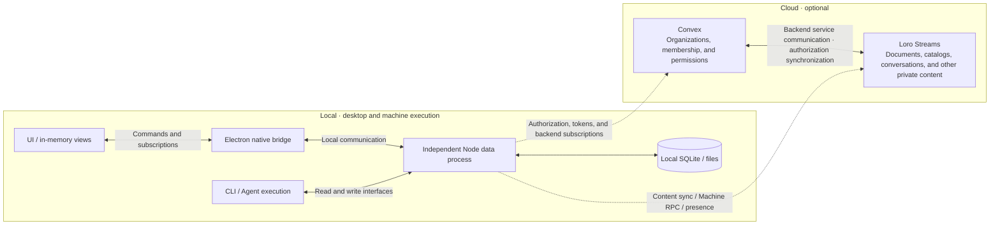

# Communication architecture

Status: draft
Human review: pending
Translation: current

[中文](communication-architecture.zh.md)

This document describes local and optional cloud communication responsibilities and the proposal for a shared desktop data process. Today, the renderer and daemon still own separate persistent replicas and sync connections; the new structure below is not implemented. Cloud service data ownership and authorization synchronization describe architectural intent, not verification of the private backend by this repository. The entire document still awaits human review.

## What readers should understand

A user starts work on the desktop, and the CLI on the target machine executes it. The UI, main process, and local daemon should read and modify application data through one independent Node.js data process, sharing its persistence and backend connections. Business commands, local persistence, remote sync, and target execution have different completion boundaries; an execution-command reply does not prove that data has been saved or synchronized.

The public desktop defaults to local mode and does not require product cloud services. The source also provides optional cloud adapter interfaces; products integrating cloud services can reuse the shared UI and execution logic.

## Modules and paths

The following is a proposed target, not the current implementation. The diagram shows the preferred independent plain Node desktop host, launched/discovered by existing process-management roles. Single headless daemons permanently support and default to the same embedded owner Layer without Agent batch IPC; multiple consumers or independent lifetimes may use a separate host. Each remote machine owns its data without Electron. Each local directory has one owner; placement changes drain/flush/release before handoff, and rejected handshakes never create another writer. Dashed arrows represent optional cloud communication; arrows within the cloud represent authorization synchronization between services, without specifying the protocol.

| Part | Responsibility |
| --- | --- |
| UI and workspace runtime | Display in-memory views and drafts; read, write, and subscribe through business interfaces. The desktop no longer owns a business-data IndexedDB Repo or its own Streams connection. |
| Electron bridge | Windows, native OS capabilities, local client authorization, and forwarding; it is not another business data source. |
| Independent data process | Local application data, storage, domain writes, authorization, token acquisition and refresh, backend subscriptions, and shared sync connections. |
| CLI | Own execution resources and scheduling; read state and submit Agent output through data interfaces, without separately opening the same local data directory. |
| Convex | Store organization structure, membership, and permissions, and provide the corresponding platform APIs. |
| Loro Streams | Store and synchronize documents, full catalogs, conversations, and other private or sensitive content; also carry separate Machine RPC request and response streams. |

**Relationship between the cloud services.** Convex manages who belongs to which organization and who can access what; Loro Streams carries the content protected by those permissions. Backend service communication synchronizes authorization information so that content access follows organization and permission settings. The bidirectional arrow expresses service collaboration; it does not mean both sides can independently change permissions or specify a synchronization order.

The data process centrally manages client Streams authorization, token acquisition and refresh, and subscriptions; the server still performs the final permission checks. Connections are shared only for the same logical stream under the same trusted identity, workspace, permissions, and content mode. Machine and user credentials must not substitute for each other. Account switches and revocation must fence the old generation; the renderer must not receive tokens or arbitrary network or disk capabilities.

The renderer and daemon may currently use user and machine/CLI credentials respectively. Before implementation, the authorized shared sync identity and the permission mapping for each client must be defined. If equivalent authorization cannot be proven, keep the transports for that combination separate and report its connection deduplication as incomplete. Putting both clients in one process does not automatically resolve their identity differences.

Loro/Flock defines mergeable data, while loro-repo manages document collections, storage, and transport. Loro Streams is a transport service and does not define product field semantics. Convex subscriptions and Machine RPC are not substitutes for CRDT document sync.

## Two typical paths

**Operating locally.** The UI submits business commands with stable IDs to the data process through a restricted local interface. The data process validates identity and fields, writes to the live document, and returns success after local persistence and recoverable result recording complete. Cloud sync and execution activation have separate completion states. An operation already known to target this machine does not wait for a cloud token and does not fall back to remote RPC when the local bridge fails. When the data process is unavailable, the UI must not mark an in-memory change as saved.

**Optional cloud collaboration.** The data process obtains workspace access and authorization information through official cloud adapters and shares the Streams, RPC, presence, and backend subscriptions needed by clients on the same machine. Documents actively being observed retain one shared live room; browsing historical catalogs does not open every document body. Requests for a remote machine to execute work still enter that machine's RPC stream. The remote daemon still owns a persistent replica on its own machine and is not replaced by the local data process. Content sync and RPC have distinct data and completion semantics.

Cloud composition can use local and remote channels together; routing follows target ownership. Public local composition does not enable cloud services merely because the source contains cloud adapters. Public managed-runtime artifact downloads remain an exception allowed by existing boundaries and do not imply that product cloud capabilities are available.

## Data ownership, recovery, and I/O scope

The business boundary covers queries/commands/observations plus target-specific authority/upload barriers, durable machine commands, typed RPC and ephemeral presence. Cloud RPC and data connections belong to one data owner; trusted consumption/execution publishing is separate from ordinary UI. Close domains by consumer ledger, preserving local/upload/execution boundaries and distinct refresh/current-authority semantics. Phase two explicitly accepts the extra hop and failure coupling of host-owned remote RPC server transport: lost replies retain method deadlines/unknown and never auto-replay unknown writes; daemon retains execution handlers/resources. Daemon execution leases bound machine online/active-turn publication, retiring it within a bound on disconnect rather than extending it with host lifetime. Session SyncAuthority targets only Loro control; Roost history acceptance uses owner receipts. Directory cloud status derives from the same Meta authority source.

Persistent directory state chooses placement; explicit user switches first stop all Agents/writers and complete actual I/O handoff. Every frozen renderer Loro source requires durable host readback OpLog coverage without pending imports; keep old IDB readonly/undeleted until verified. Flock, sole-copy inputs and upload custody have separate checks. Credential retirement plans identify local/remote impact rather than revoke whole accounts for local migration.

Release the shared interface independently before migrating to an independent process. In the first stage, daemon and renderer business code use the same query, command, and subscription contracts, with the existing in-process data implementations injected separately; only storage and sync adapters hold Repo, Doc, and Flock handles. This stage preserves existing persistence formats, sync identities and connections, and write acknowledgment semantics. Migrate consumers on both sides, rather than only consolidating the UI or renaming Repo while continuing to expose it. Catalogs, sessions, machine/workspace catalogs, and other data domains may migrate in batches; the interface stage is complete only when all business access goes through the shared interface. This stage can ship independently, but does not mean IndexedDB has been removed, connections have been deduplicated, or I/O has been centralized.

Local persistence, remote receipt, and target execution are reported separately. In particular, a workspace catalog write must not be reported as a save failure because a subsequent upload fails. Data acknowledged as locally durable must survive renderer or data-process restarts. Unacknowledged commands query their result using the same ID; no result does not prove that a command was not executed. Cross-document writes and request records must not be assumed to form an atomic transaction. Initial snapshots and observation must have no gap, old-generation events must not affect a new account or workspace, and a slow window must not block other clients.

The goal is to centralize Lody's own data, files, and service disk and network I/O in the data process, beyond replacing workspace IndexedDB. Shortcuts, Roost, user input, background prefetch, API subscriptions, attachments, resource caches, and other application storage must be included in migration. Existing IndexedDB may contain unuploaded writes; it must be fully imported, confirmed as persisted, and given a proven upload-recovery path before being disabled. An old cursor is not evidence that the new replica contains the data. Web/mobile retain their browser adapters and independent sync.

Native windows, system-browser and protocol callbacks, and OS secure storage still have host capability boundaries. The current [desktop login contract](desktop-browser-login.md) requires main-process/Chromium transport. Performing all physical I/O in ordinary Node requires separately revising and validating proxy, certificate, cookie, and secure-storage guarantees. If the data process delegates actual I/O to main, it cannot claim that all physical I/O has moved into Node. Whether Git, terminals, Agent subprocesses, and embedded pages must also centralize their own I/O remains an open scope question; this data-layer proposal does not provide execution isolation.

Existing constraints remain owned by [root AGENTS](../AGENTS.md), [component AGENTS](../packages/components/AGENTS.md), [CLI AGENTS](../apps/cli/src/lib/AGENTS.md), and [RPC AGENTS](../packages/loro-streams-rpc/AGENTS.md). The CLI currently requires dual authors; formally switching ownership and protocols must update that constraint as well. This draft does not present the proposal as an already effective rule.

## Questions for human review

- Should one local data owner, durable receipts from the data process, and distinct business authors become the desktop contract?
- Should the data host continue serving the daemon after Electron fully exits? Does all I/O include execution subprocesses and user web browsing?
- What additional guarantees are needed for the actual I/O location of login/native adapters, offline cache access, and revocation timing?

## Implementation evidence entry points

These links are navigation without automated freshness checks. Early research used `16bf3fb03dceffc6a7f2a1a37b46b8bf7ab7561f`; the third complete review pins main `df5b5a068e2f6a44118a30d0cc8fa34c2e4fcc49` with a consumer ledger and finite-model/SDK reference checks. The new application architecture and actual performance remain unvalidated; the owning Note states the limits.

- [Implementation path, protocol, migration, and acceptance proposal](../.agents/notes/proposed/architecture/2026-10-14-desktop-data-process.md).
- [Existing SessionData read/write interfaces](../packages/shared/src/session-data/types.ts), [WorkspaceWriter](../packages/components/src/providers/workspace-writer.ts).
- [Platform and sync modes](../packages/platform/src/provider.ts), [local composition](../packages/platform/src/local.ts).
- [Workspace routing and transport](../packages/components/src/providers/create-workspace-runtime.ts), [Electron document forwarding](../apps/electron/src/main/services/loro-data-plane-relay.ts).
- [CLI local storage and optional remote sync](../apps/cli/src/lib/loro/doc.ts).
- [CLI cloud adapter](../apps/cli/src/lib/cloud-cli-port.ts), [UI Convex adapter](../packages/components/src/providers/cloud-platform-api.ts).
- [CLI RPC wiring](../apps/cli/src/lib/message-handler.ts), [request dispatch](../packages/loro-streams-rpc/src/machine-rpc-server.ts).
