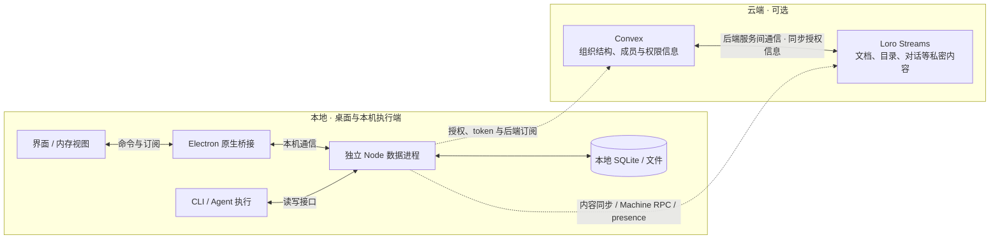

# 通讯架构

Status: draft  
Human review: pending  
Translation: current

[English](communication-architecture.md)

本文描述本地与可选云端的通讯分工，以及桌面统一数据进程的提议。当前桌面仍由 renderer 和 daemon 各自持有持久副本与同步连接；下面的新结构尚未实现。云端服务的数据归属与授权同步是架构意图，不是本仓库对私有后端的实现验证。全文仍待人工 review。

## 我们希望读者理解什么

用户在桌面发起工作，由目标机器上的 CLI 执行。界面、主进程和本机 daemon 应通过一个独立 Node.js 数据进程读取与修改应用数据，复用它的持久化和后端连接。业务命令、本地落盘、远端同步与目标执行是不同完成边界；收到执行命令回复不证明数据已经保存或同步。

公开桌面默认使用本地模式，无需产品云服务。源码另有可选云适配接口；接入云服务的产品可以复用共享 UI 和执行逻辑。

## 模块与路径

以下是提议的目标结构，不是当前实现。下图为桌面首选的独立普通 Node host，由现有进程管理角色启动/发现。无头单 daemon 永久支持并默认内嵌同一 owner Layer，Agent 批次不增加 IPC；需要多消费者共享或独立生命周期时可使用独立 host。每台远端机器有自己的 owner，不依赖 Electron。本机每个数据目录同时只有一个 owner，位置切换先 drain/flush/释放再交接，不因握手失败另开写者。虚线表示可选云通信；云端内部箭头表示服务间授权同步，省略具体协议。

| 部分 | 负责什么 |
| --- | --- |
| 界面与工作区运行时 | 展示内存视图与草稿，通过业务接口读取、写入和订阅；桌面不再持有业务 IndexedDB Repo 或自己的 Streams 连接 |
| Electron 桥接 | 窗口与 OS 原生能力、本地客户端授权及转发；不是另一套业务数据源 |
| 独立数据进程 | 本机应用数据、存储、领域写入、授权、token 获取/刷新、后端订阅与共享同步连接 |
| CLI | 持有执行资源和调度，通过数据接口读状态、提交 Agent 输出；不另开同一本机数据目录 |
| Convex | 保存组织结构、成员关系和权限信息，提供相应的平台 API |
| Loro Streams | 承载文档、整个目录、对话等私密或偏敏感内容的存储与同步，也承载独立的 Machine RPC 请求与响应流 |

**两者的关系。** Convex 管理谁属于哪个组织、谁可以访问什么；Loro Streams 承载这些权限所保护的内容。授权信息通过两者的后端服务间通信同步，使内容访问遵循组织与权限设置。图中的双向箭头表达服务间协作，不表示两边都可以独立修改权限，也不指定同步时序。

数据进程统一管理客户端 Streams 授权、取 token、刷新 token 和订阅；服务端仍执行最终权限检查。只对相同可信身份、工作区、权限与内容模式的同一逻辑 stream 共享连接。machine 与 user 凭据不得互相替代，账号切换和撤权必须封锁旧 generation；不能向 renderer 公开 token、任意网络或磁盘能力。

renderer 与 daemon 当前可能分别使用 user 和 machine/CLI 凭据。实现前必须明确合法的统一同步身份及每个客户端的权限映射；若无法证明授权等价，就保持该组合的 transport 隔离，并报告其连接去重未完成。把两者放入一个进程不自动解决身份差异。

Loro/Flock 定义可合并的数据，loro-repo 管理文档集合、存储与传输；Loro Streams 是传输服务，不决定产品字段的含义。Convex 的订阅和 Machine RPC 都不是 CRDT 文档同步的替代品。

## 两条典型路径

**操作本机。** 界面经受限本地接口向数据进程提交稳定 ID 的业务命令；数据进程验证身份和字段，在 live doc 上写入，并在本地落盘与可恢复结果记录完成后返回成功。云同步与执行激活另有完成状态。已经确定属于本机的操作不等待云令牌，也不在本地桥接失败后改投远程 RPC。数据进程不可用时，UI 不得把内存修改标为已保存。

**可选云协作。** 数据进程通过官方云适配取得工作区访问和授权信息，复用同一本机客户端需要的 Streams、RPC、presence 与后端订阅。正在被观察的文档保持一个共享 live room；仅浏览历史目录不打开所有正文。请求远端机器执行操作仍进入该机器的 RPC 流；远端 daemon 仍有自己机器上的持久副本，不由本机数据进程替代。内容同步与 RPC 具有不同的数据和完成语义。

云组装也可以同时接入本地与远程通道；路由按目标归属选择。公共本地组装不会因为源码包含云适配就自动开启它。公开运行时制品下载是既有边界允许的例外，不代表产品云能力可用。

## 数据所有权、恢复与 I/O 范围

统一业务边界覆盖查询/命令/观察，以及按目标的同步权威与上传屏障、Machine 持久命令、typed RPC 和临时 presence。云端 RPC 与数据连接由同一数据 owner 管理；可信消费/执行发布与普通 UI 能力分开。每域按消费者清单关闭，保留原本地、上传与执行边界，explicit refresh 与当前权威不互相替代。 二期明确接受 host 持有远端 RPC server 传输所带来的额外一跳和故障耦合：回复丢失按方法 deadline/unknown 处理，不自动重放未知写入；执行 handler/实际资源留在 daemon。machine online/active-turn 发布以 daemon execution lease 为限，失联有界撤销；host 存活不延长发布。SyncAuthority 的会话目标只指 Loro 控制面，Roost 正文接受另由 owner receipt 表达；目录云状态从同一 Meta 权威来源派生。

owner 位置由目录持久状态决定，运行中切换先由用户显式停止所有 Agent/写者并完成实际 I/O 交接。每个冻结 renderer Loro 来源须证明 host 持久读回 OpLog 版本覆盖、无 pending import；旧 IDB 在判据满足前只读不删。Flock、唯一副本待发输入与未上传 custody 单独核对；旧凭据退出计划明确本机/远端影响，不以全账号撤销完成本地迁移。

统一接口先独立发布，独立进程随后迁移。第一阶段 daemon 和 renderer 业务使用同一套查询、操作和订阅契约，分别注入现有进程内数据实现；Repo、Doc 和 Flock 仅由存储/同步适配器持有。该阶段保留现有持久化格式、同步身份/连接与写入确认语义，两端都迁移消费者，不仅收拢 UI，也不将 Repo 换名后继续暴露。目录、会话、machine/workspace catalog 和其他数据域可分批迁移；只有全部业务访问经过共同接口，才能称接口阶段完成。此阶段能独立上线，但不表示 IndexedDB 已移除、连接已去重或 I/O 已集中。

本地已保存、远端已收到、目标执行完成分别表达。尤其工作区目录写入不能因为后续上传失败而被报告为保存失败。收到本地持久回执的数据，在 renderer 或数据进程重启后仍须恢复；未确认命令通过同一 ID 查询结果，没有结果不代表未执行。不能假定跨文档写入与请求记录天然是原子事务。初始快照与观察无缺口，旧 generation 事件不能污染新账号/工作区，慢窗口不能阻塞其他客户端。

目标是把 Lody 自身的数据、文件和服务磁盘/网络 I/O 集中到数据进程，而不只是换掉 workspace IDB。Shortcuts、Roost、用户输入、后台预取、API 订阅、附件、资源缓存及其他应用存储都要列入迁移。旧 IDB 可能含未上传写入，必须完整导入、落盘确认并证明其上传恢复路径后才停用；不能以旧 cursor 证明新副本已具备数据。Web/mobile 保留其浏览器适配器，不因桌面改造失去独立同步。

原生窗口、系统浏览器/协议回调和 OS 安全存储仍有宿主能力边界。当前[桌面登录](desktop-browser-login.md)要求 main/Chromium transport；让所有物理 I/O 都发生在普通 Node 需要另行修改并验证代理、证书、cookie 和安全存储保证。只由数据进程委托 main 执行 I/O 时，不能声称物理 I/O 已全部迁入 Node。Git、终端、Agent 子进程及嵌入网页自身 I/O 是否也集中，仍需明确范围；数据层提案本身不提供执行隔离。

现行约束仍由[根 AGENTS](../AGENTS.md)、[组件 AGENTS](../packages/components/AGENTS.md)、[CLI AGENTS](../apps/cli/src/lib/AGENTS.md) 和 [RPC AGENTS](../packages/loro-streams-rpc/AGENTS.md) 维护。CLI 目前要求 dual-author；正式切换所有权与协议时须同步调整该约束，此草稿不把提议冒充已生效规则。

## 请人工 review

- 一个本机数据 owner、数据进程落盘回执与业务作者区分是否是要采用的桌面契约？
- 数据 host 是否在 Electron 完全退出后继续服务 daemon；所有 I/O 是否包含执行子进程和用户浏览网页？
- 登录/原生适配器的实际 I/O 位置，以及离线缓存访问和撤权时序，需要哪些额外保证？

## 实现核对入口

以下链接是导航，未绑定自动新鲜度检查。早期研究基准为 `16bf3fb03dceffc6a7f2a1a37b46b8bf7ab7561f`；第三版完整评审的源码固定到 main `df5b5a068e2f6a44118a30d0cc8fa34c2e4fcc49`，补消费者清单与有限模型/SDK参考实验。新应用架构与真实性能仍未验证，详细边界见 owning Note。

- [改造路径、协议、迁移与验收提案](../.agents/notes/proposed/architecture/2026-10-14-desktop-data-process.zh.md)。
- [现有 SessionData 读写接口](../packages/shared/src/session-data/types.ts)、[WorkspaceWriter](../packages/components/src/providers/workspace-writer.ts)。

- [平台及同步模式](../packages/platform/src/provider.ts)、[本地组装](../packages/platform/src/local.ts)
- [工作区路由与传输](../packages/components/src/providers/create-workspace-runtime.ts)、[Electron 文档转发](../apps/electron/src/main/services/loro-data-plane-relay.ts)
- [CLI 本地存储与可选远程同步](../apps/cli/src/lib/loro/doc.ts)
- [CLI 云适配](../apps/cli/src/lib/cloud-cli-port.ts)、[界面 Convex 适配](../packages/components/src/providers/cloud-platform-api.ts)
- [CLI RPC 接线](../apps/cli/src/lib/message-handler.ts)、[请求分发](../packages/loro-streams-rpc/src/machine-rpc-server.ts)
